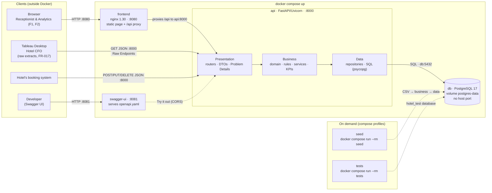

# Hotel Kong Arthur: Operations & Analytics Platform

A live data platform for Hotel Kong Arthur (214 rooms, 8 room types, lobby bar). It replaces static CSV extracts
with operational data in PostgreSQL that is changed and read through one REST/JSON API:

- **Receptionist**: creates, edits and deletes bookings in a browser page (`F1`).
- **The hotel's booking system**: can write to the same API (`POST` / `PUT` / `DELETE`).
- **Hotel Analytics Consumers & Receptionist UI**: read backend-calculated hotel and bar KPIs directly from the
  **`Hotel Analytics`** endpoints (`/api/v1/kpis/hotel/*` and `/api/v1/kpis/bar/*`) with optional filter attributes
  (`year`, `season`, `room_type`, `country`, `category`, `price_tier`), skipping the manual Tableau step.
- **Hotel CFO (Tableau)**: connects Tableau Desktop to the preserved parameterless raw REST API collection endpoints
  (`bookings`, `room-types`, `reviews`, `bar/drink-sales`) with no query parameters (`$.items[*]`), 100% backward-compatible
  with `v1.0.0` (see [Tableau handover](#tableau-handover)).

### Week 2 Updates (Git Release `v1.0.0` → Current)
As specified in `Tillægsopgave_uge_2.md`:
1. **Database Layer Migration**: Migrated from MySQL 8.4 to **PostgreSQL 17** (`postgres:17-alpine`) using `psycopg` 3.2.
2. **Hotel Analytics Tag**: Added Swagger UI tag `Hotel Analytics` containing 9 backend-calculated KPI endpoints with dynamic filtering.
3. **Frontend Analytics View**: The browser prototype (`http://localhost:8080`) provides a real-time Hotel Analytics dashboard with revenue cards, occupancy rate, customer satisfaction, cocktail bar category split, ranked drink sales table, and stay length / price tier demand metrics.
4. **Git Release Preservation**: The prior MySQL state is preserved on GitHub as Git Release **`v1.0.0`**.

Built spec-driven with GitHub Spec Kit. The artefacts are in [`specs/001-hotel-analytics-platform/`](specs/001-hotel-analytics-platform/)
(`spec.md`, `plan.md`, `tasks.md`, `data-model.md`, `research.md`, `quickstart.md`, the OpenAPI contract) and the
constitution is in [`.specify/memory/constitution.md`](.specify/memory/constitution.md).

## Quick start

You need Docker with Compose v2.

```bash
docker compose up --build -d           # db (PostgreSQL), api, frontend, swagger-ui; healthy within about a minute
docker compose run --rm seed           # Option A: load teacher sample data (1,000 bookings, ~6.9% occupancy)
docker compose run --rm seed-realistic # Option B: load realistic full-year operations (~18,000 bookings, ~75% occupancy)
```

| What | URL |
|------|-----|
| Booking page & Analytics (frontend) | http://localhost:8080 |
| REST API | http://localhost:8000/api/v1/ |
| Swagger UI (the contract) | http://localhost:8081 |

PostgreSQL has **no published port**: every client reaches the data only through the API.

`docker compose up` starts the system **empty**: the schema, the 8 room types (214 rooms) and their seasonal
price bands exist, but there are no bookings, reviews or bar sales. Bookings can be created at once. The bar KPIs
(`B1`–`B3`) show zeros until the sample data is seeded, because bar sales have no write endpoint.

Stop with `docker compose down -v`. Run `docker compose run --rm tests` for the automated tests
([CONTRIBUTE.md](CONTRIBUTE.md)).

## Architecture



Containers start in this order: `db` becomes healthy (`pg_isready`), then `api` (`GET /api/v1/health`), then `frontend`. `swagger-ui` is independent.
Containers find each other by compose service name (`api` connects to `db:5432`, nginx proxies `/api/` to
`http://api:8000`). The two tool services, `seed` and `tests`, are in compose profiles, so `up` never starts them.

### Backend: three layers

The backend (`backend/src/hotel_api/`) has exactly three layers. Calls go one way, and an architecture test
(`tests/architecture/test_layers.py`) fails the build if an import breaks the rules.

| Layer | Package | Contains | May import |
|-------|---------|----------|------------|
| 1. Presentation | `presentation/` | REST routers, DTOs, RFC 9457 Problem Details, dependencies, seed CLI. No business rules, no SQL | business |
| 2. Business | `business/` | Domain models, rules (seasons, pricing, ranking, price tiers), pure KPI calculators, services, repository ports. No HTTP, no SQL | business only |
| 3. Data | `data/` | PostgreSQL connection handling (`psycopg`) and repositories with parameterised SQL. The only code that talks to PostgreSQL | business models and ports |

`main.py` is the composition root: the only module that knows all three layers. It wires one database
connection and one transaction per request, committed **before** the response is sent and rolled back on any error.

### REST API & Swagger UI

The OpenAPI 3.0.3 contract ([`contracts/openapi.yaml`](specs/001-hotel-analytics-platform/contracts/openapi.yaml)) is the single authoritative contract, shown by Swagger UI. It defines **20 operations across 16 paths** categorized under 6 tags:

1. **`Health`**: `GET /api/v1/health`
2. **`Reference data`**: `GET /api/v1/room-types`
3. **`Bookings`**: `GET /api/v1/bookings`, `POST /api/v1/bookings`, `GET /api/v1/bookings/{id}`, `PUT /api/v1/bookings/{id}`, `DELETE /api/v1/bookings/{id}`
4. **`Reviews`**: `GET /api/v1/reviews`, `POST /api/v1/reviews`, `GET /api/v1/reviews/{id}`
5. **`Bar`**: `GET /api/v1/bar/drink-sales` (parameterless for Tableau)
6. **`Hotel Analytics`**:
   - `GET /api/v1/kpis/hotel/summary` (occupancy rate, available room nights, revenue, satisfaction, ALOS, ADR, rev/booking)
   - `GET /api/v1/kpis/hotel/by-room-type` (room revenue, rank, occupancy, satisfaction, ALOS, ADR)
   - `GET /api/v1/kpis/hotel/by-season` (seasonal revenue, occupancy, satisfaction, ALOS, ADR)
   - `GET /api/v1/kpis/hotel/by-room-type-and-season` (cross-dimensional room type × season revenue)
   - `GET /api/v1/kpis/hotel/by-country` (country origin ranking, booking count, revenue, revenue rank)
   - `GET /api/v1/kpis/bar/summary` (total bar sales, total units, distinct drinks)
   - `GET /api/v1/kpis/bar/by-drink` (ranked drinks by revenue and units with price tiers)
   - `GET /api/v1/kpis/bar/by-category` (cocktail vs. coffee split with largest-remainder rounding)
   - `GET /api/v1/kpis/bar/by-price-tier` (budget, standard, premium demand distribution)

All collection endpoints return `{"items": [...]}`. Status codes: `200`, `201` (with `Location`), `204`, `400` (Problem Details on invalid query or body), `404`, `422`, `503`.

## Data and persistence

- All runtime data is in PostgreSQL, in the named Docker volume **`postgres-data`**.
- `docker compose stop`, `down` and restarts **keep** all bookings, reviews and bar sales.
- `docker compose down -v` **deletes the volume**. The next `up` recreates the schema and reference data, and the system is empty again.
- The schema and reference data (`db/init/*.sql`) only run on an **empty** volume. After changing them, run `docker compose down -v && docker compose up --build -d`.
- **Seeding**: `docker compose run --rm seed` loads the sample data from `context/teacher/*.csv` in one transaction. It is idempotent (every run ends in the same state, with booking ids 1–1000 equal to the CSV row order).

## Tableau handover

Tableau connects to the parameterless raw collection endpoints:
- `http://localhost:8000/api/v1/bookings`
- `http://localhost:8000/api/v1/room-types`
- `http://localhost:8000/api/v1/reviews`
- `http://localhost:8000/api/v1/bar/drink-sales`

Set the JSONPath to **`$.items[*]`**. This repository delivers the REST API and contract, and contains **no Tableau files** (`.twb`, `.twbx`, `.hyper`) or connector code (FR-017; enforced by architecture tests).

## Repository layout

```text
docker-compose.yml     db (PostgreSQL), api, frontend, swagger-ui; profiles: tools (seed), test (tests)
backend/               Python 3.13 / FastAPI service (src/hotel_api) and its tests
frontend/              static booking page and Hotel Analytics dashboard served by nginx
db/init/               PostgreSQL schema, reference data (8 room types, 214 rooms, 24 rate bands), test db init
context/               teacher requirements (tværfaglig_opgave, Tillægsopgave_uge_2) and sample data
specs/                 Spec Kit artefacts and the authoritative OpenAPI contract
```

See [CONTRIBUTE.md](CONTRIBUTE.md) for development setup, tests and commit conventions.
