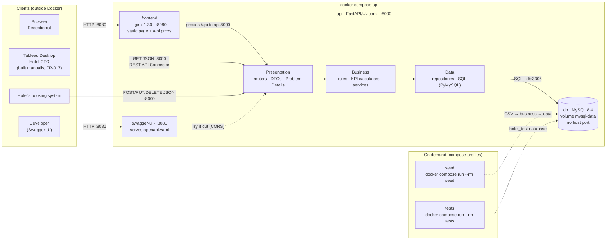

# Hotel Kong Arthur: Operations & Analytics Platform

A live data platform for Hotel Kong Arthur (214 rooms, 8 room types, lobby bar). It replaces static CSV extracts
with operational data in MySQL that is changed and read through one REST/JSON API:

- **Receptionist**: creates, edits and deletes bookings in a browser page (`F1`).
- **The hotel's booking system**: can write to the same API (`POST` / `PUT` / `DELETE`).
- **Hotel CFO**: reads every KPI (`A1`–`A7`, `B1`–`B3`, `K1`–`K3`) from the API, through a Tableau dashboard that
  the team builds by hand (see [Tableau handover](#tableau-handover)).

Built spec-driven with GitHub Spec Kit. The artefacts are in [`specs/001-hotel-analytics-platform/`](specs/001-hotel-analytics-platform/)
(`spec.md`, `plan.md`, `tasks.md`, `data-model.md`, `research.md`, `quickstart.md`, the OpenAPI contract) and the
constitution is in [`.specify/memory/constitution.md`](.specify/memory/constitution.md).

## Quick start

You need Docker with Compose v2.

```bash
docker compose up --build -d      # db, api, frontend, swagger-ui; healthy within about a minute
docker compose run --rm seed      # optional: load the sample data (1,000 bookings, 500 reviews, 30 drink sales)
```

| What | URL |
|------|-----|
| Booking page (frontend) | http://localhost:8080 |
| REST API | http://localhost:8000/api/v1/ |
| Swagger UI (the contract) | http://localhost:8081 |

MySQL has **no published port**: every client reaches the data only through the API.

`docker compose up` starts the system **empty**: the schema, the 8 room types (214 rooms) and their seasonal
price bands exist, but there are no bookings, reviews or bar sales. Bookings can be created at once. The bar KPIs
(`B1`–`B3`) show zeros until the sample data is seeded, because bar sales have no write endpoint.

Stop with `docker compose down`. Run `docker compose run --rm tests` for the automated tests
([CONTRIBUTE.md](CONTRIBUTE.md)).

## Architecture



Containers start in this order: `db` becomes healthy (a TCP query on `room_types`, so it cannot pass before the
init scripts have finished), then `api` (`GET /api/v1/health`), then `frontend`. `swagger-ui` is independent.
Containers find each other by compose service name (`api` connects to `db:3306`, nginx proxies `/api/` to
`http://api:8000`). The two tool services, `seed` and `tests`, are in compose profiles, so `up` never starts them.

### Backend: three layers

The backend (`backend/src/hotel_api/`) has exactly three layers. Calls go one way, and an architecture test
(`tests/architecture/test_layers.py`) fails the build if an import breaks the rules.

| Layer | Package | Contains | May import |
|-------|---------|----------|------------|
| 1. Presentation | `presentation/` | REST routers, DTOs, RFC 9457 Problem Details, the seed CLI. No business rules, no SQL | business |
| 2. Business | `business/` | Domain models, rules (seasons, pricing, validation, ranking, rounding), KPI functions, services, repository ports. No HTTP, no SQL | business only |
| 3. Data | `data/` | PyMySQL connection handling and repositories with parameterised SQL. The only code that talks to MySQL | business models and ports |

`main.py` is the composition root: the only module that knows all three layers. It wires one database
connection and one transaction per request, committed **before** the response is sent and rolled back on any error.

**KPIs are business logic.** Each KPI and rule is defined once, as a pure function in `business/`
(see the catalog in [data-model.md](specs/001-hotel-analytics-platform/data-model.md#7-kpi-catalog-the-single-authoritative-definitions-principle-vii)).
Neither the frontend nor Tableau recalculates a rule such as the season mapping, the occupancy formula or pricing.

**Replaceability.** Swapping MySQL touches only `data/`, `db/init/` and the compose `db` service. Replacing the web
frontend with the hotel's own booking system touches nothing in the backend.

### REST API

All endpoints are under `/api/v1`. The OpenAPI 3.0.3 contract
([`contracts/openapi.yaml`](specs/001-hotel-analytics-platform/contracts/openapi.yaml)) is the single authoritative
contract, shown by Swagger UI. Contract tests validate every response of the running code against it, and a
route-parity test checks that the implemented routes equal the contract's 19 operations.

| Resource | Methods | Scope |
|----------|---------|-------|
| `room-types` | `GET` | reference data (rooms and seasonal rate bands) |
| `bookings`, `bookings/{id}` | `GET`, `POST`, `PUT`, `DELETE` | `F1` |
| `reviews`, `reviews/{id}` | `GET`, `POST` | `K3` data |
| `bar/drink-sales` | `GET` | `B2` |
| `kpis/hotel/summary`, `by-room-type`, `by-season`, `by-room-type-and-season`, `by-country` | `GET` | `A1`–`A7`, `K1`–`K3` |
| `kpis/bar/summary`, `by-category`, `by-price-tier` | `GET` | `B1`, `B3`, `A7` (price-tier demand) |
| `health` | `GET` | liveness and database check |

KPI endpoints take `?year=` (2000–2100, default: the current year in Europe/Copenhagen), are computed on every
request and send `Cache-Control: no-store`. Status codes: `200`, `201` (with `Location`), `204`, `400` (malformed
JSON or bad parameter), `404`, `422` (a field or business rule is broken), `503` (database unavailable). Errors are
`application/problem+json` with an `errors` list of `{field, message}`. There is no authentication (prototype).

Example: `POST /api/v1/bookings` with `{"first_name": "Elena", "family_name": "Müller", "country": "Germany", "room_type":
"Superior Double", "check_in_date": "2026-07-14", "days_rented": 3}` returns `201`, `Location: /api/v1/bookings/<id>`,
`season` `high` and `price_dkk` `6000.0` (the room type's standard rate for that season times 3 nights; a given
price must lie inside the band shown by `GET /api/v1/room-types`).

## Data and persistence

- All runtime data is in MySQL, in the named Docker volume **`mysql-data`**.
- `docker compose stop`, `down` and restarts **keep** all bookings, reviews and bar sales.
- `docker compose down -v` **deletes the volume**. The next `up` recreates the schema and reference data, and the
  system is empty again.
- The schema and reference data (`db/init/*.sql`) only run on an **empty** volume. After changing them, run
  `docker compose down -v && docker compose up --build -d`.
- **Seeding**: `docker compose run --rm seed` loads the sample data from `context/teacher/*.csv` in one transaction.
  It is idempotent (every run ends in the same state, with booking ids 1–1000 equal to the CSV row order) and it
  **removes bookings and reviews created through the API**. The CSV files are never read at runtime.
- The sample data has no dates, so the seed gives each booking a deterministic 2026 check-in date inside its
  season, repairs the family name `M�ller` in the CSV file to `Müller`, and generates 500 synthetic reviews
  (satisfaction data does not exist in the CSV files).

## Tableau handover

The Hotel CFO's dashboard is built **by hand by the team in Tableau**. This repository delivers only the REST API and
its contract, and contains **no Tableau files** (`.twb`, `.twbx`, `.tbm`, `.tds`, `.tdsx`, `.hyper`) and no connector code
(FR-017; an architecture test enforces it).

Tableau cannot read an HTTP endpoint with its built-in JSON connector (that reads files). The route we expect to work
is Tableau's **REST API Connector** from Tableau Exchange (Tableau Desktop 2023.3 or later). The Web Data Connector
is deprecated by Tableau and is not used.

1. Install the **REST API Connector** from Tableau Exchange, and put its JDBC REST driver (`.jar`) in Tableau's
   `Drivers` folder (macOS: `~/Library/Tableau/Drivers`; Windows: `C:\Program Files\Tableau\Drivers`).
2. In Tableau Desktop choose *Connect → To a Server → REST API* and use a `GET` URL, for example
   `http://localhost:8000/api/v1/kpis/hotel/by-room-type?year=2026`.
3. Set the JSONPath to the records: **`$.items[*]`** for the tables (every `by-…`, `bookings`, `reviews`, `drink-sales`),
   **`$`** for the single-object summaries (`kpis/hotel/summary`, `kpis/bar/summary`).
4. The API has no authentication. If the connector insists on credentials, any Basic or Bearer value works.
5. The connector is **extract-only**: Tableau reads a copy of the data. To see the current state, choose
   *Data → Refresh All Extracts*. A booking changed through the API appears after the next refresh.

Every response is flat JSON with stable field names, JSON numbers (never strings), ISO dates, `year` repeated in every
KPI row, no pagination (the largest table has about 1,000 rows) and no authentication.

| Dashboard view | Endpoint (all with `?year=`) |
|----------------|------------------------------|
| `A1` where guests come from | `kpis/hotel/by-country` (`booking_count`, `booking_share_pct`) |
| `A2` revenue per room type per season | `kpis/hotel/by-room-type-and-season` |
| `A3` revenue per country, `A5` top countries | `kpis/hotel/by-country` (`revenue_dkk`, `revenue_rank`) |
| `A4` top room types | `kpis/hotel/by-room-type` (`revenue_rank`) |
| `A6` the year's revenue | `kpis/hotel/summary` (`total_revenue_dkk`) |
| `A7` average stay, daily rate, revenue per booking | `kpis/hotel/summary`, `by-room-type`, `by-season`; bar price tiers: `kpis/bar/by-price-tier`, `bar/drink-sales` |
| `K1` occupancy, `K3` satisfaction | `kpis/hotel/summary`, `by-room-type`, `by-season` |
| `B1` total bar sales | `kpis/bar/summary` |
| `B2` revenue per drink | `bar/drink-sales` |
| `B3` cocktail vs coffee | `kpis/bar/by-category` |

Tableau may filter, group and sum these values for interactivity, but must **not** recompute a business rule.

**Check the route early** (the first day the API runs; this connector setup has not been tried in this repository):
connect to `kpis/hotel/by-room-type?year=2026` after seeding, confirm the 8 rows match
[quickstart.md §4](specs/001-hotel-analytics-platform/quickstart.md), create a booking, refresh the extract and check
that the figures change. When the dashboard is built, compare every figure with the golden values in quickstart §4–§7
(within 0.01 DKK / 0.01 %).

## Repository layout

```text
docker-compose.yml     db, api, frontend, swagger-ui; profiles: tools (seed), test (tests)
backend/               Python 3.13 / FastAPI service (src/hotel_api) and its tests
frontend/              static booking page served by nginx (no build step)
db/init/               schema, reference data (8 room types, 214 rooms, 24 rate bands), hotel_test database
context/               teacher requirements and sample data, team plan
specs/                 Spec Kit artefacts and the OpenAPI contract
```

See [CONTRIBUTE.md](CONTRIBUTE.md) for development setup, tests and commit conventions.
