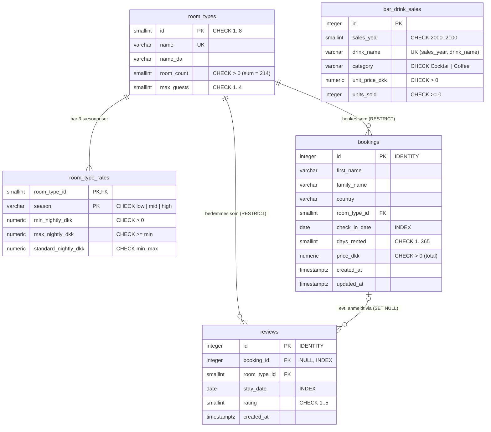

# Domænemodel & Arkitektonisk Review — Hotel Kong Arthur

> **Formål:** Dette dokument beskriver den samlede **domænemodel** for *Hotel Kong Arthur Operations & Analytics Platform* på tværs af forretningslaget ([`models.py`](../../backend/src/hotel_api/business/domain/models.py)), forretningsreglerne ([`rules/`](../../backend/src/hotel_api/business/rules/)), KPI-beregningerne ([`kpis/`](../../backend/src/hotel_api/business/kpis/)) og den relationelle PostgreSQL 17-datamodel ([`01_schema.sql`](../../db/init/01_schema.sql)).
>
> Dokumentet indeholder:
> 1. **Konceptuel domænemodel** (UML-klassediagram over kerneentiteter, værdiobjekter, enums og KPI-read-models)
> 2. **Relationel datamodel** (ER-diagram over PostgreSQL-skemaet, constraints og referencedata)
> 3. **Domæneregler, afledte egenskaber & livscyklus**
> 4. **Review af det nuværende design og dokumentation** (styrker, dokumentationsfejl og domænemodel-begrænsninger)

---

## 1. Konceptuel Domænemodel (Forretningslaget)

Forretningslaget i `backend/src/hotel_api/business/` er helt frit for SQL- og HTTP-afhængigheder. Domænet falder naturligt i tre dele:
1. **Konfiguration / Referencedata:** `RoomType` og `SeasonRate` (8 værelsestyper, 214 værelser, 24 sæsonprisbånd).
2. **Operationelle entiteter:** `Booking` (oprettet via `NewBooking`), `GuestReview` (oprettet via `NewReview`) og `BarDrinkSale`.
3. **Analytiske Read Models & Værdiobjekter:** `HotelFilters`, `BarFilters`, de delte værdiobjekter `StayMetrics` og `SatisfactionMetrics`, samt de 9 KPI-modeller udstillet under `Hotel Analytics`.

```mermaid
classDiagram
    direction TB

    class Season {
        <<enumeration>>
        low
        mid
        high
    }

    class DrinkCategory {
        <<enumeration>>
        Cocktail
        Coffee
    }

    class PriceTier {
        <<enumeration>>
        budget
        standard
        premium
    }

    class RoomType {
        +int id
        +str name
        +str name_da
        +int room_count
        +int max_guests
        +dict~Season, SeasonRate~ rates
    }

    class SeasonRate {
        <<value object>>
        +Season season
        +Decimal min_nightly_dkk
        +Decimal max_nightly_dkk
        +Decimal standard_nightly_dkk
    }

    class NewBooking {
        <<command>>
        +str first_name
        +str family_name
        +str country
        +str room_type
        +date check_in_date
        +int days_rented
        +Decimal price_dkk
    }

    class Booking {
        +int id
        +str first_name
        +str family_name
        +str country
        +str room_type
        +date check_in_date
        +int days_rented
        +Decimal price_dkk
        +datetime created_at
        +datetime updated_at
        +season() Season
        +year() int
    }

    class NewReview {
        <<command>>
        +int rating
        +str room_type
        +date stay_date
        +int booking_id
    }

    class GuestReview {
        +int id
        +int booking_id
        +str room_type
        +date stay_date
        +int rating
        +datetime created_at
        +season() Season
        +year() int
    }

    class BarDrinkSale {
        +int id
        +int sales_year
        +str drink_name
        +DrinkCategory category
        +Decimal unit_price_dkk
        +int units_sold
        +revenue_dkk() Decimal
        +price_tier() PriceTier
    }

    class StayMetrics {
        <<value object>>
        +int booking_count
        +int nights_sold
        +Decimal revenue_dkk
        +Decimal average_length_of_stay_nights
        +Decimal average_daily_rate_dkk
        +Decimal average_revenue_per_booking_dkk
    }

    class SatisfactionMetrics {
        <<value object>>
        +int review_count
        +Decimal average_satisfaction
        +Decimal satisfied_share_pct
    }

    class HotelSummary {
        <<read model>>
        +ReportYear year
        +int available_room_nights
        +Decimal occupancy_rate_pct
    }

    class RoomTypeKpi {
        <<read model>>
        +ReportYear year
        +int revenue_rank
        +str room_type
        +int room_count
        +Decimal revenue_share_pct
        +int available_room_nights
        +Decimal occupancy_rate_pct
    }

    class SeasonKpi {
        <<read model>>
        +ReportYear year
        +Season season
        +int season_days
        +Decimal revenue_share_pct
        +int available_room_nights
        +Decimal occupancy_rate_pct
    }

    class RoomTypeSeasonKpi {
        <<read model>>
        +ReportYear year
        +str room_type
        +Season season
        +int room_count
        +int season_days
        +int available_room_nights
        +Decimal occupancy_rate_pct
    }

    class CountryKpi {
        <<read model>>
        +ReportYear year
        +int revenue_rank
        +str country
        +int booking_count
        +Decimal booking_share_pct
        +int nights_sold
        +Decimal revenue_dkk
        +Decimal revenue_share_pct
    }

    class BarSummary {
        <<read model>>
        +ReportYear year
        +int drink_count
        +int units_sold
        +Decimal total_revenue_dkk
    }

    class RankedDrinkSale {
        <<read model>>
        +int revenue_rank
        +int units_rank
    }

    class BarCategoryKpi {
        <<read model>>
        +ReportYear year
        +DrinkCategory category
        +int drink_count
        +int units_sold
        +Decimal unit_share_pct
        +Decimal revenue_dkk
        +Decimal revenue_share_pct
    }

    class BarPriceTierKpi {
        <<read model>>
        +ReportYear year
        +PriceTier price_tier
        +Decimal price_from_dkk
        +Decimal price_to_dkk
        +int drink_count
        +int units_sold
        +Decimal unit_share_pct
        +Decimal revenue_dkk
        +Decimal revenue_share_pct
    }

    RoomType "1" *-- "3" SeasonRate : rates by season
    SeasonRate --> Season
    RoomType "1" <-- "0..*" Booking : booked by name
    RoomType "1" <-- "0..*" GuestReview : reviewed by name
    Booking "0..1" <-- "0..*" GuestReview : optional booking_id
    NewBooking ..> Booking : validated into
    NewReview ..> GuestReview : validated into

    BarDrinkSale --> DrinkCategory
    BarDrinkSale ..> PriceTier : derives

    HotelSummary *-- StayMetrics
    HotelSummary *-- SatisfactionMetrics
    RoomTypeKpi *-- StayMetrics
    RoomTypeKpi *-- SatisfactionMetrics
    SeasonKpi *-- StayMetrics
    SeasonKpi *-- SatisfactionMetrics
    RoomTypeSeasonKpi *-- StayMetrics
    RankedDrinkSale *-- BarDrinkSale : wraps sale
    BarCategoryKpi --> DrinkCategory
    BarPriceTierKpi --> PriceTier
```

> **Bemærk til domænegrænserne:**
> - `Booking` og `GuestReview` indeholder også `HotelFilters` (`year`, `season`, `room_type`, `country`) og `BarFilters` (`year`, `category`, `price_tier`) som filter-værdiobjekter i KPI-servicelaget ([`kpi_service.py`](../../backend/src/hotel_api/business/services/kpi_service.py)).
> - Hotel-domænet (`RoomType`, `Booking`, `GuestReview`) og bar-domænet (`BarDrinkSale`) er **uafhængige kontekster** uden direkte relation i datamodellen; de mødes først på præsentationsniveau i frontendens øverste omsætningsoversigt.

---

## 2. Relationel Datamodel (PostgreSQL 17)

Persistenslaget i [`01_schema.sql`](../../db/init/01_schema.sql) og [`02_reference_data.sql`](../../db/init/02_reference_data.sql) består af **5 normaliserede tabeller** (2 referencetabeller og 3 operationelle tabeller):

### 2.1 Referencedata (`room_types` & `room_type_rates`)

Hotellet har **214 værelser** fordelt på **8 værelsestyper** med i alt **427 maks. gæstepladser** i referencedata:

| `id` | `name` (API / CSV) | `name_da` | `room_count` | `max_guests` | Lav (`low`) min–max (std) | Mellem (`mid`) min–max (std) | Høj (`high`) min–max (std) |
| ---: | :--- | :--- | ---: | ---: | :---: | :---: | :---: |
| 1 | `Standard Single` | Standard enkeltværelse | 27 | 1 | 900–1.200 (1.050) | 1.000–1.300 (1.150) | 1.200–1.500 (1.350) |
| 2 | `Grand Lit` | Grand lit værelse | 27 | 2 | 1.100–1.400 (1.250) | 1.200–1.600 (1.400) | 1.400–1.800 (1.600) |
| 3 | `Standard Double` | Standard dobbeltværelse | 27 | 2 | 1.200–1.600 (1.400) | 1.300–1.700 (1.500) | 1.600–2.000 (1.800) |
| 4 | `Superior Double` | Superior dobbeltværelse | 27 | 2 | 1.400–1.800 (1.600) | 1.500–2.000 (1.750) | 1.800–2.200 (2.000) |
| 5 | `Junior Suite` | Junior suite | 27 | 2 | 1.800–2.200 (2.000) | 2.000–2.400 (2.200) | 2.200–2.500 (2.350) |
| 6 | `Spa Executive` | Spa executive | 27 | 2 | 2.000–2.500 (2.250) | 2.200–2.600 (2.400) | 2.500–2.800 (2.650) |
| 7 | `Suite` | Suite | 26 | 2 | 2.500–3.000 (2.750) | 2.700–3.300 (3.000) | 3.000–3.500 (3.250) |
| 8 | `LOFT Suite` | LOFT suite | 26 | 3 | 3.000–3.500 (3.250) | 3.200–3.800 (3.500) | 3.500–4.000 (3.750) |
| | **Total** | | **214** | **427 sengepladser** | | | |

---

## 3. Domæneregler, Afledte Egenskaber & Livscyklus

### 3.1 Afledte egenskaber (gemmes aldrig i databasen)
For at undgå datainkonsistens ved opdateringer beregnes afledte værdier udelukkende i forretningslaget:
- **Sæson & år på `Booking` og `GuestReview`:** Udledes deterministisk fra hhv. `check_in_date` og `stay_date` via [`seasons.py`](../../backend/src/hotel_api/business/rules/seasons.py):
  - `low` (Lavsæson): **Januar, februar, november** (89 dage i 2026; 90 i skudår; kapacitet = $214 \times 89 = 19.046$ værelsesnætter).
  - `mid` (Mellemsæson): **Marts, april, maj, september, oktober** (153 dage; kapacitet = $214 \times 153 = 32.742$ værelsesnætter).
  - `high` (Højsæson): **Juni, juli, august, december** (123 dage; kapacitet = $214 \times 123 = 26.322$ værelsesnætter).
  - **Samlet 2026:** $365\text{ dage} \times 214\text{ værelser} = 78.110$ disponible værelsesnætter.
- **Bar-afledninger på `BarDrinkSale`:**
  - `revenue_dkk = unit_price_dkk × units_sold`
  - `price_tier`: `budget` ($< 70{,}00\text{ DKK}$), `standard` ($70{,}00 \le p < 110{,}00\text{ DKK}$), `premium` ($\ge 110{,}00\text{ DKK}$) jf. [`price_tiers.py`](../../backend/src/hotel_api/business/rules/price_tiers.py).

### 3.2 Valideringsregler & Invarianter
- **Booking (`POST` / `PUT`)** ([`booking_validation.py`](../../backend/src/hotel_api/business/rules/booking_validation.py), [`pricing.py`](../../backend/src/hotel_api/business/rules/pricing.py)):
  - `first_name`, `family_name`, `country`: ikke-tom tekst efter trimning, maks. 100 tegn.
  - `room_type`: skal matche ét af de 8 kanoniske værelsesnavne.
  - `check_in_date`: gyldig ISO-dato (`YYYY-MM-DD`) mellem `2000-01-01` og `2100-12-31`.
  - `days_rented`: heltal `1..365`.
  - **Prisregel:** Klienten kan udelade pris (så beregnes `standard_nightly_dkk × days_rented`), angive `price_dkk` (totalpris) **eller** angive `price_per_night_dkk` (natpris) — aldrig begge på én gang. Ved manuel pris skal den beregnede natpris ligge inden for `[min_nightly_dkk, max_nightly_dkk]` for værelsestypens check-in-sæson. Alle fejl returneres samlet som RFC 9457 `422`.
- **GuestReview (`POST`)** ([`review_validation.py`](../../backend/src/hotel_api/business/rules/review_validation.py)):
  - `rating`: heltal `1..5` (tilfreds defineres som `rating >= 4`).
  - **XOR-regel:** Enten angives `booking_id` (så kopieres `room_type` og `stay_date = check_in_date` som snapshot fra bookingen), **eller** `room_type` + `stay_date` angives direkte uden `booking_id`.
- **KPI-beregning & Afrunding** ([`numbers.py`](../../backend/src/hotel_api/business/rules/numbers.py), [`ranking.py`](../../backend/src/hotel_api/business/rules/ranking.py)):
  - Alle beløb og procenter bruger `Decimal` afrundet med `ROUND_HALF_UP` til 2 decimaler (`0.00` ved division med 0).
  - Procentfordelinger bruger `largest_remainder_shares`, så ikke-tomme fordelinger altid summerer til præcis `100.00 %`.
  - Rangering bruger `"1224"` competition ranking faldende på værdi med alfabetisk tie-breaker.

### 3.3 Entitetslivscyklus

| Entitet | Tilstande / Livscyklus |
| :--- | :--- |
| **`RoomType` & `SeasonRate`** | Statisk referencedata oprettet ved databaseinitialisering (`02_reference_data.sql`). Læses af API og frontend, ændres ikke via API. |
| **`Booking`** | Oprettes via `POST /api/v1/bookings` (eller `seed`) → redigeres via `PUT` (ubegrænset antal gange; `updated_at` opdateres, `season`/`year` genberegnes automatisk) → slettes permanent via `DELETE` (hard delete; tilknyttede reviews beholder deres snapshot med `booking_id = NULL`). |
| **`GuestReview`** | Oprettes via `POST /api/v1/reviews` (eller 500 syntetiske reviews ved `seed`) → **immutable** (ingen `PUT`/`DELETE`-endpoints). |
| **`BarDrinkSale`** | Indlæses kun via `seed` (30 rækker fra CSV for `sales_year = 2026`) → **read-only** via API (`GET /api/v1/bar/drink-sales` & `/api/v1/kpis/bar/*`). |

---

## 4. Review af det der er blevet lavet

Nedenstående review er baseret på direkte gennemgang af kildekode, SQL-skema, integrationstests og teamets eksisterende dokumentation.

### 4.1 Styrker i det nuværende design (Kode & DB)

1. **Ren separation mellem lag og domæne:** `business/domain/models.py` har nul afhængigheder til FastAPI, Pydantic eller `psycopg`. Alle repository-kontrakter ligger som `Protocol`-interfaces i [`ports.py`](../../backend/src/hotel_api/business/ports.py), hvilket gør databaselaget reelt udskifteligt.
2. **Ingen redundant lagring af afledte felter:** At udelade `season` og `year` fra `bookings` og `reviews` i PostgreSQL forhindrer klassiske synkroniseringsfejl, når en booking opdateres med ny `check_in_date`.
3. **Robust snapshot-mønster på `reviews`:** Ved at kopiere `room_type_id` og `stay_date` ind i `reviews` og sætte `ON DELETE SET NULL` på `booking_id` bevares historisk kundetilfredshed, selv hvis en booking senere slettes.
4. **Velstrukturerede værdiobjekter i KPI-laget:** `StayMetrics` og `SatisfactionMetrics` eliminerer duplikeret logik på tværs af `HotelSummary`, `RoomTypeKpi`, `SeasonKpi` og `RoomTypeSeasonKpi`.
5. **Deterministisk økonomi og procentregning:** Konsekvent brug af `Decimal`, `ROUND_HALF_UP` og `largest_remainder_shares` sikrer, at alle KPI-tabeller stemmer ned til sidste øre og summerer til præcis `100.00 %`.
6. **Fuld synkronisering mellem kode, DB-skema og `specs/001-hotel-analytics-platform/data-model.md`:** PostgreSQL-tabeller, Python-domænemodeller, Pydantic-DTO'er og OpenAPI-kontrakten matcher hinanden 1:1.

---

### 4.2 Kritiske fund i teamets dokumentation (`project_summary.md`)

> [!WARNING]
> **Vigtigt før fremlæggelse:** Der er flere **direkte faktuelle uoverensstemmelser** mellem [`context/team/project_summary.md`](project_summary.md) og den faktiske kode, database og tests. Hvis I bruger `project_summary.md` til slides eller Q&A, bør nedenstående punkter rettes først!

| Emne | Hvad `project_summary.md` skriver | Hvad der faktisk er implementeret i kode / DB / tests |
| :--- | :--- | :--- |
| **December-sæsonen** | Linje 39 & 151 skriver at Lavsæson er *"jan, feb, nov, **dec** — 89 dage"*, og Højsæson er *"jun, jul, aug — 123 dage"* (hvilket matematisk ikke giver 89 og 123 dage). | I [`seasons.py`](../../backend/src/hotel_api/business/rules/seasons.py) er **december i `high`** (julemåned, 123 dage i `high`), mens `low` kun er **jan, feb, nov** (89 dage). |
| **Rating-skala** | Linje 42 & 296 angiver skala **1–10** (gns. `7,93 / 10`, CSAT $\ge 8 = 64{,}20\,\%$). | I [`01_schema.sql`](../../db/init/01_schema.sql) og [`review_validation.py`](../../backend/src/hotel_api/business/rules/review_validation.py) er skalaen **1–5** (`CHECK (rating BETWEEN 1 AND 5)`), og tilfreds er `rating >= 4`. |
| **Tabeller & kolonner** | Linje 160, 162 & 359 nævner `source_guest_id`, `guests_count`, `price_per_night_dkk` i `bookings` og `booking_id UNIQUE` på `reviews`. | `bookings` har kolonnerne `first_name`, `family_name`, `country`, `room_type_id`, `check_in_date`, `days_rented`, `price_dkk`. `guests_count` og `source_guest_id` findes ikke i DB, og `reviews.booking_id` er ikke `UNIQUE`. |
| **API-endpoint-stier** | Linje 294–302 & 376 nævner `/api/v1/drinks`, `/api/v1/kpis/hotel/occupancy`, `/satisfaction`, `/revenue-by-country`, `/revenue-by-room-season`, `/Booking-kpis`, `/api/v1/kpis/bar/revenue-by-drink`, `/category-split`, `/price-tier-breakdown`. | De faktiske endpoints i [`kpis_hotel.py`](../../backend/src/hotel_api/presentation/api/routers/kpis_hotel.py), [`kpis_bar.py`](../../backend/src/hotel_api/presentation/api/routers/kpis_bar.py) og [`bar.py`](../../backend/src/hotel_api/presentation/api/routers/bar.py) er `/api/v1/bar/drink-sales`, `/api/v1/kpis/hotel/{summary,by-room-type,by-season,by-room-type-and-season,by-country}` og `/api/v1/kpis/bar/{summary,by-drink,by-category,by-price-tier}`. |
| **Golden Reference-tal** | Linje 294–302 nævner `5.383` nætter, `15` lande (`Canada` #1), `Deluxe Suite` #1, `166.968` solgte drinks og `Espresso Martini` #1. | Integrationstestene ([`test_golden_revenue.py`](../../backend/tests/integration/test_golden_revenue.py), [`test_golden_occupancy_satisfaction.py`](../../backend/tests/integration/test_golden_occupancy_satisfaction.py), [`test_golden_bar.py`](../../backend/tests/integration/test_golden_bar.py), [`test_golden_a7.py`](../../backend/tests/integration/test_golden_a7.py)) verificerer **`5.379` nætter**, **`20` lande** (**South Korea** #1 med `767.699 DKK`), **Suite** #1 (`2.119.671 DKK`), **`179.958` solgte drinks** og **Espresso** #1 (`1.012.729,60 DKK`, mens *Mint Julep* er #1 cocktail). |

---

### 4.3 Arkitektoniske observationer & forbedringsforslag til domænemodellen

Selvom løsningen opfylder alle nuværende krav, viser en domænerevision disse 7 konkrete begrænsninger / afvejninger, som er værd at kende (og eventuelt adressere i en næste iteration eller forklare i Q&A):

1. **Ingen kapacitets- eller overbooking-kontrol:**
   - `room_types.room_count` bruges kun som nævner i belægningsgraden (`available_room_nights`). `BookingService.create()` kontrollerer ikke, om der allerede er f.eks. 27 aktive bookinger på `Standard Single` i et overlappende datointerval (`check_in_date` til `check_in_date + days_rented`).
   - *Anbefaling:* Hvis systemet skal fungere som reelt bookingsystem og ikke kun historisk/analytisk register, bør domænelaget have en dato-overlapningsvalidering pr. værelsestype.
2. **Manglende `guests_count` på `Booking` (og lille difference mellem `T1` og referencedata):**
   - `room_types.max_guests` findes i DB (og summerer til **427** gæstepladser i `02_reference_data.sql` vs. *"omkring 428 gæster"* i opgaveoplægget), men den enkelte booking gemmer ikke hvor mange gæster, der bor på værelset. Dermed udnyttes `max_guests` ikke i valideringen.
3. **Ingen `UNIQUE`-constraint på `reviews.booking_id`:**
   - Selvom ét ophold normalt højst giver én bedømmelse (1:0..1), tillader både [`01_schema.sql`](../../db/init/01_schema.sql) og [`review_validation.py`](../../backend/src/hotel_api/business/rules/review_validation.py) at samme `booking_id` bliver anmeldt flere gange (1:N).
   - *Anbefaling:* Tilføj `UNIQUE` på `reviews(booking_id)` (PostgreSQL tillader flere `NULL`-værdier med `UNIQUE`), hvis reglen skal være maks. 1 review pr. booking.
4. **Sæson- og årsgrænser splittes ikke pr. nat:**
   - `season_of(check_in_date)` og `booking.year` henfører **alle** `days_rented` nætter og **hele** `price_dkk` til check-in-datoens sæson og år. Et ophold på 10 nætter fra 29. december tæller altså 100 % i december/`high` og i det gamle år. Det er et bevidst og simpelt designvalg (R8), men kan i praksis få enkeltstående sæsoner til at overstige 100 % belægning.
5. **Ingen `Guest`-entitet eller lande-normalisering:**
   - Gæstenavn og land ligger denormaliseret direkte på `bookings`, og `country` valideres kun som ikke-tom tekst. Forskellige stavemåder som `"USA"` vs. `"United States"` eller `"UK"` vs. `"United Kingdom"` vil blive grupperet som to separate lande i `/api/v1/kpis/hotel/by-country`.
6. **`Booking` og `GuestReview` refererer til `RoomType` via strengnavn frem for ID:**
   - I Python-domænemodellen bruges `room_type: str` (navnet) som reference, hvilket tvinger PostgreSQL-repositories til at køre ekstra opslag (`_resolve_room_type_id`) ved skrivning. Det giver læsbar API-JSON, men kobler domænemodellen til visningsnavnet.
7. **Skævhed i `country`-filter på reviews & manglende skrive-API til baren:**
   - I [`kpi_service.py`](../../backend/src/hotel_api/business/services/kpi_service.py) filtreres `reviews` via `country_booking_ids`, når `country` er angivet — det betyder, at anonyme reviews (`booking_id IS NULL`) og reviews fra slettede bookinger (`ON DELETE SET NULL`) udelades ved landefiltrering, fordi `reviews` ikke gemmer `country`-snapshot.
   - `bar_drink_sales` mangler desuden dato/sæson-dimension og `POST`-endpoint, så lobbybarens salg ikke kan opdateres live via API'et på samme måde som bookinger og anmeldelser.
