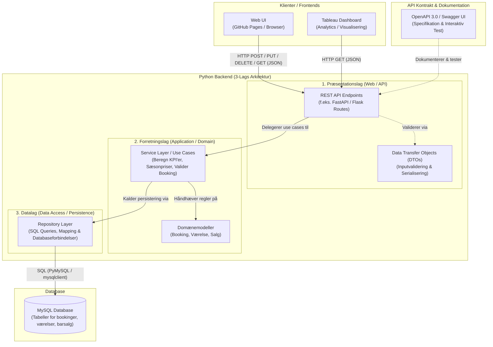

# Planen

Vi skal overholde alle krav beskrevet i filerne i context/teacher/

## Krav til systemet (Fra Undervisere)
### Overordnet Systemkrav 
- Formål: Systemet skal kunne analysere og præsentere data fra hoteldrift for beslutningstagere.
- Teknologistak: En Backend med 3 lags arkitektur og en grænseflade i JSON. Kontrakten skal leveres som en OpenApi specifikation. Alt skal køre i Docker containere og I skal gøre brug af Docker-compose. Programmeringssprog er frit, og databasen skal være MySQL. 
- Systemet skal kunne beregne nøgletal som belægningsgrader, indtjening, kundetilfredshed mm. 
- I skal udarbejde et interaktivt dashboard i Tableau, der viser nøgletallene

### Krav Forretningsdesign og analytics 
Med udgangspunkt i backendens REST API skal I lave et interaktivt tableau dashboard, der viser og beregner: 
- Hvor kommer gæsterne fra (lande) 
- Hvor meget indtjening er der Pr værelsestype (pr sæson) Pr land 
- Hvilke værelser tjener Kong Arthur flest penge på? 
- Hvilke lande tjener Kong Arthur flest penge på? 
- Beregn årets indtjening for hotellet. 
- Find også selv et interessant nøgletal at vise 
Dashboardet skal også vise og beregne følgende for cocktailbaren: 
- Hvor meget har Helene Christine solgt totalt for året 
- Vis omsætning pr drink 
- Vis procentfordeling af cocktails og kaffe for Helene Christine.

### Krav Systemudvikling 
I skal udvikle systemet spec-drevet (spec driven development) med GitHub Spec Kit (https://github.com/github/spec-kit), som I lærte det i AI-forløbet med hestecasen. Det betyder, at I beskriver hvad systemet skal gøre, før I eller jeres kodeagent skriver kode. Specifikationen er det, I styrer AI'en med, og det, I vurderer resultatet op imod. 

#### Workflowet 
Constitution → Specify → Clarify → Plan → Tasks → Implement → Converge 

- Constitution: Aftal principper og begrænsninger for hele projektet. Her hører opgavens faste krav hjemme: 3-lagsarkitektur, REST/JSON, OpenAPI-kontrakt, MySQL, Docker og docker-compose up . 
- Specify: Beskriv funktionerne, brugerne, kravene og succeskriterierne, f.eks. booking- CRUD, live-opdatering af data, nøgletal og cocktailbaren. 
- Clarify: Find og løs huller, uklarheder og ubesvarede spørgsmål. Hvad betyder "live"? Hvordan defineres en sæson? Hvordan beregnes belægningsgraden? 
- Plan: Vælg den tekniske løsning. Specifikationen sagde hvad, planen siger hvordan: sprog, arkitektur, hovedkomponenter og datamodel. 
- Tasks: Del planen op i små, konkrete opgaver, organiseret efter user stories og med afhængigheder kortlagt. 
- Implement: Lad kodeagenten skrive koden, én opgave ad gangen. I gennemgår, hvad den laver. 
- Converge: Tjek koden mod spec, plan og tasks. Mangler der noget, tilføjes nye tasks. Gentag implement → converge, indtil systemet matcher specifikationen. 

Brug checklister og analyse undervejs til at tjekke kvalitet og sammenhæng mellem spec, plan og tasks. 

#### User stories 
- Skriv user stories i formatet: "Som $rolle ønsker jeg $mål, så ". For eksempel: 
	- "Som hoteladministrator ønsker jeg at se en rapport over månedlige belægningsgrader, så jeg kan planlægge kampagner." 
	- "Som receptionist ønsker jeg at kunne oprette, rette og slette bookinger, så systemet altid viser den aktuelle belægning." 
- Brug INVEST-principperne til at sikre kvaliteten af jeres user stories. 
- Hver user story skal have acceptkriterier (Confirmation i "The Three Cs"). Det er dem, I bruger i Converge-trinnet til at afgøre, om en story er færdig. 

#### Hvad skal afleveres (Systemudvikling) 
Jeres spec-artefakter i GitHub-repositoryet: 
- constitution, spec, plan og tasks (f.eks. i en specs/ -mappe). 
- User stories med acceptkriterier. 
- Resultatet af jeres sidste Converge-tjek: Hvad er implementeret, og hvad mangler?

### Krav Softwarearkitektur 
- I skal på baggrund af de krav og det data I har fået stillet til rådighed udvikle en backend application som er bygget op efter en 3 lags arkitektur. Programmeringssprog er valgfrit. Systemets præsentationslag skal levere et REST API som grænseflade. Systemets database skal være MySQL. 
- API´s kontrakt skal leveres som en OpenAPI specifikation og skal kunne tilgås via et Swagger UI. 
- Hotellets nuværende booking system vil kunne skrive (POST/PUT/DELETE) til jeres API, men på prototype niveau skal I lave en frontend som kan køre via browseren. I denne frontend skal I kunne oprette, redigere og slette bookinger i applikationens backend. 
- Alt i jeres system skal kunne køres ved hjælp af en enkelt docker-compose up kommando. 
#### Hvad skal afleveres (Softwarearkitektur)
- Kildekode i et Github repository. (I vil blive bedømt på om alle i gruppen har deltaget i udviklingen af systemet – git commits). 
- Dokumentation: En README.md, CONTRIBUTE.md, SwaggerUI kørende i en Docker container. I skal i README.md filen have et arkitektur diagram over jeres samlede system. 

## Krav til systemet (fra Team synspunkt)
### Overordnet arkitektur

- 3Lags Backend af Python og MySQL database
- Tablaeu Dashboard (Laves selv)
- WebUI køres via browser (og Github Pages)

Brugere:
- Receptionist 
	- Bruger WebUI
- Hotel CFO
	- Bruger Tablaeu

### User stories
- User story 1 (Receptionist)(WebUI)
	- Som Receptionist ønsker jeg, at kunne oprette, fjerne, redigere en booking i systemet, så jeg hurtigt kan holde systemet opdateret og gnidningsfrit.
- User story 2 (Hotel CFO)(Tableau)
	- Som Hotel CFO ønsker jeg altid at have et overblik over hotellets indtjeninger på alle punkter, som indtjening per værelsestype (per sæson) per land. så jeg kan se hvilke værelser tjener Kong Arthur flest penge på, hvilke lande Kong Arthur tjener flest penge på og årets indtjening for hotellet.
- User story 3 (Hotel CFO)(Tableau)
	- Som Hotel CFO ønsker jeg altid at have et overblik over cocktailbaren. Både hvor meget Helene Christine har solgt totalt for året, omsætning/indtjening per drink/cocktail og vise procentfordelingen af cocktails/drinks og kaffe solgt, så jeg kan etablere de mest populære drinks/cocktails, forstå hvor høj indtjening vi har I cocktailbaren samt procentfordelingen af de forskellige læske kategorier.
- User story 4 (Hotel CFO) (Tableau)
	- Som Hotel CFO ønsker jeg altid at have et overblik over cocktailbaren, så jeg kan etablere om folk køber dyre eller billige produkter i baren og hvilke produkter der bliver købt flest af i baren.

### Team-beslutninger (TD – 2026-10-27)
Beslutninger truffet under udarbejdelsen af projektets Constitution (`constitution.md`):
- **Konfliktregel (Precedence):** Underviserkrav (`context/teacher/`) vægter højest, dernæst `constitution.md`, denne teamplan (`project-plan.md`), specifikationer/planer/tasks og til sidst kode. Konflikter med underviserkrav afgøres altid til fordel for underviserkravet og dokumenteres åbent under *Open Questions*.
- **Commit- og review-flow:** Gruppemedlemmer committer direkte til `main` (pull requests er ikke påkrævet). Kodeagenten implementerer én task ad gangen, og medlemmet gennemgår hele diff'en og kører tests (samt `docker-compose up` ved ændringer i Docker, compose eller databaseskema) før commit. Commit-beskeder bør referere til task-ID (f.eks. `T012`). Teamet gennemgår nye commits sammen ved check-ins.
- **Test-politik:** Alle KPI-formler og forretningsregler i forretningslaget skal have automatiserede unit tests, og alle REST API-endpoints skal have automatiserede kontrakttests mod OpenAPI-kontrakten. TDD er ikke påkrævet, men en task er først færdig, når dens tests er skrevet og består.
- **Ændringer til Constitution (Amendments):** Ændringer foretages via `/speckit-constitution`, committes direkte til `main` med versionsbump (SemVer) og begrundelse i commit-beskeden, og gennemgås ved næste team check-in.
- **Sprog:** Spec-artefakter skrives på engelsk, mens citater fra kilder og selve user story-sætningerne (`"Som <rolle> ønsker jeg <mål>, så <fordel>"`) skrives på dansk. Praktisk udviklervejledning samles i `CONTRIBUTE.md`.
