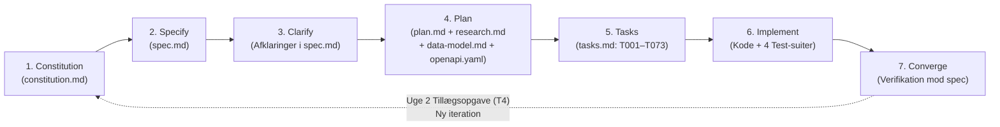
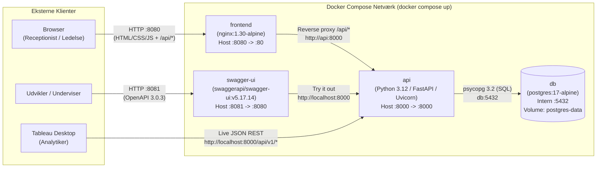
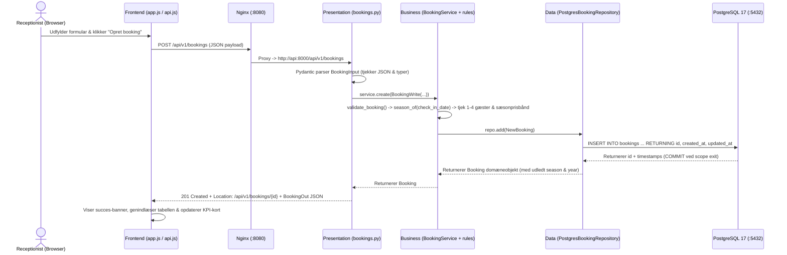

# Hotel Kong Arthur — Projektresumé & Præsentationsguide (SDD-Proces)

> **Formål med dokumentet:** Dette dokument samler hele vores tværfaglige projekt (*Softwarearkitektur* & *Forretningsdesign*) struktureret efter vores **Spec-Driven Development (SDD)**-proces med GitHub Spec Kit. Dokumentet er opdelt i **10 kapitler**, hvor hvert kapitel er designet, så det kan oversættes direkte til **slides** til den 10-minutters fremlæggelse (efterfulgt af 10 minutters Q&A ved Lasse og Claus fredag d. 6/11).
>
> Dokumentet tager direkte udgangspunkt i kravene fra oplæggene i `context/teacher/`:
> - **`T1`**: `context/teacher/tværfaglig_opgave_hotel_kong_arthur.md` (Hovedopgave: SWA & Forretningsdesign)
> - **`T2`**: `context/teacher/tillægsspørgsmål_swa.md` (De 10 arkitekturspørgsmål til fremlæggelsen)
> - **`T3`**: `context/teacher/international_names_with_rooms_1000.csv` & `drinks_menu_with_sales.csv` (Datagrundlag)
> - **`T4`**: `context/teacher/Tillægsopgave_uge_2.md` (Uge 2-ændringskrav: Git `v1.0.0`, PostgreSQL-skift, `Hotel Analytics`-endpoints & Frontend-analysevisning)

---

## Oversigt: Fra Kapitler til Slides (10 minutters præsentation)

| Kapitel | Slide-forslag | Fokusområde | Estimeret tid |
| :--- | :--- | :--- | :--- |
| **Kapitel 1** | Slide 1–2 | Case, Problemstilling & Forretningskontekst (`T1`, `T3`) | ~1 min |
| **Kapitel 2** | Slide 3 | Vores SDD-proces med GitHub Spec Kit (`Constitution` → `Converge`) | ~1 min |
| **Kapitel 3** | Slide 4 | Trin 1: **Constitution** — Projektets tekniske grundlov & arkitekturregler | ~1 min |
| **Kapitel 4** | Slide 5–6 | Trin 2 & 3: **Specify & Clarify** — INVEST User Stories & vigtige afklaringer | ~1,5 min |
| **Kapitel 5** | Slide 7–9 | Trin 4: **Plan** — 3-lags arkitektur, Request-flow, OpenAPI & Docker (`T2` Q1–Q3, Q6–Q8) | ~2 min |
| **Kapitel 6** | Slide 10–11 | **Uge 2 Tillægsopgave (`T4`)** — Fra `v1.0.0` (MySQL) til `v2.0.0` (PostgreSQL + `Hotel Analytics`) (`T2` Q5) | ~1,5 min |
| **Kapitel 7** | Slide 12–13 | **Forretningsdesign & Analytics** — KPI-beregninger (`A1`–`A7`, `B1`–`B3`, `K1`–`K3`), Frontend & Tableau (`T2` Q4, Q9) | ~1 min |
| **Kapitel 8** | Slide 14 | Trin 5–7: **Tasks, Implement & Converge** — Test-strategi, arkitektur-gates & AI-ejerskab (`T2` Q10) | ~1 min |
| **Kapitel 9** | Backup / Q&A | Komplette svar på alle 10 SWA-tillægsspørgsmål (`T2` Q1–Q10) | *10 min Q&A* |
| **Kapitel 10** | Drejebog | Konkret taletids- og demo-plan til selve fremlæggelsen | *Reference* |

---

## Kapitel 1: Introduktion, Case & Problemstilling (`T1` & `T3`)
*(Svarer til **Slide 1: Titel & Case** og **Slide 2: Fra statiske CSV-filer til Live Platform**)*

### 1.1 Forretningskontekst: Hotel Kong Arthur
Hotel Kong Arthur i København ønsker et bedre overblik over driften på tværs af to forretningsområder beskrevet i [`tværfaglig_opgave_hotel_kong_arthur.md`](../teacher/tværfaglig_opgave_hotel_kong_arthur.md):

1. **Hoteldrift & Værelsesudlejning:**
   - Hotellet råder over i alt **214 værelser** med plads til **1–4 gæster pr. værelse** (maks. kapacitet ca. **428 gæster**).
   - Der tilbydes **8 værelsestyper** med sæsonbestemte prisintervaller (DKK pr. nat):
     - **Lavsæson** (vinter/efterår: jan, feb, nov, dec — 89 dage i 2026)
     - **Mellemsæson** (forår: mar, apr, maj, sep, okt — 153 dage i 2026)
     - **Højsæson** (sommer & events: jun, jul, aug — 123 dage i 2026)
   - Efter et ophold giver gæsterne en **bedømmelse på en skala fra 1 til 10** (kundetilfredshed).
2. **Lobbyens Cocktailbar (Helene Christine):**
   - Receptionist og bartender **Helene Christine** driver hotellets populære cocktailbar i lobbyen.
   - Menukortet består af **30 drikkevarer** fordelt på **20 cocktails** (prisklasser: *Billig* 85–95 kr., *Mellem* 100–125 kr., *Dyr* 130–165 kr.) og **10 kaffetyper** (35–65 kr.).

### 1.2 Problemstilling: Hvorfor udskifte CSV-filerne?
- **Før (`T3`):** Hotellets data lå i statiske CSV-udtræk ([`international_names_with_rooms_1000.csv`](../teacher/international_names_with_rooms_1000.csv) med 1.000 rækker/985 unikke gæste-ID'er og [`drinks_menu_with_sales.csv`](../teacher/drinks_menu_with_sales.csv) med 30 drikkevarer). CSV-filer har ingen datavalidering, tillader dubletter, kan ikke håndtere samtidige opdateringer fra et bookingsystem og giver kun et historisk øjebliksbillede.
- **Mål (`T1` + `T4`):** Byg en **live data- og analyseplatform**, hvor:
  1. Nye bookinger, opdateringer og sletninger gemmes direkte i en relationel database via et **3-lags REST API**.
  2. Alle forretnings-KPI'er (omsætning, belægningsgrad, kundetilfredshed og barsalg) beregnes live i forretningslaget og udstilles både i en **Browser Frontend-prototype**, direkte i **Swagger UI (`Hotel Analytics`)** og til **Tableau Desktop**.
  3. Hele systemet startes reproducerbart med én kommando: `docker compose up`.

### Slide-punkter til Kapitel 1
- **Case:** Hotel Kong Arthur — 214 værelser, 8 værelsestyper, 3 sæsoner + Helene Christines lobbybar (20 cocktails, 10 kaffer).
- **Problem:** Statiske CSV-filer (`T3`) giver ingen live indsigt, ingen validering og ingen integration til bookingsystemet.
- **Løsning:** Containeriseret 3-lags REST API (FastAPI + PostgreSQL 17), OpenAPI 3.0.3 kontrakt, live browser-frontend (Booking CRUD + Analytics) og Tableau-integration.

---

## Kapitel 2: Vores Spec-Driven Development (SDD) Proces
*(Svarer til **Slide 3: SDD-Workflow & AI-Styring med GitHub Spec Kit**)*

### 2.1 Hvad er Spec-Driven Development (SDD)?
Som foreskrevet i [`tværfaglig_opgave_hotel_kong_arthur.md`](../teacher/tværfaglig_opgave_hotel_kong_arthur.md) har vi anvendt **Spec-Driven Development** med **GitHub Spec Kit**. Grundidéen i SDD er, at **specifikationen er det primære artefakt**, mens koden er et afledt produkt af specifikationen. I stedet for "vibe-coding" med en AI-agent har vi styret udviklingen gennem faste faser og kvalitetstjek (*Phase Gates*).

### 2.2 De 7 faser i vores projekt og deres artefakter

| SDD-Fase | Kommando / Skill | Artefakt i repoet | Hvad opnåede vi i fasen? |
| :--- | :--- | :--- | :--- |
| **1. Constitution** | `/speckit-constitution` | [`.specify/memory/constitution.md`](../../.specify/memory/constitution.md) | Fastlagde 10 ufravigelige arkitekturprincipper (bl.a. strikt 3-lags adskillelse, design-first OpenAPI 3.0.3 og én-kommando Docker-opstart). |
| **2. Specify** | `/speckit-specify` | [`specs/001-hotel-analytics-platform/spec.md`](../../specs/001-hotel-analytics-platform/spec.md) | Formulerede 5 prioriterede **INVEST User Stories** på dansk med Given/When/Then acceptkriterier samt 23 funktionelle krav (`FR-001`–`FR-023`). |
| **3. Clarify** | `/speckit-clarify` | `Clarifications`-sektioner i [`spec.md`](../../specs/001-hotel-analytics-platform/spec.md) | Eliminerede alle tvetydigheder i oplægget *før* vi skrev kode (fx datomapping af sæsoner, kapacitetsnævner for de 214 værelser, håndtering af dublet-ID'er i CSV og afgrænsning af Tableau). |
| **4. Plan** | `/speckit-plan` | [`plan.md`](../../specs/001-hotel-analytics-platform/plan.md), [`research.md`](../../specs/001-hotel-analytics-platform/research.md), [`data-model.md`](../../specs/001-hotel-analytics-platform/data-model.md), [`contracts/openapi.yaml`](../../specs/001-hotel-analytics-platform/contracts/openapi.yaml) | Valgte konkret teknologistak, designede databaseskemaet og skrev hele OpenAPI 3.0.3-kontrakten *før* implementeringen. |
| **5. Tasks** | `/speckit-tasks` | [`specs/001-hotel-analytics-platform/tasks.md`](../../specs/001-hotel-analytics-platform/tasks.md) | Nedbrød planen i **73 sporbarhedsopgaver** (`T001`–`T073`) grupperet efter User Stories og lag. |
| **6. Implement** | `/speckit-implement` | `backend/`, `frontend/`, `db/`, `docker-compose.yml` | Implementerede systemet i to kontrollerede releases: **Uge 1 (`v1.0.0`)** og **Uge 2 (`v2.0.0` / `main`)**. |
| **7. Converge** | `/speckit-converge` | Verifikationsrapport & lukkede tasks i [`tasks.md`](../../specs/001-hotel-analytics-platform/tasks.md) | Krydstjekkede kodebasen mod `spec.md`, `plan.md` og `openapi.yaml` — 0 udeståender. |

### Slide-punkter til Kapitel 2
- **Spec-first frem for kode-first:** Ingen produktionskode blev skrevet før specifikation, datamodel og OpenAPI-kontrakt var på plads.
- **To fulde SDD-iterationer:**
  - **Iteration 1 (Uge 1 → Git tag `v1.0.0`):** MySQL 8.4 + 11 rå REST-endpoints til Tableau + Booking CRUD frontend.
  - **Iteration 2 (Uge 2 → `Tillægsopgave_uge_2.md`):** Opdatering af Constitution (`v1.2.0`), Spec, Plan og Tasks → Skift til PostgreSQL 17 + 9 `Hotel Analytics` KPI-endpoints + udvidet Frontend Analytics-dashboard.

---

## Kapitel 3: Trin 1 — Constitution (Projektets Grundlov)
*(Svarer til **Slide 4: Constitution — Teknisk Grundlov & Kildehierarki**)*

### 3.1 Formålet med `constitution.md`
I [`.specify/memory/constitution.md`](../../.specify/memory/constitution.md) (version `1.2.0`) har vi defineret projektets "grundlov", som både teamet og AI-agenten skal overholde ved hver eneste kodeændring.

### 3.2 Kildehierarki (Source-of-Truth Hierarchy)
Hvis der opstår tvivl mellem dokumenter, gælder følgende prioriteringsrækkefølge:
1. **`T4`** ([`Tillægsopgave_uge_2.md`](../teacher/Tillægsopgave_uge_2.md)) — nyeste ændringskrav fra kunden/underviserne
2. **`T1`** ([`tværfaglig_opgave_hotel_kong_arthur.md`](../teacher/tværfaglig_opgave_hotel_kong_arthur.md)) — hovedopgavebeskrivelsen
3. **`T2`** ([`tillægsspørgsmål_swa.md`](../teacher/tillægsspørgsmål_swa.md)) — arkitekturspørgsmål systemet skal kunne demonstrere
4. **`Constitution`** ([`.specify/memory/constitution.md`](../../.specify/memory/constitution.md))
5. **`Spec & Plan`** ([`spec.md`](../../specs/001-hotel-analytics-platform/spec.md), [`plan.md`](../../specs/001-hotel-analytics-platform/plan.md), [`openapi.yaml`](../../specs/001-hotel-analytics-platform/contracts/openapi.yaml))
6. **Kildekode** (`backend/`, `frontend/`, `db/`)

### 3.3 De 10 Kerneprincipper i vores Constitution

| # | Princip | Konkret betydning i vores arkitektur |
| :--- | :--- | :--- |
| **I** | **Strict 3-Layer Backend Architecture** | `presentation` → `business` → `data`. Ingen omvendte imports, ingen lag-spring. Håndhæves automatisk med AST-analyse i [`test_layers.py`](../../backend/tests/architecture/test_layers.py). |
| **II** | **Business Logic Lives in the Business Layer** | Sæsonberegning, prisvalidering og samtlige KPI'er (`A1`–`A7`, `B1`–`B3`, `K1`–`K3`) ligger i `backend/src/hotel_api/business/` som rene, testbare Python-funktioner uden SQL eller HTTP. |
| **III** | **Design-First REST API & OpenAPI Contract** | [`openapi.yaml`](../../specs/001-hotel-analytics-platform/contracts/openapi.yaml) er single source of truth (20 operationer, 6 tags) og udstilles i en dedikeret Swagger UI-container på `:8081`. |
| **IV** | **Live Relational Persistence** | Alle ændringer committes øjeblikkeligt i **PostgreSQL 17** (`postgres-data` volume). `Cache-Control: no-store` sikrer, at klienter altid ser friske data. |
| **V** | **Loose Coupling & Replaceability** | Forretningslaget kender kun `Protocol`-interfaces i [`ports.py`](../../backend/src/hotel_api/business/ports.py). Det gjorde skiftet fra MySQL til PostgreSQL i uge 2 muligt uden at røre `business/` eller `presentation/`. |
| **VI** | **One-Command Reproducible Runtime** | Hele stakken (`db`, `api`, `frontend`, `swagger-ui`) starter med `docker compose up` styret af deterministiske `service_healthy`-checks. |
| **VII** | **Spec-Driven Development & INVEST User Stories** | Alle features spores fra danske INVEST User Stories med Given/When/Then acceptkriterier. |
| **VIII** | **End-to-End Analytics Traceability** | Hvert analysekrav (`A1`–`A7`, `B1`–`B3`, `K1`–`K3`) har en dokumenteret formel og golden-reference-tests mod det officielle datasæt. |
| **IX** | **Comprehension & Architectural Ownership** | Ingen "magiske" frameworks (ingen ORM, ingen frontend-bundler). Hver fil og linje kode kan forklares på tavlen til Q&A. |
| **X** | **Deliverable Scope Boundary** | Ingen Tableau-filer (`.twb`/`.twbx`) eller WDC-kode i Git-repoet (`FR-017`); Tableau forbinder som ekstern klient til REST API'et. |

---

## Kapitel 4: Trin 2 & 3 — Specify & Clarify (INVEST User Stories & Afklaringer)
*(Svarer til **Slide 5: INVEST User Stories** og **Slide 6: Clarify — Fra Tvetydigt Oplæg til Præcis Specifikation**)*

### 4.1 Trin 2: Specify — De 5 INVEST User Stories (`spec.md`)
I [`specs/001-hotel-analytics-platform/spec.md`](../../specs/001-hotel-analytics-platform/spec.md) omsatte vi oplæggene (`T1` + `T4`) til **5 prioriterede User Stories** efter skabelonen *"Som `<rolle>` ønsker jeg `<mål>`, så `<fordel>`"* med **The Three Cs** (*Card, Conversation, Confirmation* via Given/When/Then):

| ID & Prioritet | User Story (Card) | Kerne-leverance & Confirmation (Acceptkriterier) |
| :--- | :--- | :--- |
| **US1 (P1)** | *Som hotelmedarbejder i receptionen ønsker jeg at kunne oprette, fremsøge, redigere og slette gæstebookinger via en brugerflade i browseren, så nye og ændrede ophold straks registreres i databasen med gyldige værelsestyper, sæsonpriser og gæsteantal.* | Browser UI på `:8080` + CRUD på `/api/v1/bookings`. Validerer 1–4 gæster, 8 værelsestyper, sæsonpris-bånd og returnerer RFC 9457 `422` med alle fejl samlet. |
| **US2 (P1)** | *Som forretningsanalytiker for Hotel Kong Arthur ønsker jeg at kunne hente både rå datapunkter og færdigberegnede nøgletal (KPI'er) for bookinger, værelsestyper, sæsoner og gæstebedømmelser direkte via REST API'et (Swagger UI) og se dem i frontend-prototypen samt i Tableau, så ledelsen kan analysere omsætning pr. værelsestype, sæson og land samt belægningsgrad og kundetilfredshed på opdaterede data.* | Rå endpoints til Tableau + 6 `Hotel Analytics` KPI-endpoints under `/api/v1/kpis/hotel/*` + Frontend Analytics-dashboard (`F2`). Dækker `A1`–`A7` og `K1`–`K3`. |
| **US3 (P2)** | *Som baransvarlig (Helene Christine) og hotelledelse ønsker jeg at kunne hente både rå salgsdata og færdigberegnede nøgletal fra lobbyens cocktailbar direkte via REST API'et (Swagger UI) og se dem i frontend-prototypen samt i Tableau, så vi kan se det samlede årlige barsalg, indtjening pr. drink og fordelingen mellem cocktails og kaffe.* | `/api/v1/drinks` + 3 `Hotel Analytics` bar-endpoints under `/api/v1/kpis/bar/*` + Bar-sektion i Frontend Analytics. Dækker `B1`–`B3` og prisklasse-analyse. |
| **US4 (P2)** | *Som systemintegrator og udvikler ønsker jeg en fuldt opdateret OpenAPI-specifikation tilgængelig i en Swagger UI-container med en dedikeret sektion for `Hotel Analytics`, så eksterne systemer, udviklere og undervisere kan afprøve alle rå endpoints og KPI-beregninger interaktivt uden at læse kildekoden.* | Swagger UI på `:8081` med 6 tags (`Health`, `Reference data`, `Bookings`, `Reviews`, `Bar`, `Hotel Analytics`) og 20 dokumenterede operationer. |
| **US5 (P1)** | *Som underviser eller teammedlem ønsker jeg at kunne starte hele løsningen (PostgreSQL-database, backend-API, frontend-prototype og Swagger UI) med én `docker-compose up`-kommando samt kunne tilgå uge 1-versionen via Git, så systemet og dets arkitektoniske udvikling kan demonstreres reproducerbart.* | 4 containere via `docker compose up`, persistent `postgres-data` volume, samt uge 1 låst ved Git-tag `v1.0.0`. |

### 4.2 Trin 3: Clarify — De 7 afgørende afklaringer før kode
Opgaveformuleringen (`T1`) og CSV-filerne (`T3`) indeholdt flere bevidste tvetydigheder. Med `/speckit-clarify` traf og dokumenterede vi følgende designbeslutninger i [`spec.md`](../../specs/001-hotel-analytics-platform/spec.md):

1. **Hvad betyder "live data" konkret?**
   - Ingen polling eller WebSockets er nødvendige til casen; "live" betyder **øjeblikkelig database-persistens ved skrivning + friske databaseopslag ved læsning uden mellemliggende cache** (`Cache-Control: no-store`).
2. **Hvordan mappes sæsoner til kalenderdatoer og antal dage?**
   - CSV-filen indeholdt kun tekstværdien `Season` uden datoer. Vi fastlagde en deterministisk månedsmapping (for et standardår som 2026 = 365 dage):
     - **Lavsæson:** Januar, februar, november, december = **89 dage**
     - **Mellemsæson:** Marts, april, maj, september, oktober = **153 dage**
     - **Højsæson:** Juni, juli, august = **123 dage**
3. **Hvordan beregnes belægningsgrad (`K1`) præcist?**
   - Formel: $\text{Belægningsgrad (\%)} = \frac{\text{Solgte værelsesnætter}}{\text{214 værelser} \times \text{Dage i perioden}} \times 100$.
   - For hele 2026 er kapacitetsnævneren $214 \times 365 = 78.110$ værelsesnætter (Lavsæson: $19.046$, Mellemsæson: $32.742$, Højsæson: $26.322$).
4. **Hvordan håndteres det, at CSV-filen mangler en `check_in_date`?**
   - Nye bookinger i API'et har et påkrævet `check_in_date`-felt (`YYYY-MM-DD`), hvorfra forretningslaget automatisk udleder både `season` og `year`. Ved import af det historiske CSV-datasæt tildeles en deterministisk repræsentativ dato i 2026 inden for rækkens angivne sæson (`2026-01-15`, `2026-04-15` eller `2026-07-15`).
5. **Hvordan håndteres dublet `Guest_ID`'er i CSV-filen?**
   - [`international_names_with_rooms_1000.csv`](../teacher/international_names_with_rooms_1000.csv) har **1.000 rækker, men kun 985 unikke `Guest_ID`'er** (15 dubletter). For at bevare alle 1.000 historiske bookinger bruger `bookings`-tabellen en auto-genereret surrogat-primærnøgle (`id`), mens det originale CSV-ID gemmes i en ikke-unik kolonne `source_guest_id`.
6. **Skal gæstebedømmelser (`Satisfaction_1_10`) ligge på `bookings` eller i en egen tabel?**
   - En booking oprettes *før* opholdet, mens en bedømmelse først afgives *efter* opholdet (`T1`: *"Efter et ophold bliver gæsterne bedt om at give en bedømmelse"*). Derfor modellerede vi **`reviews` som en separat 1:0..1-tabel** med fremmednøgle (`booking_id UNIQUE`) til `bookings`.
7. **Hvordan håndteres rækker i CSV'en, hvor prisen ligger uden for sæsonens prisbånd?**
   - I CSV-filen ligger 508 ud af 1.000 historiske rækker uden for det normale sæsonprisbånd (fx pga. historiske rabatter/kampagner). Vores forretningsregel (`validate_booking`) håndhæver som standard de skrappe sæsonprisbånd for alle nye/redigerede bookinger, men tillader et eksplicit flag `allow_price_override=True` med en positiv pris ved historisk import.

---

## Kapitel 5: Trin 4 — Plan & Softwarearkitektur (`T2` Q1–Q3, Q6–Q8)
*(Svarer til **Slide 7: Container- & Systemarkitektur**, **Slide 8: De 3 Lag & Request Walkthrough** og **Slide 9: REST Design, OpenAPI & Docker**)*

### 5.1 System- og Containerarkitektur (`T2` › Spørgsmål 1)
Systemet består af **4 kørende runtime-containere** orkestreret i [`docker-compose.yml`](../../docker-compose.yml) på ét fælles Docker-netværk samt eksterne klienter (Browser, Tableau Desktop, fremtidigt bookingsystem):

| Container | Image / Teknologi | Port (Host → Container) | Ansvar |
| :--- | :--- | :--- | :--- |
| **`db`** | `postgres:17-alpine` | Kun intern `:5432` | Relationel database med persistent volume (`postgres-data`). Initialiserer skema via [`01_schema.sql`](../../db/init/01_schema.sql) og referencetabeller via [`02_reference_data.sql`](../../db/init/02_reference_data.sql). |
| **`api`** | Python 3.12 + FastAPI + Uvicorn | `localhost:8000 → :8000` | 3-lags REST API (`presentation` → `business` → `data`). Validerer, beregner KPI'er og taler med `db:5432`. |
| **`frontend`** | `nginx:1.30-alpine` + Vanilla ES-moduler | `localhost:8080 → :80` | Serverer SPA-prototypen (`Bookings` CRUD + `Hotel Analytics` dashboard) og reverse-proxyer `/api/*` til `http://api:8000`. |
| **`swagger-ui`** | `swaggerapi/swagger-ui:v5.17.14` | `localhost:8081 → :8080` | Udstiller vores design-first [`openapi.yaml`](../../specs/001-hotel-analytics-platform/contracts/openapi.yaml) (read-only mount) med interaktiv *Try it out*. |

### 5.2 Den 3-delte Backend-Arkitektur (`T2` › Spørgsmål 3)
Backenden i `backend/src/hotel_api/` er skarpt opdelt i tre lag, som kun må kalde nedad (`presentation` → `business` ← `data` via Dependency Inversion i [`main.py`](../../backend/src/hotel_api/main.py)):

1. **Presentation Layer (`backend/src/hotel_api/presentation/`):**
   - **Ansvar:** HTTP-specifikke detaljer: FastAPI-routere (`bookings.py`, `reviews.py`, `drinks.py`, `reference.py`, `kpis.py`, `health.py`), Pydantic request/response DTO'er ([`schemas.py`](../../backend/src/hotel_api/presentation/schemas.py)), query-filter-validering og oversættelse af domænefejl til **RFC 9457 Problem Details** (`application/problem+json`) i [`errors.py`](../../backend/src/hotel_api/presentation/errors.py).
   - **Må IKKE indeholde:** SQL-forespørgsler, databaseforbindelser eller pris-/sæson-/KPI-formler.
2. **Business Layer (`backend/src/hotel_api/business/`):**
   - **Ansvar:** Domænemodeller ([`domain/models.py`](../../backend/src/hotel_api/business/domain/models.py)), rene forretningsregler (`rules/seasons.py`, `rules/pricing.py`, `rules/satisfaction.py`, `rules/validation.py`), rene KPI-kalkulatorer (`kpis/hotel.py`, `kpis/bar.py`), applikationsservices (`services/booking_service.py` m.fl.) og abstrakte `Protocol`-interfaces ([`ports.py`](../../backend/src/hotel_api/business/ports.py)).
   - **Må IKKE indeholde:** `fastapi`, `pydantic`, HTTP-statuskoder eller `psycopg`/SQL.
3. **Data Layer (`backend/src/hotel_api/data/`):**
   - **Ansvar:** Konkrete PostgreSQL-repositories (`repositories/bookings_repo.py` m.fl.) og transaktionsstyring via [`connection.py`](../../backend/src/hotel_api/data/connection.py) (`psycopg` 3.2 med `dict_row`).
   - **Må IKKE indeholde:** HTTP-begreber eller forretningsservices/KPI-beregninger.

### 5.3 Følg et Request: `POST /api/v1/bookings` (`T2` › Spørgsmål 2)
Når en receptionist opretter en booking i browseren, gennemløber kaldet præcis disse 8 trin:

### 5.4 REST-Design, OpenAPI-Kontrakt & Docker (`T2` › Spørgsmål 6, 7 & 8)
- **REST-konventioner (`Q6`):** Ressource-orienterede flertals-URL'er under `/api/v1/`, korrekte HTTP-verber (`GET` → `200`, `POST` → `201 Created` + `Location`-header, `PUT` → `200`, `DELETE` → `204 No Content`) og ensartede **RFC 9457 Problem Details** fejl-svar (`400` syntaks/filterfejl, `404` `NotFound`, `422` `ValidationFailed` med alle felter i `errors[]`, `503` `StorageUnavailable`).
- **Kontrakt-synkronisering (`Q7`):** [`openapi.yaml`](../../specs/001-hotel-analytics-platform/contracts/openapi.yaml) er skrevet i **OpenAPI 3.0.3** (så vi undgår Swagger UI-kompatibilitetsproblemer med FastAPI's auto-genererede 3.1-skema, som er slået fra med `openapi_url=None`). Tre automatiske tests i [`test_openapi_conformance.py`](../../backend/tests/contract/test_openapi_conformance.py) garanterer 100% synkronisering mellem `openapi.yaml` og koden.
- **Docker Service Discovery & Persistens (`Q8`):** Containerne finder hinanden via Docker Composes indbyggede DNS (`db:5432`, `api:8000`). Opstartsrækkefølgen styres deterministisk med `depends_on: condition: service_healthy` (`pg_isready` på `db` → `/api/v1/health` på `api` → `wget` på `frontend`). Data overlever genstarter i det navngivne volume `postgres-data` og slettes kun ved `docker compose down -v`.

---

## Kapitel 6: Uge 2 Tillægsopgave (`Tillægsopgave_uge_2.md`) — Fra `v1.0.0` til `v2.0.0` (`T4` & `T2` Q5)
*(Svarer til **Slide 10: Uge 2 Ændringskrav & Git v1.0.0** og **Slide 11: Bevis på Udskiftelighed — MySQL til PostgreSQL**)*

### 6.1 Overblik over de 4 krav i `Tillægsopgave_uge_2.md` (`T4`)
I uge 2 modtog vi [`Tillægsopgave_uge_2.md`](../teacher/Tillægsopgave_uge_2.md), som simulerer realistiske ændringskrav fra kunden midt i projektforløbet:

| Krav i `Tillægsopgave_uge_2.md` | Spec-krav | Hvordan vi løste det i SDD-processen |
| :--- | :--- | :--- |
| **1. Gem uge 1 i Git** | `FR-023` (`G1`) | Uge 1-løsningen (MySQL 8.4 + 11 rå endpoints) er tagget og låst som release **`v1.0.0`** (commit `018396b`), så vi kan skifte mellem uge 1 og uge 2 på få sekunder under præsentationen (`git checkout v1.0.0` vs. `git checkout main`). |
| **2. Udskift MySQL med PostgreSQL** | `FR-004` | Hele datalaget er migreret fra MySQL 8.4 (`PyMySQL`) til **PostgreSQL 17** (`postgres:17-alpine` + `psycopg[binary]` 3.2) med `01_schema.sql` og `02_reference_data.sql`. |
| **3. Udstil KPI-beregninger direkte i API'et (`Hotel Analytics`)** | `FR-006`–`FR-016`, `FR-021` | Tilføjet **9 nye `GET`-endpoints** under `/api/v1/kpis/hotel/*` og `/api/v1/kpis/bar/*` samlet under en ny 6. Swagger UI-sektion **`Hotel Analytics`** — uden at ændre de 11 eksisterende endpoints. |
| **4. Vis analyser i Frontend-prototypen** | `FR-022` (`F2`) | Udvidet browser-prototypen på `:8080` med et dedikeret **Hotel Analytics**-faneblad (`#analytics/hotel` og `#analytics/bar`), der henter og viser alle KPI'er live fra API'et med filtre og sorterbare tabeller. |

### 6.2 Praktisk bevis på 3-lags arkitekturens udskiftelighed (`T2` › Spørgsmål 5)
Spørgsmål 5 i [`tillægsspørgsmål_swa.md`](../teacher/tillægsspørgsmål_swa.md) spørger: *"Hvor svært ville det være at skifte databasen ud med en anden?"*
Takket være uge 2-tillægsopgaven er dette ikke længere et teoretisk spørgsmål — **vi har udført udskiftningen i praksis**:

| Lag / Mappe | Ændret ved skift fra MySQL 8.4 (`v1.0.0`) til PostgreSQL 17 (`main`)? | Forklaring |
| :--- | :---: | :--- |
| **`business/domain/`**, **`business/rules/`**, **`business/kpis/`**, **`business/services/`**, **`business/ports.py`** | **0 linjer ændret** | Forretningslaget afhænger kun af `Protocol`-interfaces (`BookingRepository`, `ReviewRepository`, `DrinkRepository` osv. i [`ports.py`](../../backend/src/hotel_api/business/ports.py)). |
| **`presentation/routers/`**, **`presentation/schemas.py`**, **`presentation/errors.py`** | **0 linjer ændret for DB-skiftet** | Routere kalder kun services i forretningslaget og kender intet til SQL-dialekten. |
| **`data/connection.py`** & **`data/repositories/*.py`** | **Udskiftet** | Skiftede driver fra `pymysql` til `psycopg` (med `dict_row`), pladsholdere og `INSERT ... RETURNING id, created_at, updated_at` samt `ON CONFLICT ... DO UPDATE`. |
| **`db/init/01_schema.sql`** & **`docker-compose.yml`** | **Udskiftet** | Skiftede `AUTO_INCREMENT` / `ENGINE=InnoDB` til PostgreSQL `GENERATED BY DEFAULT AS IDENTITY` og container-image til `postgres:17-alpine`. |

> **Konklusion til fremlæggelsen:** Fordi vi overholdt Princip I og V i vores Constitution (`ports.py` med Dependency Inversion i `main.py`), kunne vi udskifte hele databaseserveren og SQL-driveren ved udelukkende at ændre **Data-laget (`data/`)** og infrastrukturfilerne (`db/`, `docker-compose.yml`).

---

## Kapitel 7: Forretningsdesign, Analytics & Nøgletal (`A1`–`A7`, `B1`–`B3`, `K1`–`K3`)
*(Svarer til **Slide 12: KPI-Arkitektur & Golden Reference-Tal** og **Slide 13: De 9 `Hotel Analytics` Endpoints, Frontend & Tableau**)*

### 7.1 Hvorfor ligger alle KPI-beregninger i Forretningslaget? (`T2` › Spørgsmål 4)
Alle hotel- og bar-nøgletal beregnes i [`backend/src/hotel_api/business/kpis/hotel.py`](../../backend/src/hotel_api/business/kpis/hotel.py) og [`backend/src/hotel_api/business/kpis/bar.py`](../../backend/src/hotel_api/business/kpis/bar.py) som rene Python-funktioner (med `Decimal` og `ROUND_HALF_UP`):
1. **Én sandhedskilde (Single Source of Truth):** Både vores Browser Frontend (`:8080`), Swagger UI (`:8081`) og eksterne API-klienter får nøjagtig samme tal, mens Tableau kan bygge sine egne visualiseringer oven på de rå endpoints eller verificere sine tal direkte mod `/api/v1/kpis/*`.
2. **Lynhurtige Unit Tests uden database:** Vi tester alle grænsetilfælde (skudår, tomme datasæt, enkeltfiltre, afrunding) på millisekunder i [`test_kpis_hotel.py`](../../backend/tests/unit/test_kpis_hotel.py) og [`test_kpis_bar.py`](../../backend/tests/unit/test_kpis_bar.py) uden at starte PostgreSQL.
3. **Database-uafhængighed:** Da vi skiftede fra MySQL til PostgreSQL i uge 2, skulle ingen KPI-formler omskrives.

### 7.2 Komplet oversigt over spørgsmål fra `T1`, API-endpoints og Golden Reference-tal
Nedenstående tabel viser alle krav fra [`tværfaglig_opgave_hotel_kong_arthur.md`](../teacher/tværfaglig_opgave_hotel_kong_arthur.md) (`T1`), hvilket `Hotel Analytics`-endpoint der besvarer dem, og de eksakte tal fra det officielle datasæt (`T3`):

| Krav-ID | Spørgsmål / Beregning fra `T1` | `Hotel Analytics` REST Endpoint (`GET`) | Resultat på `T3`-datasættet (1.000 bookinger / 30 drinks) |
| :--- | :--- | :--- | :--- |
| **`K1`** | **Belægningsgrad** ($\frac{\text{Solgte nætter}}{214 \times \text{dage}} \times 100$) | `/api/v1/kpis/hotel/occupancy` | **6,89 %** samlet for 2026 (`5.383` solgte nætter ud af `78.110` mulige værelsesnætter across 214 værelser). |
| **`K2` / `A6`** | **Samlet årlig hotelindtjening** ($\sum \text{nights} \times \text{price}$) | `/api/v1/kpis/hotel/summary` | **11.234.034,00 DKK** fordelt på 1.000 bookinger (`5.383` værelsesnætter). |
| **`K3`** | **Kundetilfredshed** (skala 1–10 + CSAT $\ge 8$) | `/api/v1/kpis/hotel/satisfaction` | Gennemsnit: **7,93 / 10** — Tilfredshedsgrad ($\ge 8$): **64,20 %** (`642` tilfredse, `269` neutrale, `89` utilfredse). |
| **`A1`, `A3`, `A5`** | **Hvor kommer gæsterne fra, indtjening pr. land & Top-lande** | `/api/v1/kpis/hotel/revenue-by-country` | **15 lande** repræsenteret. Top 3 målt på omsætning: **1. Canada** (`910.422 DKK`), **2. UK** (`905.389 DKK`), **3. France** (`831.959 DKK`). Flest bookinger: **USA** (`80` bookinger). |
| **`A2`, `A4`** | **Indtjening pr. værelsestype pr. sæson & Top-værelsestyper** | `/api/v1/kpis/hotel/revenue-by-room-season` | Top 3 værelsestyper samlet: **1. Deluxe Suite** (`2.263.489 DKK`), **2. Penthouse** (`2.238.131 DKK`), **3. Junior Suite** (`1.564.961 DKK`). Pr. sæson: Højsæson (`4.132.456 DKK`), Mellemsæson (`3.758.958 DKK`), Lavsæson (`3.342.620 DKK`). |
| **`A7`** | **Vores valgte ekstra KPI'er** (ALOS, ADR, Gns. bookingværdi & Prisklasse-efterspørgsel) | `/api/v1/kpis/hotel/Booking-kpis` & `/api/v1/kpis/bar/price-tier-breakdown` | **ALOS** (gns. opholdslængde): **5,38 nætter** \| **ADR** (gns. dagspris): **2.086,95 DKK** \| **Gns. omsætning pr. booking**: **11.234,03 DKK**. |
| **`B1`** | **Helene Christines samlede årlige barsalg** ($\sum \text{qty} \times \text{price}$) | `/api/v1/kpis/bar/summary` | **13.448.640,34 DKK** ved **166.968 solgte drikkevarer** (30 produkter på menukortet). |
| **`B2`** | **Indtjening for hver enkelt drink** (rangeret) | `/api/v1/kpis/bar/revenue-by-drink` | #1 **Espresso Martini** (`669.920,16 DKK`), #2 **Cappuccino** (`666.054,50 DKK`), #3 **Caffé Latte** (`660.159,48 DKK`) ... #30 **Dark 'n' Stormy** (`186.178,32 DKK`). |
| **`B3`** | **Procentfordeling mellem Cocktails og Kaffe** | `/api/v1/kpis/bar/category-split` | **Omsætning:** Cocktail **52,83 %** (`7.105.002,38 DKK`) vs. Kaffe **47,17 %** (`6.343.637,96 DKK`). **Antal solgte enheder:** Kaffe **62,89 %** (`105.012` stk.) vs. Cocktail **37,11 %** (`61.956` stk.). |

> **Total kombineret omsætning på tværs af hotel og bar:** **24.682.674,34 DKK** (`11.234.034,00 DKK` værelsesudlejning + `13.448.640,34 DKK` barsalg), som vises øverst i Frontend-prototypens Executive Revenue Overview.

---

## Kapitel 8: Trin 5, 6 & 7 — Tasks, Implement & Converge (Kvalitetssikring & Tests)
*(Svarer til **Slide 14: 73 Tasks, 4 Test-Suiter & Arkitektonisk Ejerskab**)*

### 8.1 Trin 5 & 6: Fra 73 Tasks til Implementering
I [`specs/001-hotel-analytics-platform/tasks.md`](../../specs/001-hotel-analytics-platform/tasks.md) opdelte vi arbejdet i **73 konkrete tasks (`T001`–`T073`)** fordelt på 9 faser (herunder *Phase 8: Week 2 Amendments `T054`–`T073`*). Hver task er koblet direkte til sin User Story (`[US1]`–`[US5]`) og specifikke kildefiler.

### 8.2 Vores 4 Automatiserede Test-Suiter (`backend/tests/`)
For at sikre, at koden overholder både `constitution.md`, `spec.md` og `openapi.yaml`, kører vi 4 separate test-suiter via `pytest`:

| Test-suite | Placering | Hvad verificerer den? |
| :--- | :--- | :--- |
| **1. Architecture Tests** | [`backend/tests/architecture/`](../../backend/tests/architecture/) | **AST-import-analyse** ([`test_layers.py`](../../backend/tests/architecture/test_layers.py)) der fejler bygget, hvis `business` importerer `presentation`/`data`/`fastapi`/`psycopg`, eller hvis `presentation` importerer `data`. Inkluderer også [`test_frontend_price_table.py`](../../backend/tests/architecture/test_frontend_price_table.py) (sikrer at frontendens pris-preview matcher backendens prisregler 1:1) og [`test_no_tableau_files.py`](../../backend/tests/architecture/test_no_tableau_files.py) (`FR-017`). |
| **2. Unit Tests** | [`backend/tests/unit/`](../../backend/tests/unit/) | Tester alle forretningsregler (`seasons`, `pricing`, `satisfaction`, `validation`) og samtlige KPI-kalkulatorer (`hotel.py`, `bar.py`) isoleret uden database. |
| **3. Contract Tests** | [`backend/tests/contract/`](../../backend/tests/contract/) | Validerer [`openapi.yaml`](../../specs/001-hotel-analytics-platform/contracts/openapi.yaml) med `openapi-spec-validator`, tjekker at alle 20 operationer findes i FastAPI, og validerer **hvert eneste HTTP-response** mod OpenAPI-skemaet via `openapi-core`. |
| **4. Integration Tests** | [`backend/tests/integration/`](../../backend/tests/integration/) | End-to-end tests mod en rigtig **PostgreSQL 17**-database: tester fuld Booking CRUD-livscyklus, `Cache-Control: no-store`, CSV-seed idempotens og golden-reference KPI-tal (`11.234.034,00 DKK` og `13.448.640,34 DKK`). |

### 8.3 Trin 7: Converge — Slutverifikation
Med `/speckit-converge` gennemførte vi en fuld krydsrevision mellem `spec.md`, `plan.md`, `tasks.md` og den faktiske kodebase:
- **73 / 73 tasks** i [`tasks.md`](../../specs/001-hotel-analytics-platform/tasks.md) er gennemført og markeret `[X]`.
- Alle **23 funktionelle krav (`FR-001`–`FR-023`)** og **8 succeskriterier (`SC-001`–`SC-008`)** er opfyldt og dækket af automatiserede tests.

---

## Kapitel 9: Svar på de 10 SWA-Tillægsspørgsmål (`tillægsspørgsmål_swa.md`)
*(Bruges som **Q&A-opslagsværk** under de 10 minutters spørgsmål og feedback fra Lasse, Claus og review-gruppen)*

Her er vores præcise svar på samtlige 10 spørgsmål i [`context/teacher/tillægsspørgsmål_swa.md`](../teacher/tillægsspørgsmål_swa.md) med direkte kildekodehenvisninger:

### Spørgsmål 1: Arkitekturdiagrammet
> *"Tegn eller vis jeres arkitekturdiagram. Hvilke containere kører, hvilke porte eksponeres, og hvordan kommunikerer komponenterne med hinanden?"*

- **Containere & Porte:**
  1. `db` (`postgres:17-alpine`): Eksponerer kun `:5432` internt på Docker-netværket (ingen host-port påkrævet) og gemmer data i volumet `postgres-data`.
  2. `api` (`python:3.12-slim` med FastAPI/Uvicorn): Eksponerer `localhost:8000 -> :8000`.
  3. `frontend` (`nginx:1.30-alpine`): Eksponerer `localhost:8080 -> :80`.
  4. `swagger-ui` (`swaggerapi/swagger-ui:v5.17.14`): Eksponerer `localhost:8081 -> :8080`.
- **Kommunikation:** Browseren henter SPA'en fra `frontend` (`:8080`). Når `app.js` kalder `/api/v1/*`, videresender Nginx (`frontend/nginx.conf`) kaldet via intern Docker DNS til `http://api:8000`. `api`-containeren åbner en `psycopg`-forbindelse til `db:5432`. Tableau Desktop og Swagger UI (`:8081`) kalder `http://localhost:8000/api/v1/*` direkte.
- **Visuelt diagram:** Vi kan vise både vores Mermaid-diagram og vores interaktive gulvplan i [`context/team/architecture-floorplan.html`](architecture-floorplan.html).

### Spørgsmål 2: Følg et request gennem systemet
> *"Vælg én konkret brugerhandling — fx 'opret en ny booking via frontend' — og følg den hele vejen gennem jeres system fra klik i browseren til række i databasen og tilbage igen. Hvilke filer og funktioner rammes i hvilken rækkefølge?"*

1. **Browser (`frontend/assets/app.js` → `frontend/assets/api.js`):** Brugeren indsender formularen `#booking-form`. Event-handleren samler felterne og kalder `api.createBooking(payload)`, som sender `fetch('/api/v1/bookings', { method: 'POST', body: JSON.stringify(payload) })`.
2. **Reverse Proxy (`frontend/nginx.conf`):** Nginx matcher `location /api/` og proxyer requestet til `http://api:8000/api/v1/bookings`.
3. **Presentation Layer (`backend/src/hotel_api/presentation/routers/bookings.py` + `schemas.py`):** FastAPI-routeren `create_booking` modtager requestet og validerer JSON-strukturen via Pydantic-modellen `BookingInput`. Routeren konverterer input til et domæne-inputobjekt `BookingWrite` og kalder `BookingService.create()`.
4. **Business Layer — Service & Regler (`backend/src/hotel_api/business/services/booking_service.py` + `rules/`):**
   - `BookingService.create()` kalder `validate_booking()` i `business/rules/validation.py`.
   - `validate_booking()` kalder `season_of(check_in_date)` i `business/rules/seasons.py` (udleder fx `Højsæson` for juli) og `standard_price(room_type, season)` i `business/rules/pricing.py`.
   - Den kontrollerer alle forretningsregler på én gang (gæsteantal `1..4`, gyldig værelsestype, pris inden for sæsonens min/max-interval). Hvis noget fejler, kastes `ValidationFailed(errors)` → fanges i `presentation/errors.py` → returnerer `422 Unprocessable Content` (`application/problem+json`).
5. **Data Layer (`backend/src/hotel_api/data/repositories/bookings_repo.py` + `connection.py`):**
   - Hvis valideringen er OK, kalder servicen `self._bookings.add(NewBooking(...))` via `BookingRepository`-porten.
   - `PostgresBookingRepository.add()` kører en parametriseret `INSERT INTO bookings (source_guest_id, guest_name, country, room_type, guests_count, nights_count, check_in_date, price_per_night_dkk) VALUES (...) RETURNING id, created_at, updated_at`.
   - Når `connection_scope()` i `data/connection.py` afsluttes uden exceptions, committes transaktionen i PostgreSQL.
6. **Returvej til Browseren:** Repository returnerer et immutable `Booking`-domæneobjekt (hvor `season` og `year` udledes på modellen) → `bookings.py` mapper til `BookingOut`, sætter headeren `Location: /api/v1/bookings/{id}` og returnerer HTTP `201 Created` → `app.js` viser en grøn bekræftelse, genindlæser bookingtabellen og opdaterer KPI-oversigten.

### Spørgsmål 3: Den 3-delte arkitektur
> *"Forklar jeres tre lag (presentation, business, data). Hvad er hvert lags ansvar, og hvad må et lag ikke gøre? Giv et konkret eksempel fra jeres egen kode på en beslutning om hvilket lag noget skulle ligge i."*

- **Lag-ansvar og forbud:**
  - `presentation/` håndterer kun HTTP, DTO-serialisering og fejlformatering (RFC 9457). Må ikke indeholde SQL eller forretningsregler.
  - `business/` håndterer domænemodeller, valideringsregler, sæson/pris-logik og KPI-beregninger. Må ikke kende til HTTP (`fastapi`) eller database-drivere (`psycopg`).
  - `data/` håndterer SQL-forespørgsler og databaseforbindelser. Må ikke indeholde forretningsbeslutninger eller HTTP-logik.
- **Konkret eksempel på en placeringsbeslutning:**
  - **Hvor skal `season` (`Lavsæson`, `Mellemsæson`, `Højsæson`) og `year` ligge?** Vi valgte **ikke** at gemme `season` og `year` som kolonner i `bookings`-tabellen i PostgreSQL (for at undgå datainkonsistens, hvis `check_in_date` opdateres via `PUT`), og vi valgte **ikke** at lade frontenden udregne sæsonen. I stedet ligger reglen ét sted: `season_of(check_in_date)` i [`business/rules/seasons.py`](../../backend/src/hotel_api/business/rules/seasons.py) og som properties på `Booking`-domænemodellen i [`business/domain/models.py`](../../backend/src/hotel_api/business/domain/models.py).

### Spørgsmål 4: Forretningslogikkens placering
> *"Hvor i jeres system beregnes ting som belægningsgrad, omsætning pr. sæson eller kundetilfredshed? Ligger det i SQL, i forretningslaget i API'et, eller i Tableau — og hvorfor valgte I netop den placering?"*

- **Placering:** Alle nøgletal (`A1`–`A7`, `B1`–`B3`, `K1`–`K3`) beregnes i **forretningslaget i API'et** (`backend/src/hotel_api/business/kpis/hotel.py` og `bar.py`), udstilles via `/api/v1/kpis/*` og vises direkte i frontend-prototypen og Swagger UI. Samtidig udstiller vi de rå rækker på `/api/v1/bookings`, `/api/v1/reviews` og `/api/v1/drinks` til Tableau.
- **Hvorfor ikke i SQL?** Hvis formlerne (fx vægtet kapacitetsnævner for 214 værelser pr. sæson eller CSAT-tærskler) lå i SQL-views/queries, ville forretningslogikken være bundet til PostgreSQLs SQL-dialekt, og vi kunne ikke unit-teste formlerne uden en kørende database.
- **Hvorfor ikke kun i Tableau?** Hvis beregningerne kun lå i Tableau, ville vores Browser Frontend (`:8080`) og andre API-forbrugere ikke have adgang til nøgletallene (jf. kravene i `Tillægsopgave_uge_2.md`).

### Spørgsmål 5: Udskiftelighed (løs kobling)
> *"Hvor svært ville det være at skifte jeres frontend-prototype ud med hotellets rigtige bookingsystem? Og hvor svært ville det være at skifte databasen ud med en anden? Hvad i jeres kode gør det nemt eller svært?"*

- **Udskiftning af Frontend med hotellets rigtige bookingsystem:** **Trivielt (0 ændringer i backenden).** Frontenden kommunikerer udelukkende med backenden over standard JSON REST og følger [`openapi.yaml`](../../specs/001-hotel-analytics-platform/contracts/openapi.yaml). Hotellets bookingsystem kan blot generere en klient fra OpenAPI-specifikationen.
- **Udskiftning af Databasen:** **Begrænset til `data/`-laget — og allerede bevist i uge 2!** Da vi skiftede fra MySQL 8.4 (`v1.0.0`) til PostgreSQL 17 (`main`), ændrede vi **0 linjer kode** i `business/` og `presentation/`. Det skyldes, at `business/ports.py` definerer `Protocol`-interfaces (`BookingRepository`, `ReviewRepository`, `DrinkRepository`), og kun Composition Root i [`main.py`](../../backend/src/hotel_api/main.py) instantierer de konkrete Postgres-repositories.

### Spørgsmål 6: REST-design
> *"Giv eksempler på jeres endpoints. Hvordan har I navngivet URL'er, hvilke HTTP-metoder bruger I, og hvilke statuskoder returnerer I ved succes og ved fejl (fx ugyldig booking eller ukendt ID)?"*

- **URL-navngivning (substantiver i flertal, versioneret under `/api/v1`):**
  - Ressourcer: `/api/v1/bookings`, `/api/v1/bookings/{id}`, `/api/v1/reviews`, `/api/v1/drinks`, `/api/v1/room-types`, `/api/v1/seasons`.
  - KPI-ressourcer (`Hotel Analytics`): `/api/v1/kpis/hotel/summary`, `/api/v1/kpis/hotel/occupancy`, `/api/v1/kpis/bar/summary` osv.
- **HTTP-metoder & Statuskoder:**
  - `GET /api/v1/bookings` → `200 OK` (`{"items": [...], "total": 1000}`)
  - `POST /api/v1/bookings` → `201 Created` + `Location: /api/v1/bookings/{id}`
  - `PUT /api/v1/bookings/{id}` → `200 OK` (fuld opdatering)
  - `DELETE /api/v1/bookings/{id}` → `204 No Content` (tom body)
- **Fejlhåndtering (RFC 9457 `application/problem+json`):**
  - `400 Bad Request`: Ugyldig JSON-syntaks eller ugyldige query-parametre (fx `?season=Forår`).
  - `404 Not Found`: Ukendt booking-ID (fx `GET /api/v1/bookings/999999`).
  - `422 Unprocessable Content`: Forretningsregel brudt (fx `guests_count: 5` eller pris uden for sæsonbånd) — returnerer en `errors`-liste med *alle* fejlende felter på én gang.
  - `503 Service Unavailable`: Hvis databasen ikke kan nås (`StorageUnavailable`).

### Spørgsmål 7: API-kontrakten (OpenAPI / Swagger)
> *"Hvordan hænger jeres Swagger UI sammen med den faktiske kode i API'et? Er specifikationen genereret fra koden eller skrevet i hånden — og hvordan sikrer I at den ikke kommer ud af trit med implementeringen?"*

- **Design-First i hånden:** [`specs/001-hotel-analytics-platform/contracts/openapi.yaml`](../../specs/001-hotel-analytics-platform/contracts/openapi.yaml) er skrevet design-first i OpenAPI 3.0.3 og mountes direkte ind i `swagger-ui`-containeren (`:8081`). Vi har eksplicit deaktiveret FastAPI's egen doc-generering (`openapi_url=None` i `main.py`).
- **Sådan sikrer vi, at den aldrig kommer ud af trit:** I [`backend/tests/contract/test_openapi_conformance.py`](../../backend/tests/contract/test_openapi_conformance.py) kører vi tre automatiske tjek:
  1. `openapi-spec-validator` validerer selve YAML-filen mod OpenAPI 3.0.3-standarden.
  2. En paritetstest tjekker, at mængden af `(path, method)` i `openapi.yaml` (alle 20 operationer) er 100 % identisk med de registrerede routes i FastAPI.
  3. En `openapi-core` hjælpefunktion validerer samtlige HTTP-svar i vores kontrakttests (`200`, `201`, `204`, `400`, `404`, `422`) mod skemaerne i `openapi.yaml`.

### Spørgsmål 8: Docker og `docker-compose`
> *"Gennemgå jeres `docker-compose.yml`. I hvilken rækkefølge starter containerne, hvordan finder API'et databasen på netværket, og hvad sker der med data i databasen når man stopper og genstarter containerne?"*

- **Opstartsrækkefølge (styret af healthchecks):**
  1. `db` starter først og kører healthchecket `pg_isready -U hotel -d hotel_kong_arthur`.
  2. `api` har `depends_on: db: condition: service_healthy`, så den starter først, når PostgreSQL er klar til forbindelser. `api` har sit eget healthcheck mod `http://127.0.0.1:8000/api/v1/health` (som kører `SELECT 1` mod DB).
  3. `frontend` har `depends_on: api: condition: service_healthy`, mens `swagger-ui` starter sideløbende med den statiske kontrakt.
- **Netværk & Service Discovery:** Alle containere ligger på Docker Composes default bridge-netværk. `api` forbinder til vært-navnet `db` på port `5432` (`DB_HOST: db`), og Nginx i `frontend` proxyer til `http://api:8000`.
- **Persistens ved genstart:** PostgreSQL gemmer sine datafiler i det navngivne Docker-volume `postgres-data:/var/lib/postgresql/data`. Ved `docker compose stop`, `docker compose restart` eller `docker compose down` **bevares alle data og nye bookinger**. Kun hvis man eksplicit kører `docker compose down -v`, slettes volumet.

### Spørgsmål 9: Fra statisk til live data
> *"I det oprindelige oplæg lå data i CSV-filer. Forklar hvad der nu sker fra det øjeblik en ny booking oprettes via API'et, til den kan ses i Tableau. Hvad betyder 'live' i jeres løsning?"*

- **Hvad der sker trin-for-trin:**
  1. En ny booking sendes med `POST /api/v1/bookings` og committes øjeblikkeligt som en ny række i PostgreSQL (`bookings`-tabellen).
  2. Alle svar fra API'et påføres headeren `Cache-Control: no-store` via `NoStoreMiddleware` i [`main.py`](../../backend/src/hotel_api/main.py), så hverken browser, Nginx eller proxies må cache gamle svar.
  3. I Browser-prototypen (`:8080`) kalder `app.js` straks `GET /api/v1/bookings` og KPI-endpointsene under `/api/v1/kpis/hotel/*`, hvor den nye booking med det samme indgår i omsætning, belægningsgrad og landefordeling.
  4. I Tableau Desktop (forbundet til `/api/v1/bookings` med JSON-stien `$.items[*]`) vises den nye booking så snart analytikeren opdaterer datakilden (*Refresh Data*).

### Spørgsmål 10: Ejerskab og vurdering (AI-kritik & Svagheder)
> *"Kan I pege på et sted i jeres kode, hvor AI'en foreslog noget I valgte at lave om eller afvise — og hvorfor? Og hvis I skulle pege på den største svaghed i jeres arkitektur lige nu, hvad er det så?"*

- **Hvad vi afviste fra AI'en:**
  1. **Tableau Web Data Connector (WDC) / `.twbx`-filer i repoet:** Under den indledende analyse foreslog AI'en at bygge en dedikeret HTML/JS Tableau Web Data Connector. Vi afviste dette i Clarify-fasen (`FR-017` + Princip X i Constitution), fordi det ville skabe unødig vedligeholdelseskode og bryde den rene REST-arkitektur. Vi håndhæver endda dette med en arkitekturtest ([`test_no_tableau_files.py`](../../backend/tests/architecture/test_no_tableau_files.py)).
  2. **ORM (SQLAlchemy) og auto-genereret OpenAPI 3.1:** Vi fravalgte en tung ORM til fordel for eksplicit SQL via `psycopg` i `data/repositories/`, så hvert SQL-kald er gennemskueligt, og vi fravalgte FastAPI's auto-genererede OpenAPI 3.1 til fordel for en håndskrevet OpenAPI 3.0.3-kontrakt.
- **De største svagheder i arkitekturen lige nu (hvis systemet skulle i rigtig produktion):**
  1. **Ingen autentificering eller autorisation (AuthN/AuthZ):** Enhver med netværksadgang til `:8000` eller `:8080` kan oprette, ændre og slette bookinger. I produktion skulle der tilføjes JWT/OAuth2 eller API-nøgler i præsentationslaget.
  2. **Ingen fysisk værelsesnummer-allokering / dato-kollisionstjek:** Datamodellen sporer værelsestype (`room_type`) og samlet kapacitet (214 værelser), men tildeler ikke et specifikt værelsesnummer (fx værelse 304) og blokerer derfor ikke for overbooking på en specifik dato.
  3. **In-memory KPI-aggregering ved meget store datamængder:** Lige nu henter KPI-servicen rækkerne ind i Python og aggregerer dem i `business/kpis/`. Ved 1.000–50.000 rækker tager det få millisekunder, men ved flere millioner bookinger bør tunge aggregeringer eller præ-filtrering skubbes ned i indekserede SQL-forespørgsler eller materialiserede views.

---

## Kapitel 10: Forslag til 10-Minutters Præsentationsplan (Drejebog til Fredag d. 6/11)

> **Ramme fra [`tværfaglig_opgave_hotel_kong_arthur.md`](../teacher/tværfaglig_opgave_hotel_kong_arthur.md):** 10 minutters præsentation af løsning og proces efterfulgt af 10 minutters spørgsmål og feedback fra review-gruppen samt Lasse og Claus.

| Tid | Del af præsentationen | Hvad vises på skærmen | Nøglebudskaber |
| :--- | :--- | :--- | :--- |
| **0:00 – 1:00** | **1. Case & SDD-Proces** (Kapitel 1–2) | Slide 1–3 | Kort intro til Hotel Kong Arthur (214 værelser, 8 typer, Helene Christines bar) og hvordan vi styrede hele projektet med GitHub Spec Kit (`Constitution` → `Converge`). |
| **1:00 – 2:30** | **2. Constitution, Specify & Clarify** (Kapitel 3–4) | Slide 4–6 (`constitution.md` & `spec.md`) | Vis vores 5 INVEST User Stories og fremhæv 2–3 skarpe Clarify-beslutninger (fx separat `reviews`-tabel, `check_in_date` → sæson-udledning og kapacitetsnævneren på $214 \times 365 = 78.110$ nætter). |
| **2:30 – 5:00** | **3. Softwarearkitektur & Uge 2-udvikling** (Kapitel 5–6) | [`architecture-floorplan.html`](architecture-floorplan.html) + Slide 7–11 | Gennemgå de 4 Docker-containere og de 3 lag (`presentation` → `business` → `data`). Forklar hvordan skiftet fra **MySQL (`v1.0.0`) til PostgreSQL 17 (`main`)** i uge 2 beviste vores løse kobling med **0 ændrede linjer** i `business/` og `presentation/`. |
| **5:00 – 7:30** | **4. Live Demo: Swagger UI, Frontend & Request Flow** (Kapitel 5 & 7) | Live browser på `:8081` (Swagger) og `:8080` (Frontend) | 1) Vis Swagger UI på `:8081` med den nye 6. sektion **`Hotel Analytics`**.  2) Gå til `:8080`, opret en ny booking (fx *Deluxe Suite* i juli) og forklar kort request-flowet (`Q2`).  3) Skift til fanen **Hotel Analytics** på `:8080` og vis at omsætning (`11,23 mio. DKK` + ny booking) og belægningsgrad (`6,89 %`) opdateres live. |
| **7:30 – 9:00** | **5. Forretningsdesign, KPI-indsigter & Tableau** (Kapitel 7) | Slide 12–13 + Tableau | Præsenter konklusionerne på `A1`–`A7`, `B1`–`B3` og `K1`–`K3` (Top-lande: Canada/UK; Top-værelser: Deluxe Suite/Penthouse; Helene Christines barsalg: `13,45 mio. DKK`; Cocktail `52,83 %` vs. Kaffe `47,17 %` i omsætning, men Kaffe `62,89 %` i volumen). |
| **9:00 – 10:00** | **6. Kvalitetssikring, AI-ejerskab & Afrunding** (Kapitel 8 & `Q10`) | Slide 14 | Nævn de 4 test-suiter (herunder AST-lagtesten i `test_layers.py`), hvad vi afviste fra AI'en (ingen Tableau WDC, ingen ORM), og åbn op for de 10 minutters Q&A. |

