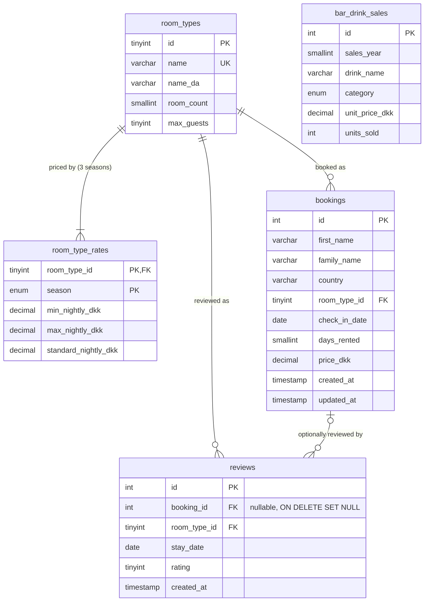

# Data Model: Hotel Kong Arthur Operations & Analytics Platform

**Feature**: `001-hotel-analytics-platform` | **Date**: 2026-10-28 | **Plan**: [plan.md](plan.md)

This document defines what is stored in MySQL (data layer), the domain models and rules in the
business layer, and the single authoritative definition of every KPI. The API representations are
in [contracts/openapi.yaml](contracts/openapi.yaml), and the decisions behind them are in
[research.md](research.md).

## 1. Overview

- **Reference data** (`room_types`, `room_type_rates`) is created by `docker compose up` through
  `db/init/` and does not change at runtime.
- **Operational data** (`bookings`, `reviews`, `bar_drink_sales`) starts empty. Bookings change
  through the API (F1). Reviews are added through the API or by `seed`. Bar sales come only from
  `seed`.
- Season and reporting year are **never stored**. The business layer derives them from
  `check_in_date` / `stay_date` (research R8).
- Every table uses InnoDB, `utf8mb4` and `utf8mb4_0900_ai_ci`. The connection charset is `utf8mb4`.

## 2. Reference data

### 2.1 `room_types`

| Column | Type | Constraints |
|--------|------|-------------|
| `id` | `TINYINT UNSIGNED` | PK. Also the canonical display order (T1 order, 1 to 8) |
| `name` | `VARCHAR(40)` | NOT NULL, UNIQUE. The English name used in the API and the CSV |
| `name_da` | `VARCHAR(60)` | NOT NULL. The Danish name from T1 |
| `room_count` | `SMALLINT UNSIGNED` | NOT NULL, `> 0`. All 8 add up to **214** |
| `max_guests` | `TINYINT UNSIGNED` | NOT NULL, `BETWEEN 1 AND 4`. Informational; no KPI uses it |

| id | name | name_da | room_count | max_guests |
|----|------|---------|-----------:|-----------:|
| 1 | Standard Single | Standard enkeltværelse | 27 | 1 |
| 2 | Grand Lit | Grand lit værelse | 27 | 2 |
| 3 | Standard Double | Standard dobbeltværelse | 27 | 2 |
| 4 | Superior Double | Superior dobbeltværelse | 27 | 2 |
| 5 | Junior Suite | Junior suite | 27 | 2 |
| 6 | Spa Executive | Spa executive | 27 | 2 |
| 7 | Suite | Suite | 26 | 2 |
| 8 | LOFT Suite | LOFT suite | 26 | 3 |
| | **Total** | | **214** | **427 guests** |

- The room counts follow Clarify (27 each for six room types, 26 each for the two suites).
- `max_guests` stays within T1's "1–4 persons per room". It gives a total of 427, close to T1's
  "omkring 428 gæster".
- Occupancy is measured in room-nights (Clarify), so guest capacity affects no KPI.

### 2.2 `room_type_rates` (seasonal pricing rule, research R9)

| Column | Type | Constraints |
|--------|------|-------------|
| `room_type_id` | `TINYINT UNSIGNED` | PK part, FK → `room_types.id` |
| `season` | `ENUM('low','mid','high')` | PK part |
| `min_nightly_dkk` | `DECIMAL(10,2)` | NOT NULL, `> 0` |
| `max_nightly_dkk` | `DECIMAL(10,2)` | NOT NULL, `>= min_nightly_dkk` |
| `standard_nightly_dkk` | `DECIMAL(10,2)` | NOT NULL, between min and max. The midpoint |

Bands in DKK per night, shown as min–max (standard):

| Room type | low | mid | high |
|-----------|-----|-----|------|
| Standard Single | 900–1200 (1050) | 1000–1300 (1150) | 1200–1500 (1350) |
| Grand Lit | 1100–1400 (1250) | 1200–1600 (1400) | 1400–1800 (1600) |
| Standard Double | 1200–1600 (1400) | 1300–1700 (1500) | 1600–2000 (1800) |
| Superior Double | 1400–1800 (1600) | 1500–2000 (1750) | 1800–2200 (2000) |
| Junior Suite | 1800–2200 (2000) | 2000–2400 (2200) | 2200–2500 (2350) |
| Spa Executive | 2000–2500 (2250) | 2200–2600 (2400) | 2500–2800 (2650) |
| Suite | 2500–3000 (2750) | 2700–3300 (3000) | 3000–3500 (3250) |
| LOFT Suite | 3000–3500 (3250) | 3200–3800 (3500) | 3500–4000 (3750) |

All 1,000 sample bookings have a nightly rate (`Price / Days Rented`) inside their band. A unit
test keeps this true.

## 3. Operational data

### 3.1 `bookings` (entity *Booking*, F1)

| Column | Type | Constraints |
|--------|------|-------------|
| `id` | `INT UNSIGNED AUTO_INCREMENT` | PK. Seeded rows use IDs 1 to 1000 (CSV row order) |
| `first_name` | `VARCHAR(100)` | NOT NULL |
| `family_name` | `VARCHAR(100)` | NOT NULL |
| `country` | `VARCHAR(100)` | NOT NULL. Stored as entered, after trimming |
| `room_type_id` | `TINYINT UNSIGNED` | NOT NULL, FK → `room_types.id` |
| `check_in_date` | `DATE` | NOT NULL. Index `ix_bookings_check_in_date` |
| `days_rented` | `SMALLINT UNSIGNED` | NOT NULL, `CHECK (days_rented BETWEEN 1 AND 365)` |
| `price_dkk` | `DECIMAL(10,2)` | NOT NULL, `CHECK (price_dkk > 0)`. Total price for the stay |
| `created_at` | `TIMESTAMP` | NOT NULL, default `CURRENT_TIMESTAMP` |
| `updated_at` | `TIMESTAMP` | NOT NULL, default `CURRENT_TIMESTAMP ON UPDATE CURRENT_TIMESTAMP` |

Derived in the business layer, never stored:

- `season`: from the month of `check_in_date` (§4.1).
- `year`: the year of `check_in_date`.

### 3.2 `reviews` (entity *GuestReview*, K3)

| Column | Type | Constraints |
|--------|------|-------------|
| `id` | `INT UNSIGNED AUTO_INCREMENT` | PK |
| `booking_id` | `INT UNSIGNED` | NULL, FK → `bookings.id` **ON DELETE SET NULL** |
| `room_type_id` | `TINYINT UNSIGNED` | NOT NULL, FK → `room_types.id` |
| `stay_date` | `DATE` | NOT NULL. Check-in date of the reviewed stay. Index `ix_reviews_stay_date` |
| `rating` | `TINYINT UNSIGNED` | NOT NULL, `CHECK (rating BETWEEN 1 AND 5)` |
| `created_at` | `TIMESTAMP` | NOT NULL, default `CURRENT_TIMESTAMP` |

- When a review refers to a booking, the business layer **copies** the booking's room type and
  check-in date at creation time.
- The review therefore survives if the booking is later deleted (`booking_id` becomes NULL) and
  still counts in K3.
- If the booking is later edited, the review keeps the stay it was written about.
- `season` and `year` are derived from `stay_date`.

### 3.3 `bar_drink_sales` (entity *BarDrinkSale*, B1–B3)

| Column | Type | Constraints |
|--------|------|-------------|
| `id` | `INT UNSIGNED AUTO_INCREMENT` | PK. Seeded rows use IDs 1 to 30 (CSV row order) |
| `sales_year` | `SMALLINT UNSIGNED` | NOT NULL. The reporting year of the sales (2026 for the sample) |
| `drink_name` | `VARCHAR(100)` | NOT NULL. `UNIQUE (sales_year, drink_name)` |
| `category` | `ENUM('Cocktail','Coffee')` | NOT NULL |
| `unit_price_dkk` | `DECIMAL(10,2)` | NOT NULL, `CHECK (unit_price_dkk > 0)` |
| `units_sold` | `INT UNSIGNED` | NOT NULL |

Derived in the business layer, never stored:

- `revenue_dkk`: unit price × units sold.
- `price_tier`: from the unit price (§4.4).
- `revenue_rank` and `units_rank`: rankings within the year.

## 4. Domain model (business layer)

These are plain Python dataclasses and enums in `business/domain/`. They import no HTTP or SQL
code.

| Model | Fields | Derived (properties / functions) |
|-------|--------|----------------------------------|
| `Season` (enum) | `low`, `mid`, `high` | |
| `DrinkCategory` (enum) | `Cocktail`, `Coffee` | |
| `PriceTier` (enum) | `budget`, `standard`, `premium` | |
| `SeasonRate` | `season`, `min_nightly_dkk`, `max_nightly_dkk`, `standard_nightly_dkk` | |
| `RoomType` | `id`, `name`, `name_da`, `room_count`, `max_guests`, `rates: dict[Season, SeasonRate]` | |
| `Booking` | `id`, `first_name`, `family_name`, `country`, `room_type` (name), `check_in_date`, `days_rented`, `price_dkk`, `created_at`, `updated_at` | `season`, `year` |
| `NewBooking` | the client-editable fields of `Booking`, with `price_dkk` optional | validated and priced into a `Booking` by `BookingService` |
| `GuestReview` | `id`, `booking_id` (optional), `room_type`, `stay_date`, `rating`, `created_at` | `season`, `year` |
| `BarDrinkSale` | `id`, `sales_year`, `drink_name`, `category`, `unit_price_dkk`, `units_sold` | `revenue_dkk`, `price_tier` |
| KPI value objects | `HotelSummary`, `RoomTypeKpi`, `SeasonKpi`, `RoomTypeSeasonKpi`, `CountryKpi`, `BarSummary`, `BarCategoryKpi`, `BarPriceTierKpi`, `RankedDrinkSale` | built by `business/kpis/*` (§7) |

### 4.1 Season mapping (`business/rules/seasons.py`)

| Season | Months | Days in 2026 | Available room-nights in 2026 (214 rooms) |
|--------|--------|-------------:|------------------------------------------:|
| `low` | Jan, Feb, Nov | 89 | 19,046 |
| `mid` | Mar, Apr, May, Sep, Oct | 153 | 32,742 |
| `high` | Jun, Jul, Aug, Dec | 123 | 26,322 |
| **year** | | **365** | **78,110** |

- Day counts come from the calendar of the reporting year, so a leap year gives `low` 90 days and
  366 in total (research R8).
- A booking belongs entirely to the season and year of its `check_in_date`.

### 4.2 Standard price (`business/rules/pricing.py`)

- Omitted price: `price_dkk = standard_nightly_dkk(room_type, season(check_in_date)) × days_rented`.
- Manual price: accepted only when `min_nightly_dkk ≤ price_dkk / days_rented ≤ max_nightly_dkk`.
- Fixed price per night (FR-019): `price_dkk = price_per_night_dkk × days_rented`, accepted only when
  `min_nightly_dkk ≤ price_per_night_dkk ≤ max_nightly_dkk`. It is the same verdict as for the
  matching total, and it is exclusive with a manual `price_dkk`. Only the total is stored.

### 4.3 Ranking (`business/rules/ranking.py`)

- Competition ranking ("1224"): equal values share a rank, and the next rank skips.
- Rows with equal values are ordered by name.

### 4.4 Price tiers (`business/rules/price_tiers.py`, FR-016)

| Tier | Unit price (DKK) | Sample drinks (2026) |
|------|------------------|----------------------|
| `budget` | `< 70` | 10 (all coffees) |
| `standard` | `70 ≤ price < 110` | 10 cocktails |
| `premium` | `≥ 110` | 10 cocktails |

### 4.5 Number rules (`business/rules/numbers.py`, research R10)

- Money stays as exact `Decimal`.
- Averages and rates are rounded half-up to 2 decimals.
- Shares within one breakdown use largest-remainder rounding to 2 decimals, so they add up to
  exactly 100.00.
- When a denominator is 0, the result is 0.

## 5. Validation rules (business layer)

The presentation DTOs check only the JSON shape and types. A malformed body gives `400`; a
missing field or wrong type gives `422`. All rules below run in the business layer and give `422`
with one `{field, message}` per broken rule, so every client gets the same rules (FR-002, FR-003).

### 5.1 Booking (create `POST`, replace `PUT`)

| Field | Rule | Example message |
|-------|------|-----------------|
| `first_name`, `family_name`, `country` | required; trimmed; 1 to 100 characters | "First name must not be empty." |
| `room_type` | one of the 8 names in `room_types` | "Room type must be one of: Standard Single, …, LOFT Suite." |
| `check_in_date` | ISO `YYYY-MM-DD`; a real date; year 2000 to 2100 | "Check-in date must be a valid date (YYYY-MM-DD) between 2000-01-01 and 2100-12-31." |
| `days_rented` | whole number, 1 to 365 | "Days rented must be a whole number from 1 to 365." |
| `price_dkk` | optional; when given: > 0, at most 2 decimals, nightly rate inside the band | "4,500.00 DKK for 3 nights is 1,500.00 DKK per night, outside 900.00–1,200.00 DKK per night for Standard Single in low season." |
| `price_per_night_dkk` | optional, exclusive with `price_dkk`; when given: > 0, at most 2 decimals, inside the band; the total is this × `days_rented` | "1,500.00 DKK per night is outside 900.00–1,200.00 DKK per night for Standard Single in low season." and, when both prices are given, "Give either the total price or the price per night, not both." (on `price_per_night_dkk`) |

- On `PUT`, `price_dkk` and `price_per_night_dkk` both omitted or `null` recalculates the standard
  price for the new values.
- Satisfaction is not part of a booking (FR-003, FR-011).

### 5.2 Review (create `POST`)

| Field | Rule |
|-------|------|
| `rating` | required whole number, 1 to 5 |
| `booking_id` | optional; when given, the booking must exist (otherwise `422`, field `booking_id`), and `room_type`/`stay_date` must be omitted (they are copied from the booking) |
| `room_type`, `stay_date` | required together when `booking_id` is omitted; same rules as the booking's `room_type` and `check_in_date` |

### 5.3 Query and path parameters

- `year` is a whole number from 2000 to 2100.
- `season`, `room_type` and `category` must be values from their enumerations.
- IDs are whole numbers ≥ 1.
- Any violation gives `400`.

## 6. Lifecycles

| Entity | Lifecycle |
|--------|-----------|
| Booking | *(none)* → **created** (`POST`, or `seed`) → **updated** (`PUT`, any number of times) → **deleted** (`DELETE`; hard delete, linked reviews keep their snapshot with `booking_id = NULL`) |
| GuestReview | **created** (`POST`, or `seed`). Immutable afterwards; no update or delete endpoint |
| BarDrinkSale | **seeded** (`seed`). Read-only through the API |
| Operational data as a whole | `docker compose up` on an empty volume gives **empty** (0 bookings, 0 reviews, 0 drink sales). `seed` (any state) gives **sample state** (1,000 / 500 / 30). `docker compose down -v` deletes everything; the next `up` gives empty again |

## 7. KPI catalog: the single authoritative definitions (Principle VII)

Scope: all rows are filtered to one reporting **year**, using the booking's `check_in_date`, the
review's `stay_date` and the drink sale's `sales_year`. Segment rows apply the segment's filter
(room type, season, room type and season, country, category, tier) on top.

All-time (FR-021): with `year=all`, or no `year`, there is no year filter and every row reports
`year` `"all"`. Available room-nights (and `season_days`) then cover every calendar year from the
first to the last booking, a year without bookings in between included; without bookings there
is no period, so they are 0 and the occupancy rate is 0.00. A drink on the menu in several years
counts once in `drink_count`.

| KPI | Scope ID | Definition | When empty | Code (only place) | Exposed as |
|-----|----------|------------|------------|-------------------|------------|
| Room revenue (indtjening) | K2, A6, A2, A3 | Σ `price_dkk` | 0.00 | `business/kpis/hotel.py` | `total_revenue_dkk` (summary), `revenue_dkk` (by-* tables) |
| Booking count, nights sold | A1, A2, FR-008, FR-009 | count of bookings; Σ `days_rented` | 0 | `business/kpis/hotel.py` | `booking_count`, `nights_sold` |
| Guest origin share | A1 | country bookings ÷ all bookings × 100 (largest remainder) | 0.00 | `business/kpis/hotel.py` | `kpis/hotel/by-country.booking_share_pct` |
| Revenue share | A4, A5 | segment revenue ÷ total revenue × 100 (largest remainder) | 0.00 | `business/kpis/hotel.py` | `revenue_share_pct` |
| Revenue rank | A4, A5 | competition rank by `revenue_dkk`, descending | n/a | `business/rules/ranking.py` | `revenue_rank` (by-room-type, by-country) |
| Available room-nights | K1 | `room_count` × days in the segment's period (§4.1). Overall: 214 × days in the year | n/a | `business/rules/seasons.py` | `available_room_nights` |
| Occupancy rate (belægningsgrad) | K1 | `nights_sold` ÷ `available_room_nights` × 100 | 0.00 | `business/kpis/hotel.py` | `occupancy_rate_pct` |
| Average satisfaction (kundetilfredshed) | K3 | mean `rating` of the reviews in scope | 0.00 | `business/kpis/hotel.py` | `average_satisfaction` |
| Satisfied share | K3 | reviews with `rating ≥ 4` ÷ reviews × 100 | 0.00 | `business/kpis/hotel.py` | `satisfied_share_pct` |
| Average length of stay (ALOS) | A7 | Σ `days_rented` ÷ booking count | 0.00 | `business/kpis/hotel.py` | `average_length_of_stay_nights` |
| Average daily rate (ADR) | A7 | Σ `price_dkk` ÷ Σ `days_rented` | 0.00 | `business/kpis/hotel.py` | `average_daily_rate_dkk` |
| Average revenue per booking | A7 | Σ `price_dkk` ÷ booking count | 0.00 | `business/kpis/hotel.py` | `average_revenue_per_booking_dkk` |
| Revenue per drink | B2 | `unit_price_dkk` × `units_sold` | n/a | `business/kpis/bar.py` | `bar/drink-sales.revenue_dkk` |
| Drink ranks | B2, FR-016 | competition rank by `revenue_dkk` and by `units_sold`, descending | n/a | `business/rules/ranking.py` | `revenue_rank`, `units_rank` |
| Bar sales for the year | B1 | Σ revenue per drink; Σ `units_sold`; count of drinks | 0.00 / 0 | `business/kpis/bar.py` | `kpis/bar/summary` |
| Cocktail vs coffee split | B3 | category revenue ÷ total × 100 and category units ÷ total × 100 (largest remainder) | 0.00 | `business/kpis/bar.py` | `kpis/bar/by-category` |
| Price-tier demand | A7 (US4), FR-016 | units and revenue per tier (§4.4), with shares (largest remainder) | 0.00 | `business/kpis/bar.py` | `kpis/bar/by-price-tier` |
| Season of a stay | rule | month mapping (§4.1) | n/a | `business/rules/seasons.py` | `season` on bookings, reviews and KPI rows |
| Standard price | rule | §4.2 | n/a | `business/rules/pricing.py` | `price_dkk` when the client omits it |

**Per-segment satisfaction**: by room type, the review's room type is used. By season, the season
of the review's `stay_date` is used. The summary uses all reviews in the year.

## 8. Sample data mapping (`seed`, research R13)

| CSV (T3) | Target | Transformation |
|----------|--------|----------------|
| `international_names_with_rooms_1000.csv`, row *n* (1-based) | `bookings.id = n` | |
| `First Name`, `Family Name`, `Country` | `first_name`, `family_name`, `country` | trimmed. Family name `M�ller` becomes `Müller`; any other U+FFFD stops the seed with an error |
| `Room Type` | `room_type_id` | looked up by `room_types.name` |
| `Season` | `check_in_date` | the *k*-th row of that season (0-based) gets the *k mod N*-th date of that season's 2026 dates (`N` = 89 / 153 / 123). The derived season equals the CSV season (unit test) |
| `Days Rented` | `days_rented` | integer |
| `Price` | `price_dkk` | `Decimal`; validated against the band (all rows pass) |
| (synthetic) | `reviews` | one review for each odd booking ID (500 reviews). `booking_id`, `room_type_id` and `stay_date` are copied from the booking. `rating` comes from `random.Random(2026)` with weights 1: 5%, 2: 10%, 3: 20%, 4: 35%, 5: 30% |
| `drinks_menu_with_sales.csv`, row *n* (UTF-8 BOM, `;`) | `bar_drink_sales.id = n`, `sales_year = 2026` | `Price (DKK)`: decimal comma becomes a decimal point, then `Decimal`. `Units Sold` is an integer |

**Reset semantics**: one transaction deletes all `reviews`, `bookings` and `bar_drink_sales` rows
and then inserts the sample set. Running it again gives the same rows, IDs and totals.
