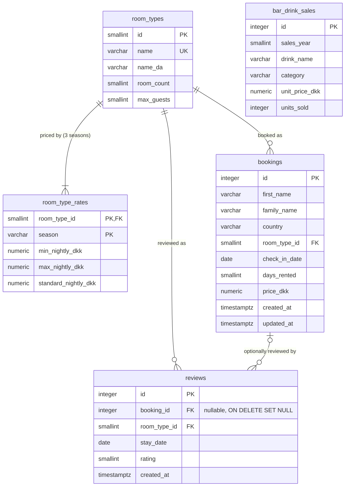

# Data Model: Hotel Kong Arthur Operations & Analytics Platform

**Feature**: `001-hotel-analytics-platform` | **Date**: 2026-10-28 (Updated 2026-11-02 for Week 2 Demands) | **Plan**: [plan.md](plan.md)

This document defines what is stored in **PostgreSQL 17** (data layer), the domain models and rules in the
business layer, the query filter rules for **`Hotel Analytics`**, and the single authoritative definition
of every KPI in `business/kpis/`. The API representations are in [contracts/openapi.yaml](contracts/openapi.yaml),
and the decisions behind them are in [research.md](research.md).

## 1. Overview

- **Reference data** (`room_types`, `room_type_rates`) is created by `docker compose up` through
  `db/init/` and does not change at runtime.
- **Operational data** (`bookings`, `reviews`, `bar_drink_sales`) starts empty. Bookings change
  through the API (`F1`). Reviews are added through the API or by `seed`. Bar sales come only from
  `seed`.
- Season and reporting year are **never stored** on bookings or reviews. The business layer derives
  them from `check_in_date` / `stay_date` (research R8).
- PostgreSQL database uses `UTF8` encoding throughout.

## 2. Reference data (PostgreSQL)

### 2.1 `room_types`

| Column | PostgreSQL Type | Constraints |
|--------|-----------------|-------------|
| `id` | `SMALLINT` | PK, `CHECK (id BETWEEN 1 AND 8)`. Canonical display order (T1 order, 1 to 8) |
| `name` | `VARCHAR(40)` | `NOT NULL UNIQUE`. The English name used in the API and the CSV |
| `name_da` | `VARCHAR(60)` | `NOT NULL`. The Danish name from T1 |
| `room_count` | `SMALLINT` | `NOT NULL CHECK (room_count > 0)`. All 8 add up to **214** |
| `max_guests` | `SMALLINT` | `NOT NULL CHECK (max_guests BETWEEN 1 AND 4)`. Informational |

| id | name | name_da | room_count | max_guests |
|----|------|---------|-----------:|-----------:|
| 1 | Standard Single | Standard enkeltværelse | 27 | 1 |
| 2 | Grand Lit | Grand lit værelse | 27 | 2 |
| 3 | Standard Double | Standard dobbeltværelse | 27 | 2 |
| 4 | Superior Double | Superior dobbeltværelse | 27 | 2 |
| 5 | Junior Suite | Junior suite | 27 | 2 |
| 6 | Spa Executive | Spa executive | 27 | 2 |
| 7 | Suite | Suite | 26 | 2 |
| 8 | LOFT Suite | LOFT suite | 26 | 3 |
| | **Total** | | **214** | **427 guests** |

### 2.2 `room_type_rates` (seasonal pricing rule, research R9)

| Column | PostgreSQL Type | Constraints |
|--------|-----------------|-------------|
| `room_type_id` | `SMALLINT` | PK part, FK → `room_types(id)` |
| `season` | `VARCHAR(10)` | PK part, `CHECK (season IN ('low', 'mid', 'high'))` |
| `min_nightly_dkk` | `NUMERIC(10,2)` | `NOT NULL CHECK (min_nightly_dkk > 0)` |
| `max_nightly_dkk` | `NUMERIC(10,2)` | `NOT NULL CHECK (max_nightly_dkk >= min_nightly_dkk)` |
| `standard_nightly_dkk` | `NUMERIC(10,2)` | `NOT NULL CHECK (standard_nightly_dkk BETWEEN min_nightly_dkk AND max_nightly_dkk)`. The midpoint |

Bands in DKK per night, shown as min–max (standard):

| Room type | low | mid | high |
|-----------|-----|-----|------|
| Standard Single | 900–1200 (1050) | 1000–1300 (1150) | 1200–1500 (1350) |
| Grand Lit | 1100–1400 (1250) | 1200–1600 (1400) | 1400–1800 (1600) |
| Standard Double | 1200–1600 (1400) | 1300–1700 (1500) | 1600–2000 (1800) |
| Superior Double | 1400–1800 (1600) | 1500–2000 (1750) | 1800–2200 (2000) |
| Junior Suite | 1800–2200 (2000) | 2000–2400 (2200) | 2200–2500 (2350) |
| Spa Executive | 2000–2500 (2250) | 2200–2600 (2400) | 2500–2800 (2650) |
| Suite | 2500–3000 (2750) | 2700–3300 (3000) | 3000–3500 (3250) |
| LOFT Suite | 3000–3500 (3250) | 3200–3800 (3500) | 3500–4000 (3750) |

## 3. Operational data (PostgreSQL)

### 3.1 `bookings` (entity *Booking*, F1)

| Column | PostgreSQL Type | Constraints |
|--------|-----------------|-------------|
| `id` | `INTEGER GENERATED BY DEFAULT AS IDENTITY` | PK. Seeded rows use explicit IDs 1 to 1000 (sequence synchronised after seed) |
| `first_name` | `VARCHAR(100)` | `NOT NULL` |
| `family_name` | `VARCHAR(100)` | `NOT NULL` |
| `country` | `VARCHAR(100)` | `NOT NULL`. Stored as entered, after trimming |
| `room_type_id` | `SMALLINT` | `NOT NULL`, FK → `room_types(id)` |
| `check_in_date` | `DATE` | `NOT NULL`. Index `ix_bookings_check_in_date` |
| `days_rented` | `SMALLINT` | `NOT NULL CHECK (days_rented BETWEEN 1 AND 365)` |
| `price_dkk` | `NUMERIC(10,2)` | `NOT NULL CHECK (price_dkk > 0)`. Total price for the stay |
| `created_at` | `TIMESTAMPTZ` | `NOT NULL DEFAULT CURRENT_TIMESTAMP` |
| `updated_at` | `TIMESTAMPTZ` | `NOT NULL DEFAULT CURRENT_TIMESTAMP` (updated to `CURRENT_TIMESTAMP` on `UPDATE`) |

### 3.2 `reviews` (entity *GuestReview*, K3)

| Column | PostgreSQL Type | Constraints |
|--------|-----------------|-------------|
| `id` | `INTEGER GENERATED BY DEFAULT AS IDENTITY` | PK (sequence synchronised after seed) |
| `booking_id` | `INTEGER` | `NULL`, FK → `bookings(id)` **ON DELETE SET NULL** |
| `room_type_id` | `SMALLINT` | `NOT NULL`, FK → `room_types(id)` |
| `stay_date` | `DATE` | `NOT NULL`. Check-in date of the reviewed stay. Index `ix_reviews_stay_date` |
| `rating` | `SMALLINT` | `NOT NULL CHECK (rating BETWEEN 1 AND 5)` |
| `created_at` | `TIMESTAMPTZ` | `NOT NULL DEFAULT CURRENT_TIMESTAMP` |

### 3.3 `bar_drink_sales` (entity *BarDrinkSale*, B1–B3)

| Column | PostgreSQL Type | Constraints |
|--------|-----------------|-------------|
| `id` | `INTEGER GENERATED BY DEFAULT AS IDENTITY` | PK. Seeded rows use explicit IDs 1 to 30 (sequence synchronised after seed) |
| `sales_year` | `SMALLINT` | `NOT NULL CHECK (sales_year BETWEEN 2000 AND 2100)`. Reporting year (2026 for sample) |
| `drink_name` | `VARCHAR(100)` | `NOT NULL`, `UNIQUE (sales_year, drink_name)` |
| `category` | `VARCHAR(20)` | `NOT NULL CHECK (category IN ('Cocktail', 'Coffee'))` |
| `unit_price_dkk` | `NUMERIC(10,2)` | `NOT NULL CHECK (unit_price_dkk > 0)` |
| `units_sold` | `INTEGER` | `NOT NULL CHECK (units_sold >= 0)` |

- `GET /api/v1/bar/drink-sales` (under tag `Bar`) returns the raw fields (`id`, `year`, `drink_name`, `category`, `unit_price_dkk`, `units_sold`) with no query parameters for Tableau compatibility.
- `GET /api/v1/kpis/bar/by-drink` (under tag `Hotel Analytics`) returns the enriched analytical rows (`id`, `year`, `drink_name`, `category`, `unit_price_dkk`, `units_sold`, `revenue_dkk`, `revenue_rank`, `units_rank`, `price_tier`) with optional `year`, `category`, and `price_tier` filter parameters.

## 4. Domain model (business layer)

Plain Python dataclasses and enums in `business/domain/models.py` (no HTTP or SQL imports):

| Model | Fields | Derived / Purpose |
|-------|--------|-------------------|
| `Season` (enum) | `low`, `mid`, `high` | |
| `DrinkCategory` (enum) | `Cocktail`, `Coffee` | |
| `PriceTier` (enum) | `budget`, `standard`, `premium` | `budget` < 70 DKK ≤ `standard` < 110 DKK ≤ `premium` |
| `ReportYear` (type alias) | `int \| Literal["all"]` | Calendar year `2000`–`2100` or `"all"` (FR-021) |
| `SeasonRate` | `season`, `min_nightly_dkk`, `max_nightly_dkk`, `standard_nightly_dkk` | |
| `RoomType` | `id`, `name`, `name_da`, `room_count`, `max_guests`, `rates: dict[Season, SeasonRate]` | |
| `Booking` | `id`, `first_name`, `family_name`, `country`, `room_type` (name), `check_in_date`, `days_rented`, `price_dkk`, `created_at`, `updated_at` | `season`, `year` |
| `NewBooking` | client-editable fields of `Booking`, with `price_dkk` resolved | validated and priced into a `Booking` by `BookingService` |
| `GuestReview` | `id`, `booking_id` (optional), `room_type`, `stay_date`, `rating`, `created_at` | `season`, `year` |
| `NewReview` | `booking_id` (optional), `room_type`, `stay_date`, `rating` | validated by `ReviewService` |
| `BarDrinkSale` | `id`, `sales_year`, `drink_name`, `category`, `unit_price_dkk`, `units_sold` | `revenue_dkk` (`unit_price_dkk × units_sold`), `price_tier` |
| `HotelSummary` | `year`, `booking_count`, `nights_sold`, `total_revenue_dkk`, `available_room_nights`, `occupancy_rate_pct`, `review_count`, `average_satisfaction`, `satisfied_share_pct`, `average_length_of_stay_nights`, `average_daily_rate_dkk`, `average_revenue_per_booking_dkk` | `GET /api/v1/kpis/hotel/summary` |
| `RoomTypeKpi` | `year`, `revenue_rank`, `room_type`, `room_count`, `booking_count`, `nights_sold`, `revenue_dkk`, `revenue_share_pct`, `available_room_nights`, `occupancy_rate_pct`, `review_count`, `average_satisfaction`, `satisfied_share_pct`, `average_length_of_stay_nights`, `average_daily_rate_dkk`, `average_revenue_per_booking_dkk` | `GET /api/v1/kpis/hotel/by-room-type` |
| `SeasonKpi` | `year`, `season`, `season_days`, `booking_count`, `nights_sold`, `revenue_dkk`, `revenue_share_pct`, `available_room_nights`, `occupancy_rate_pct`, `review_count`, `average_satisfaction`, `satisfied_share_pct`, `average_length_of_stay_nights`, `average_daily_rate_dkk`, `average_revenue_per_booking_dkk` | `GET /api/v1/kpis/hotel/by-season` |
| `RoomTypeSeasonKpi` | `year`, `room_type`, `season`, `room_count`, `season_days`, `booking_count`, `nights_sold`, `revenue_dkk`, `available_room_nights`, `occupancy_rate_pct`, `average_length_of_stay_nights`, `average_daily_rate_dkk`, `average_revenue_per_booking_dkk` | `GET /api/v1/kpis/hotel/by-room-type-and-season` |
| `CountryKpi` | `year`, `revenue_rank`, `country`, `booking_count`, `booking_share_pct`, `nights_sold`, `revenue_dkk`, `revenue_share_pct` | `GET /api/v1/kpis/hotel/by-country` |
| `BarSummary` | `year`, `drink_count`, `units_sold`, `total_revenue_dkk` | `GET /api/v1/kpis/bar/summary` |
| `RankedDrinkSale` | `id`, `year`, `drink_name`, `category`, `unit_price_dkk`, `units_sold`, `revenue_dkk`, `revenue_rank`, `units_rank`, `price_tier` | `GET /api/v1/kpis/bar/by-drink` |
| `BarCategoryKpi` | `year`, `category`, `drink_count`, `units_sold`, `unit_share_pct`, `revenue_dkk`, `revenue_share_pct` | `GET /api/v1/kpis/bar/by-category` |
| `BarPriceTierKpi` | `year`, `price_tier`, `price_from_dkk`, `price_to_dkk`, `drink_count`, `units_sold`, `unit_share_pct`, `revenue_dkk`, `revenue_share_pct` | `GET /api/v1/kpis/bar/by-price-tier` |

### 4.1 Season mapping (`business/rules/seasons.py`)

| Season | Months | Days in 2026 | Available room-nights in 2026 (214 rooms) |
|--------|--------|-------------:|------------------------------------------:|
| `low` | Jan, Feb, Nov | 89 (90 in leap yr) | 19,046 |
| `mid` | Mar, Apr, May, Sep, Oct | 153 | 32,742 |
| `high` | Jun, Jul, Aug, Dec | 123 | 26,322 |
| **year** | | **365** | **78,110** |

### 4.2 Standard price (`business/rules/pricing.py`)

- Omitted price: `price_dkk = standard_nightly_dkk(room_type, season(check_in_date)) × days_rented`.
- Manual price (`price_dkk` or `price_per_night_dkk`, mutually exclusive per FR-019): nightly rate must lie within `[min_nightly_dkk, max_nightly_dkk]`.

### 4.3 Number rules & ranking (`business/rules/numbers.py`, `business/rules/ranking.py`, `business/rules/price_tiers.py`)

- Money and rates use `Decimal` rounded half-up to 2 decimals (`round_half_up`).
- `safe_ratio(numerator, denominator, scale=1)` returns `Decimal("0.00")` when `denominator == 0`.
- `largest_remainder_shares(values)` rounds percentage shares to 2 decimals so that non-zero totals sum to `100.00`.
- `competition_ranks(items, key, tie_key)` assigns `"1224"` competition ranks (`1` = highest), ordering ties alphabetically by `tie_key`.
- `classify_price_tier(unit_price_dkk)`: `budget` (`< 70.00`), `standard` (`70.00 <= p < 110.00`), `premium` (`>= 110.00`).

## 5. Validation & Filter Rules

### 5.1 Booking (`POST`, `PUT`) & Review (`POST`)

Unchanged from §5.1–§5.2 of Week 1 (returns `422` Problem Details with `{field, message}` on rule violations).

### 5.2 Path & Query Parameters (`400 Bad Request` on violation)

- **Raw collection `GET` endpoints** (`GET /api/v1/room-types`, `GET /api/v1/bookings`, `GET /api/v1/reviews`, `GET /api/v1/bar/drink-sales`): take **no query parameters**.
- **`Hotel Analytics` `GET` endpoints (`/api/v1/kpis/hotel/*` and `/api/v1/kpis/bar/*`)** take optional filter query parameters (`FR-021`):
  - `year` (`ReportYear`): integer `2000`–`2100` or `'all'`. Omitting `year` defaults to `'all'`. Any other value returns `400` on `field: "year"`.
  - `season` (`SeasonFilter`, hotel KPI endpoints): `'low'`, `'mid'`, or `'high'`. Any other value returns `400` on `field: "season"`.
  - `room_type` (`RoomTypeFilter`, hotel KPI endpoints): one of the 8 room type names. Any other value returns `400` on `field: "room_type"`.
  - `country` (`CountryFilter`, hotel KPI endpoints): trimmed string of 1 to 100 characters. Empty/whitespace-only or >100 chars returns `400` on `field: "country"`.
  - `category` (`CategoryFilter`, bar KPI endpoints): `'Cocktail'` or `'Coffee'`. Any other value returns `400` on `field: "category"`.
  - `price_tier` (`PriceTierFilter`, bar KPI endpoints): `'budget'`, `'standard'`, or `'premium'`. Any other value returns `400` on `field: "price_tier"`.
- **How filters affect breakdown rows and denominators**:
  - When no dimensional filter (`season`, `room_type`, `country`, `category`, `price_tier`) is passed, all breakdown endpoints return their full canonical sets (`by-room-type`: 8 rows; `by-season`: 3 rows; `by-room-type-and-season`: 24 rows; `by-country`: all countries with bookings in scope; `by-drink`: all drinks in scope; `by-category`: 2 rows `Cocktail`, `Coffee`; `by-price-tier`: 3 rows `budget`, `standard`, `premium`).
  - When a dimensional filter is supplied:
    - Input records (`bookings`, `reviews`, `bar_drink_sales`) are filtered to matching records before aggregation.
    - On `summary` (`HotelSummary`), `available_room_nights` scales to the filtered `room_type` (its `room_count`, or `214` if unfiltered) multiplied by the filtered `season` days (`season_days`, or full year days if unfiltered).
    - On `by-room-type`, if `room_type` is passed, only that room type's row is returned (or 8 rows when `room_type` is omitted, with `available_room_nights` scaled to `season` if `season` is passed).
    - On `by-season`, if `season` is passed, only that season's row is returned (with `available_room_nights` scaled to `room_type` if `room_type` is passed).
    - On `by-room-type-and-season`, rows are filtered to the requested `room_type` and/or `season` (1, 3, 8, or 24 rows).
    - On `by-country`, rows are computed over bookings matching `year`, `season`, `room_type`, and `country`.
    - On `by-drink`, `by-category`, and `by-price-tier`, drinks are filtered by `year`, `category`, and `price_tier` (and `by-category` / `by-price-tier` filter their returned rows when `category` or `price_tier` is explicitly specified).

## 6. Lifecycles

| Entity | Lifecycle |
|--------|-----------|
| Booking | *(none)* → **created** (`POST`, or `seed`) → **updated** (`PUT`, any number of times) → **deleted** (`DELETE`; hard delete, linked reviews keep their snapshot with `booking_id = NULL`) |
| GuestReview | **created** (`POST`, or `seed`). Immutable afterwards |
| BarDrinkSale | **seeded** (`seed`). Read-only through the API |
| Operational data as a whole | `docker compose up` on an empty volume gives **empty** (0 bookings, 0 reviews, 0 drink sales). `seed` (any state) gives **sample state** (1,000 / 500 / 30). `docker compose down -v` deletes `postgres-data`; the next `up` gives empty again |

## 7. Authoritative KPI Catalog in the Business Layer (Principle VII)

All KPIs (`A1`–`A7`, `B1`–`B3`, `K1`–`K3`) are computed in `business/kpis/hotel.py` and `business/kpis/bar.py` and served under the **`Hotel Analytics`** tag:

| KPI / Rule | Scope ID | Formula / Definition | `"Hotel Analytics"` Endpoint(s) |
|------------|----------|----------------------|---------------------------------|
| Room revenue (indtjening) | K2, A6, A2, A3 | Σ `price_dkk` (overall, by `room_type`, by `season`, by `room_type` × `season`, or by `country`) | `GET /api/v1/kpis/hotel/{summary,by-room-type,by-season,by-room-type-and-season,by-country}` |
| Booking count, nights sold | A1, A2, FR-008, FR-009 | count of bookings; Σ `days_rented` | All 5 `/api/v1/kpis/hotel/*` endpoints |
| Guest origin share | A1 | country bookings ÷ total bookings in scope × 100 (`largest_remainder_shares`) | `GET /api/v1/kpis/hotel/by-country` |
| Revenue share & competition rank | A4, A5 | segment revenue ÷ total revenue in scope × 100; `"1224"` rank by `revenue_dkk` descending | `GET /api/v1/kpis/hotel/{by-room-type,by-country}` |
| Available room-nights | K1 | `rooms_in_scope × days_in_scope` (§4.1: 89 `low`, 153 `mid`, 123 `high`, 365 full year in 2026; 214 rooms → 78,110 room-nights) | `GET /api/v1/kpis/hotel/{summary,by-room-type,by-season,by-room-type-and-season}` |
| Occupancy rate (belægningsgrad) | K1 | `nights_sold ÷ available_room_nights × 100` (`0.00` when denominator is 0) | `GET /api/v1/kpis/hotel/{summary,by-room-type,by-season,by-room-type-and-season}` |
| Average satisfaction & satisfied share (kundetilfredshed) | K3 | mean `rating` of reviews; reviews with `rating ≥ 4` ÷ reviews × 100 | `GET /api/v1/kpis/hotel/{summary,by-room-type,by-season}` |
| Average length of stay (ALOS) | A7 | Σ `days_rented` ÷ booking count | `GET /api/v1/kpis/hotel/{summary,by-room-type,by-season,by-room-type-and-season}` |
| Average daily rate (ADR) | A7 | Σ `price_dkk` ÷ Σ `days_rented` | `GET /api/v1/kpis/hotel/{summary,by-room-type,by-season,by-room-type-and-season}` |
| Average revenue per booking | A7 | Σ `price_dkk` ÷ booking count | `GET /api/v1/kpis/hotel/{summary,by-room-type,by-season,by-room-type-and-season}` |
| Revenue per drink & drink ranks | B2, FR-016 | `unit_price_dkk × units_sold`; competition rank by revenue and by `units_sold` descending | `GET /api/v1/kpis/bar/by-drink` |
| Bar sales for the year | B1 | Σ (`unit_price_dkk × units_sold`); Σ `units_sold`; count of drinks | `GET /api/v1/kpis/bar/summary` |
| Cocktail vs coffee split | B3 | category revenue ÷ total × 100 and category units ÷ total × 100 | `GET /api/v1/kpis/bar/by-category` |
| Price-tier demand | A7 (US4), FR-016 | units, revenue, and shares per tier (`budget` `< 70` DKK, `standard` `70 ≤ price < 110` DKK, `premium` `≥ 110` DKK) | `GET /api/v1/kpis/bar/by-price-tier` |

## 8. Sample data mapping (`seed`, research R13)

| CSV (T3) | Target in PostgreSQL | Transformation |
|----------|----------------------|----------------|
| `international_names_with_rooms_1000.csv`, row *n* (1-based) | `bookings.id = n` | Identity sequence synchronised via `setval(pg_get_serial_sequence('bookings', 'id'), ...)` |
| `First Name`, `Family Name`, `Country` | `first_name`, `family_name`, `country` | trimmed. Family name `Mller` becomes `Müller`; any other U+FFFD stops the seed with an error |
| `Room Type` | `room_type_id` | looked up by `room_types.name` |
| `Season` | `check_in_date` | the *k*-th row of that season (0-based) gets the *k mod N*-th date of that season's 2026 dates (`N` = 89 / 153 / 123) |
| `Days Rented` | `days_rented` | integer |
| `Price` | `price_dkk` | `Decimal`; validated against the band (all rows pass) |
| (synthetic) | `reviews` | one review for each odd booking ID (500 reviews). `rating` from `random.Random(2026)` with weights 1: 5%, 2: 10%, 3: 20%, 4: 35%, 5: 30%. Sequence synchronised |
| `drinks_menu_with_sales.csv`, row *n* (UTF-8 BOM, `;`) | `bar_drink_sales.id = n`, `sales_year = 2026` | `Price (DKK)`: decimal comma becomes decimal point, then `Decimal`. `Units Sold` is an integer. Sequence synchronised |
