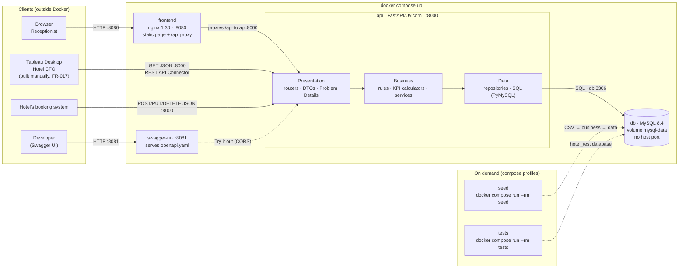

# Implementation Plan: Hotel Kong Arthur Operations & Analytics Platform

**Branch**: `001-hotel-analytics-platform` (work is committed to `main`, per the constitution's commit flow) | **Date**: 2026-10-28 | **Spec**: [spec.md](spec.md)

**Input**: Feature specification from `/specs/001-hotel-analytics-platform/spec.md`

**Phase outputs**:

- [research.md](research.md): Phase 0 decisions R1–R17 and the decision log.
- [data-model.md](data-model.md): tables, domain model, validation and the KPI catalog.
- [contracts/openapi.yaml](contracts/openapi.yaml): the authoritative API contract.
- [quickstart.md](quickstart.md): validation guide with golden values.

## Summary

The platform replaces Hotel Kong Arthur's static CSV extracts with live operational data in MySQL.

- **Receptionist**: creates, edits and deletes bookings in a browser page (F1).
- **Hotel's booking system**: writes to the same REST API.
- **Hotel CFO**: gets every mandatory KPI (A1–A7, B1–B3, K1–K3) from that API, through a Tableau
  dashboard the team builds by hand (FR-017).

Technical approach:

- **Backend**: Python 3.13, FastAPI, three packages
  (`presentation` → `business` → `data`) wired by a composition root. PyMySQL with hand-written
  SQL against MySQL 8.4.
- **KPIs**: each KPI and business rule (season mapping, pricing bands, validation, occupancy,
  revenue, satisfaction, ALOS/ADR, shares, ranks, price tiers) is one pure function in the
  business layer. KPIs are computed on every request from one reporting year of data.
- **Contract**: design-first OpenAPI 3.0.3, served by a Swagger UI container and enforced by
  contract tests that validate real responses with openapi-core.
- **Containers**: `docker compose up` starts MySQL (schema and reference data created on first
  start), the API, an nginx-served static frontend that proxies `/api`, and Swagger UI.
- **Sample data**: the T3 dataset (1,000 bookings, 500 synthetic reviews, 30 drink sales) is
  loaded on demand by an idempotent `seed` command, as decided in Clarify.

## Technical Context

**Language/Version**: Python 3.13 (backend, image `python:3.13-slim`); SQL for MySQL 8.4; HTML5 +
vanilla JavaScript (ES2022 modules) + CSS for the frontend, with no build step.

**Primary Dependencies**:

- API: FastAPI 0.16x, Uvicorn 0.5x, Pydantic 2.14, PyMySQL 1.2 with `rsa` extra (installs
  `cryptography`).
- Tests: pytest 9, httpx 0.28 (FastAPI `TestClient`), openapi-core 0.23, openapi-spec-validator
  0.9.
- Containers: `mysql:8.4`, `nginx:1.30-alpine`, `swaggerapi/swagger-ui:v5.33.3`.
- Exact versions are pinned in `backend/pyproject.toml` during implementation.

**Storage**: MySQL 8.4 LTS (InnoDB, `utf8mb4`) in the named volume `mysql-data`.

- Reference data (`room_types`, `room_type_rates`): created by `db/init/*.sql` on first start.
- Operational data (`bookings`, `reviews`, `bar_drink_sales`): starts empty.
- Details: [data-model.md](data-model.md).

**Testing**: pytest suites, run in Docker with `docker compose run --rm tests` against the separate
`hotel_test` database (research R16).

- `unit`: every business rule and KPI formula, no database.
- `contract`: every operation validated against `openapi.yaml`, plus route parity and contract
  validity.
- `integration`: repositories, seed idempotency and golden KPI values.
- `architecture`: layer import rules, plus no Tableau files in the repository (FR-017).

**Target Platform**: Docker Engine or Docker Desktop with Compose v2+ on the team's macOS, Windows
and Linux laptops (Linux containers). Clients are an evergreen browser, Tableau Desktop 2023.3+
(outside Docker, team-owned) and the hotel's booking system over HTTP.

**Project Type**: Web application: a REST/JSON backend service, a static browser frontend and a
database, orchestrated by one compose file.

**Performance Goals**:

- Booking create, read, update and delete under 200 ms (p95) on a laptop.
- Every KPI endpoint under 500 ms (p95) at 10,000 bookings per year.
- A change is visible on the next request; the spec's limit is 5 seconds (SC-004).
- All healthchecks green within 60 seconds of `docker compose up` once images are built or pulled
  (SC-005).

**Constraints**:

- Exactly three backend layers, with the import rules enforced by a test.
- Every client uses only the REST/JSON API. MySQL's port is not published.
- OpenAPI 3.0.3 is authoritative, and FastAPI's generated 3.1 is switched off.
- **No Tableau artifacts or connector code** in the repository (FR-017).
- Money is exact `Decimal`, sent as JSON numbers.
- UTF-8 end to end.
- No authentication (spec Assumptions).
- Development-default credentials only; no real secrets.

**Scale/Scope**:

- One hotel: 214 rooms, 8 room types, 3 seasons, one lobby bar (20 cocktails, 10 coffees).
- Sample year 2026: 1,000 bookings, 500 reviews, 30 drink sales.
- 2 human roles and 2 machine clients.
- 19 API operations, 1 frontend page, 4 compose services plus 2 tool services.

All Technical Context items are decided; no `NEEDS CLARIFICATION` remains (see
[research.md](research.md)).

## Constitution Check

*GATE: Must pass before Phase 0 research. Re-check after Phase 1 design.*

| Gate | Question | Before research | After design | Evidence |
|------|----------|:---------------:|:------------:|----------|
| I | Is the spec clarified, and do plan and tasks exist before any code? | PASS | PASS | Clarify (2026-10-27) settled "live", seasons, occupancy, satisfaction data, reporting year and seeding; the Tableau scope (FR-017) was added the same day. The repository has no application code; `tasks.md` comes next |
| II | Does every story use the teacher's format, meet INVEST and have acceptance criteria? | PASS | PASS | Spec US1–US5 in `Som … ønsker jeg … så …` form with Given/When/Then; [checklists/requirements.md](checklists/requirements.md) 16/16 |
| III | Does every component sit in exactly one layer, with calls only going downwards? | PASS | PASS | [Component → layer table](#backend-components-and-their-layer); the composition root is the only module that knows all layers; the architecture test enforces imports (R3) |
| IV | Do all clients, Tableau included, use only the REST/JSON API? | PASS | PASS | Frontend through the nginx `/api` proxy; Tableau through the REST API Connector (R14); the hotel's booking system through `POST`/`PUT`/`DELETE`; the MySQL port is not published; [worked example](#worked-rest-example-apiv1bookings) |
| V | Is the OpenAPI contract updated, and is the sync mechanism named? | PASS | PASS | [contracts/openapi.yaml](contracts/openapi.yaml) 3.0.3 (validated); 3.0 is authoritative over FastAPI's 3.1; the mechanism is spec validation, route parity and openapi-core response validation (R4); [consumer checklist](#api-contract-and-its-consumers-principle-v-answers-q7) |
| VI | Is all runtime data in MySQL and seeded automatically, with persistence decided? | PASS ¹ | PASS ¹ | All runtime data is in MySQL. Schema and reference data are created automatically on `up`. Sample data loads with `seed` (Clarify Q5). Persistence uses the named volume (R12); how Tableau gets current data is in R7 and R14 |
| VII | Is each KPI defined once, in the business layer? | PASS | PASS | KPI catalog with one module per definition ([data-model.md §7](data-model.md#7-kpi-catalog-the-single-authoritative-definitions-principle-vii)); Tableau and the frontend compute nothing; placement and cost of moving are in R6 |
| VIII | Does the whole system start from a fresh clone with `docker-compose up`? | PASS ¹ | PASS ¹ | `db`, `api`, `frontend` and `swagger-ui` with healthchecks and `depends_on: service_healthy`; development defaults in compose; frontend in a container (OQ-1); Tableau external (OQ-5) |
| IX | Are unit tests for business rules and contract tests for endpoints planned? | PASS | PASS | Four suites (R16); `CONTRIBUTE.md` documents `docker compose run --rm tests` |
| X | Are architecture decisions recorded with rationale, including one the AI proposed? | PASS | PASS | [research.md decision log](research.md#architecture-decision-log-principle-x): language and framework, KPI placement, contract sync, persistence, the Tableau connection (the AI's WDC proposal changed by the team) and the biggest weakness |

¹ **Interpretation the team must confirm.**

- **The tension**: Principle VI says "The schema and any seed data MUST be created automatically
  by `docker-compose up`". Principle VIII forbids a "manual database import".
- **What this plan does**: `up` creates everything the system needs to run: schema, 8 room types,
  214 rooms and 24 rate bands. Bookings can be created at once and every KPI answers (with zeros).
  The T3 sample data is optional demo data, loaded by the explicit `seed` command the team chose
  in Clarify Q5.
- **Side effect**: bar sales have no write endpoint, so B1–B3 show zeros until `seed` has run.
- **Why not resolved silently**: Governance forbids that. Two ways out:
  - (a) Amend the constitution (PATCH) so "seed data" means reference data. This is recommended:
    it matches Clarify Q5 and T1's single-command rule.
  - (b) Revisit Clarify Q5 and seed on the first `up`.

No gate fails, so Complexity Tracking stays empty.

## Architecture

### System and containers (proposed `README.md` diagram, closes the gap in OQ-4)



**Start-up order** (R11):

1. `db` becomes healthy (TCP query on `room_types`).
2. `api` becomes healthy (`GET /api/v1/health`).
3. `frontend` starts.
4. `swagger-ui` is independent.

**When containers stop** (R12): data stays in `mysql-data`, and `docker compose down -v` wipes it.

### Backend components and their layer

| Component | Path (under `backend/src/hotel_api/`) | Layer | Responsibility |
|-----------|----------------------------------------|-------|----------------|
| Composition root | `main.py` | none (wiring) | Builds the FastAPI app (generated docs off), adds CORS and error handlers, binds service providers to request-scoped services and repositories, one transaction per request |
| Settings | `config.py` | none | Reads environment variables (DB host, name, user, password, CORS origins) with development defaults |
| Routers | `presentation/api/routers/{health,room_types,bookings,reviews,bar,kpis_hotel,kpis_bar}.py` | Presentation | Paths, methods, status codes and `Location` headers. Call one service. Map results to DTOs |
| DTOs | `presentation/api/schemas/*.py` | Presentation | Pydantic request and response shapes. `Decimal` goes out as a JSON number |
| Error mapping | `presentation/api/errors.py` | Presentation | Maps errors to RFC 9457 Problem Details: malformed JSON or bad parameter → 400, `NotFound` → 404, `ValidationFailed` and body errors → 422, `StorageUnavailable` → 503 |
| Service providers | `presentation/api/dependencies.py` | Presentation | Provider stubs typed with business services, bound by `main.py`. Default `year` from an injectable clock |
| Seed CLI | `presentation/cli/seed.py` | Presentation | Parses the two CSV files (BOM, `;`, decimal comma) and calls `SampleDataService` |
| Domain models | `business/domain/models.py` | Business | `RoomType`, `SeasonRate`, `Booking`, `NewBooking`, `GuestReview`, `BarDrinkSale`, enums and KPI value objects |
| Domain errors | `business/errors.py` | Business | `ValidationFailed(field_errors)`, `NotFound`, `StorageUnavailable` |
| Rules | `business/rules/{seasons,pricing,booking_validation,review_validation,price_tiers,ranking,numbers}.py` | Business | The single definition of each business rule |
| KPI calculators | `business/kpis/{hotel,bar}.py` | Business | Pure KPI functions (data-model §7) |
| Services | `business/services/{room_type,booking,review,bar,kpi,health,sample_data}_service.py` | Business | Use cases that load through ports, apply rules and KPIs, and persist through ports |
| Ports | `business/ports.py` | Business | Repository `Protocol`s implemented by the data layer |
| Connection | `data/connection.py` | Data | PyMySQL connection factory (`utf8mb4`, autocommit off); wraps driver errors as `StorageUnavailable` |
| Repositories | `data/repositories/{room_types,bookings,reviews,bar_sales,health}.py` | Data | Parameterised SQL and mapping between rows and domain models; the only code that talks to MySQL |
| Schema and reference data | `db/init/01_schema.sql`, `02_reference_data.sql`, `03_test_database.sql` | Data (deployment) | Tables and constraints; 8 room types and 24 rate bands; the `hotel_test` database and its grant |
| Frontend | `frontend/public/{index.html,app.js,api.js,styles.css}` | Client | Booking list, form and delete. No business rules (R15) |

### Replaceability (answers Q5)

- **Replace MySQL with another database**: change `data/` (connection and SQL dialect),
  `db/init/` and the `db` service in compose. Presentation, business, all KPI formulas and the
  unit tests stay untouched, because they only see `business/ports.py`.
- **Replace the web frontend with the hotel's booking system**: nothing in the backend changes.
  The booking system calls the same `POST`, `PUT` and `DELETE` endpoints, and the business layer
  applies the same validation.
- This works because each layer depends only on the layer below it through a narrow interface:
  HTTP is confined to presentation and SQL to data.

### Worked REST example: `/api/v1/bookings`

| Method and URL | Meaning | Success | Errors |
|----------------|---------|---------|--------|
| `GET /api/v1/bookings?year=2026&room_type=Suite` | List the collection, with optional filters | `200` with `{"items": [...]}` | `400` bad filter value |
| `POST /api/v1/bookings` | Create a booking (server assigns the id) | `201`, `Location: /api/v1/bookings/1001`, booking in the body | `400` malformed JSON; `422` rule broken |
| `GET /api/v1/bookings/1001` | Read one booking | `200` | `400` id not a whole number ≥ 1; `404` unknown id |
| `PUT /api/v1/bookings/1001` | Replace the client-editable fields | `200` with the updated booking | `400`; `404`; `422` |
| `DELETE /api/v1/bookings/1001` | Remove the booking | `204` with no body | `400`; `404` |

Every operation can also return `503` when the database is down.

Why this design:

- The plural noun is the collection; the id is a sub-resource.
- `GET` is safe. `PUT` and `DELETE` are idempotent. `POST` is not idempotent, so it returns `201`
  with a `Location` header.
- The JSON fields are the domain model's fields. Derived `season` and `year` are read-only output.
- The `/api/v1` prefix lets a breaking change ship as `/api/v2` without breaking Tableau or the
  hotel's booking system.

### Request walkthrough: "create a booking" (answers Q2)

1. The receptionist submits the form. `app.js` sends `POST /api/v1/bookings` with JSON to its own
   origin (`localhost:8080`).
2. nginx in the `frontend` container proxies the request to `http://api:8000/api/v1/bookings`
   (compose service name).
3. **Presentation**: FastAPI parses the body into the `BookingInput` DTO. A malformed body gives
   `400`; a wrong type gives `422`. The router calls `BookingService.create(new_booking)`.
4. **Business**:
   - `BookingService` loads the room types through `RoomTypeRepository`.
   - It validates the fields (`booking_validation`) and derives the season from the check-in date
     (`seasons`).
   - It either calculates the standard price or checks the given price against the band
     (`pricing`).
   - Any broken rule raises `ValidationFailed`, which becomes `422` listing every field.
5. **Data**: `BookingRepository.add` runs a parameterised `INSERT` over PyMySQL against `db:3306`
   and reads the stored row back (id and timestamps).
6. The composition root **commits** the request's transaction, so the booking is in MySQL before
   any response is sent.
7. **Presentation** maps the `Booking` to the response DTO (with `season` and `year`) and returns
   `201` with a `Location` header.
8. The frontend shows the result and reloads `GET /api/v1/bookings`. The next KPI request or
   Tableau extract refresh includes the booking.

### API contract and its consumers (Principle V, answers Q7)

| Consumer | Uses | Check when the contract changes |
|----------|------|---------------------------------|
| Browser frontend (Receptionist) | `room-types`, booking CRUD, Problem Details `errors[]` | Form fields, the enum list and error rendering still match |
| Tableau dashboard (CFO, built by hand outside the repository) | Every `GET`: `bookings`, `reviews`, `bar/drink-sales`, `kpis/*` | Field names and types of the extracted tables are unchanged; JSONPath `$.items[*]` still works. Otherwise the team updates the workbook |
| Hotel's booking system | `POST`, `PUT` and `DELETE /api/v1/bookings` | `BookingInput` required fields and the 400/404/422 meanings are unchanged |

Change rule:

- Adding an optional field or a new endpoint is non-breaking: bump `info.version` minor.
- Removing or renaming a field, or changing its type or meaning, is breaking: it requires a new
  `/api/v2` path, a major version bump and team agreement.
- The contract tests and the route-parity test fail on any change made in only one of contract or
  code.

### Mandatory scope traceability

| Scope ID | Endpoint → field(s) | Business code | Verified by |
|----------|---------------------|---------------|-------------|
| F1 | `bookings` (5 operations), frontend | `services/booking_service.py`, `rules/booking_validation.py`, `rules/pricing.py`, `rules/seasons.py` | Unit (validation, pricing, seasons); contract (5 operations); quickstart §3 |
| A1 | `kpis/hotel/by-country` → `booking_count`, `booking_share_pct` | `kpis/hotel.py` | Unit; integration golden values; quickstart §5 |
| A2 | `kpis/hotel/by-room-type-and-season` → `revenue_dkk` | `kpis/hotel.py` | Same, quickstart §4 |
| A3 | `kpis/hotel/by-country` → `revenue_dkk` | `kpis/hotel.py` | Same, quickstart §4 |
| A4 | `kpis/hotel/by-room-type` → `revenue_rank` | `kpis/hotel.py`, `rules/ranking.py` | Same, quickstart §4 |
| A5 | `kpis/hotel/by-country` → `revenue_rank` | `kpis/hotel.py`, `rules/ranking.py` | Same, quickstart §4 |
| A6 | `kpis/hotel/summary` → `total_revenue_dkk` | `kpis/hotel.py` | Same, quickstart §4 |
| A7 | `summary`, `by-room-type`, `by-season` → ALOS, ADR, revenue per booking; `kpis/bar/by-price-tier`; `bar/drink-sales` → `units_rank`, `price_tier` | `kpis/hotel.py`, `kpis/bar.py`, `rules/price_tiers.py` | Same, quickstart §7 |
| B1 | `kpis/bar/summary` | `kpis/bar.py` | Same, quickstart §6 |
| B2 | `bar/drink-sales` → `revenue_dkk`, `revenue_rank` | `kpis/bar.py`, `rules/ranking.py` | Same, quickstart §6 |
| B3 | `kpis/bar/by-category` | `kpis/bar.py`, `rules/numbers.py` | Same, quickstart §6 |
| K1 | `summary`, `by-season`, `by-room-type` → `occupancy_rate_pct`, `available_room_nights` | `kpis/hotel.py`, `rules/seasons.py` | Same, quickstart §5 |
| K2 | `summary` and `by-*` → revenue fields | `kpis/hotel.py` | Same, quickstart §4 |
| K3 | `summary`, `by-season`, `by-room-type` → `average_satisfaction`, `satisfied_share_pct`; `reviews` | `kpis/hotel.py`, `services/review_service.py`, `rules/review_validation.py` | Same, quickstart §5 |
| FR-017 | none: no Tableau files or connector code | none | Architecture test scans the repository for Tableau extensions; quickstart §8 |

### Answering the T2 questions from the repository (Principle X)

| T2 question | Answered by |
|-------------|-------------|
| Q1 Architecture diagram | [System and containers](#system-and-containers-proposed-readmemd-diagram-closes-the-gap-in-oq-4), copied to `README.md` |
| Q2 Follow a request | [Request walkthrough](#request-walkthrough-create-a-booking-answers-q2) |
| Q3 Three layers | [Component → layer table](#backend-components-and-their-layer), research R3, the architecture test |
| Q4 Placement of KPIs | research R6 |
| Q5 Replaceability | [Replaceability](#replaceability-answers-q5) |
| Q6 REST design | [Worked example](#worked-rest-example-apiv1bookings), research R5, the contract |
| Q7 The API contract | [Contract and consumers](#api-contract-and-its-consumers-principle-v-answers-q7), research R4 |
| Q8 Docker | [Containers](#system-and-containers-proposed-readmemd-diagram-closes-the-gap-in-oq-4), research R11 and R12 |
| Q9 Static to live | research R7 and R14 |
| Q10 Ownership | research decision log and "Biggest weakness" |

## Project Structure

### Documentation (this feature)

```text
specs/001-hotel-analytics-platform/
├── spec.md              # /speckit-specify + /speckit-clarify output
├── plan.md              # This file (/speckit-plan command output)
├── research.md          # Phase 0 output: decisions R1–R17, decision log
├── data-model.md        # Phase 1 output: schema, domain model, validation, KPI catalog
├── quickstart.md        # Phase 1 output: validation guide with golden values
├── contracts/
│   └── openapi.yaml     # Phase 1 output: AUTHORITATIVE API contract (mounted by Swagger UI and tests)
├── checklists/
│   └── requirements.md  # spec quality checklist
└── tasks.md             # Phase 2 output (/speckit-tasks command - NOT created by /speckit-plan)
```

### Source Code (repository root)

```text
docker-compose.yml                 # db, api, frontend, swagger-ui; profiles: tools (seed), test (tests)
README.md                          # architecture diagram, how to run and seed, data persistence (D2)
CONTRIBUTE.md                      # dev setup, tests, schema reset, commit conventions (D3)

backend/
├── Dockerfile                     # stages: runtime (API and seed), test (adds dev dependencies)
├── pyproject.toml                 # pinned dependencies, pytest configuration
├── src/hotel_api/
│   ├── main.py                    # composition root (outside the layers)
│   ├── config.py                  # settings from environment variables
│   ├── presentation/              # LAYER 1: HTTP and CLI adapters only
│   │   ├── api/
│   │   │   ├── routers/           # health, room_types, bookings, reviews, bar, kpis_hotel, kpis_bar
│   │   │   ├── schemas/           # Pydantic DTOs + Problem Details
│   │   │   ├── dependencies.py
│   │   │   └── errors.py
│   │   └── cli/
│   │       └── seed.py
│   ├── business/                  # LAYER 2: no HTTP, no SQL
│   │   ├── domain/models.py
│   │   ├── errors.py
│   │   ├── ports.py
│   │   ├── rules/                 # seasons, pricing, booking_validation, review_validation,
│   │   │                          # price_tiers, ranking, numbers
│   │   ├── kpis/                  # hotel.py, bar.py
│   │   └── services/              # room_type, booking, review, bar, kpi, health, sample_data
│   └── data/                      # LAYER 3: the only code that talks to MySQL
│       ├── connection.py
│       └── repositories/          # room_types, bookings, reviews, bar_sales, health
└── tests/
    ├── conftest.py                # hotel_test schema setup, TestClient, contract loader
    ├── unit/                      # business rules and KPI formulas (no DB)
    ├── contract/                  # every operation vs specs/.../contracts/openapi.yaml
    ├── integration/               # repositories, seed idempotency, golden KPI values
    └── architecture/              # layer import rules, no Tableau files (FR-017)

db/
└── init/
    ├── 01_schema.sql              # tables, constraints, indexes
    ├── 02_reference_data.sql      # 8 room types (214 rooms), 24 seasonal rate bands
    └── 03_test_database.sql       # CREATE DATABASE hotel_test + GRANT to the app user

frontend/
├── Dockerfile                     # nginx:1.30-alpine + static files + config
├── nginx.conf                     # serves /, proxies /api/ → http://api:8000
└── public/
    ├── index.html
    ├── app.js                     # list, form, delete, error rendering (no business rules)
    ├── api.js                     # fetch wrappers for /api/v1
    └── styles.css

context/teacher/*.csv              # T3 sample data: read only by the seed command (mounted read-only)
```

**Structure Decision**:

- **Backend**: one backend package with exactly three layer packages plus a composition root (R3).
  Tests sit next to it.
- **Frontend**: a separate static frontend served by its own container (R15).
- **Database**: SQL bootstrap in `db/init/` (R11).
- **Contract**: stays in this feature's `contracts/` folder as the single authoritative copy.
  Swagger UI mounts it read-only.
- **Test container**: mounts the repository at `/repo`, so it sees the backend sources, the
  contract, `db/init/`, the sample CSVs and the whole tree for the FR-017 check.
- **No Tableau files** exist anywhere in the tree (FR-017).

## Spec follow-ups and open items for the team

Nothing here blocks `/speckit-tasks`. Each item needs a team decision or an amendment.

1. **Gate VI/VIII interpretation** (see the note under Constitution Check): confirm reading (a), and
   amend the constitution's wording with `/speckit-constitution` (PATCH). Alternatively, revisit
   Clarify Q5.
2. **Outdated hint in the constitution**: its Clarify list suggests proving the Tableau route with
   "a Web Data Connector". WDC 3.0 is deprecated and FR-017 excludes connector code. Amend the
   note to point at R14 (the REST API Connector, owned by the team).
3. **FR-010** states a "365-day year". The plan derives season days from the calendar, which is
   identical for 2026 and gives 366 days in leap years (R8). Amend FR-010 if the team agrees.
4. **FR-003 bounds** (R17): `days_rented` ≤ 365; dates and `year` between 2000 and 2100; text up
   to 100 characters; prices with at most 2 decimals. Add them to FR-003 so spec and code agree in
   Converge.
5. **OQ-1** (GitHub Pages) and **OQ-4** (diagram) are resolved in this plan: the frontend runs in a
   compose container, and the container diagram above goes into `README.md`. Closing them is a
   constitution amendment.
6. **Decision log**: during plan review, mark each "Pending team review" row in
   [research.md](research.md#architecture-decision-log-principle-x) as Kept or Changed.
7. **Tableau route**: prove it early by hand (quickstart §8), because the connector is extract-only
   and needs a JDBC driver on each CFO machine.

Next commands: `/speckit-tasks`, then `/speckit-checklist` and `/speckit-analyze` before
`/speckit-implement` (Phase gate 7).

## Complexity Tracking

> **Fill ONLY if Constitution Check has violations that must be justified**

No violations. The gate VI/VIII note above is an interpretation to confirm, not a waiver, so this
table is intentionally empty.

| Violation | Why Needed | Simpler Alternative Rejected Because |
|-----------|------------|-------------------------------------|
| — | — | — |
