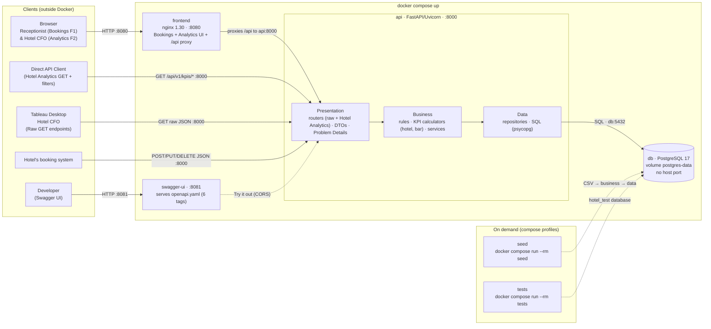

# Implementation Plan: Hotel Kong Arthur Operations & Analytics Platform

**Branch**: `001-hotel-analytics-platform` (work is committed to `main`, per the constitution's commit flow; Week 1 milestone tagged as `v1.0.0`) | **Date**: 2026-10-28 (Updated 2026-11-02 for Week 2 Demands) | **Spec**: [spec.md](spec.md)

**Input**: Feature specification from `/specs/001-hotel-analytics-platform/spec.md` and Week 2 demands from `/context/teacher/Tillægsopgave_uge_2.md`

**Phase outputs**:

- [research.md](research.md): Phase 0 decisions R1–R18 and the decision log.
- [data-model.md](data-model.md): PostgreSQL tables, domain model, validation, filter attributes, and the authoritative KPI catalog.
- [contracts/openapi.yaml](contracts/openapi.yaml): the authoritative API contract (v1.1.0, 20 operations across 15 paths).
- [quickstart.md](quickstart.md): validation guide with golden values for both raw endpoints and `"Hotel Analytics"` KPI endpoints.

## Summary

The platform replaces Hotel Kong Arthur's static CSV extracts with live operational data in **PostgreSQL** (migrated from MySQL in Week 2 per `Tillægsopgave_uge_2.md`, while preserving the Week 1 MySQL baseline as Git release `v1.0.0`):

- **Receptionist**: creates, edits and deletes bookings in the browser frontend (`F1`).
- **Hotel's booking system**: writes to the same REST API (`POST`, `PUT`, `DELETE /api/v1/bookings`).
- **Hotel CFO & Direct API Consumers**:
  1. **Direct API & Frontend Analytics (`Hotel Analytics`, Week 2 `T4`)**: Queries every mandatory KPI (`A1`–`A7`, `B1`–`B3`, `K1`–`K3`) directly from the backend via 9 `GET` endpoints under the **`Hotel Analytics`** Swagger UI header with filter query attributes (`year`, `season`, `room_type`, `country`, `category`, `price_tier`), and views them directly in the browser frontend prototype (`F2`, `FR-022`) without needing Tableau.
  2. **Tableau Compatibility (Week 1 `v1.0.0` preserved)**: All 11 existing operations across the 5 original Swagger UI headers (`Health`, `Reference data`, `Bookings`, `Reviews`, `Bar`) remain unchanged and parameterless so raw data can still feed into Tableau as-is.

Technical approach:

- **Backend**: Python 3.13, FastAPI, three packages (`presentation` → `business` → `data`) wired by a composition root (`main.py`). **`psycopg[binary]` 3.2x** with hand-written parameterised SQL against **PostgreSQL 17** (`postgres:17-alpine`).
- **Business rules & KPI processing**: Both operational domain rules (season mapping from `check_in_date`/`stay_date`, seasonal pricing bands, standard pricing, booking/review validation, ranking, and price tiers) and analytical KPI calculations (`A1`–`A7`, `B1`–`B3`, `K1`–`K3` in `business/kpis/{hotel,bar}.py`) live as pure, unit-tested functions in `business/`.
- **Contract**: design-first OpenAPI 3.0.3 (`info.version: 1.1.0`, 20 operations across 15 paths, 6 Swagger UI tags: `Health`, `Reference data`, `Bookings`, `Reviews`, `Bar`, and **`Hotel Analytics`**), served by a Swagger UI container and enforced by contract tests that validate real responses with `openapi-core`.
- **Containers**: `docker compose up` starts PostgreSQL (schema and reference data created on first start), the API, an nginx-served static frontend (booking CRUD + Hotel Analytics dashboard) that proxies `/api`, and Swagger UI.
- **Sample data**: the T3 dataset (1,000 bookings, 500 synthetic reviews, 30 drink sales) is loaded on demand by an idempotent `seed` command (`docker compose run --rm seed`).

## Technical Context

**Language/Version**: Python 3.13 (backend, image `python:3.13-slim`); SQL for PostgreSQL 17; HTML5 +
vanilla JavaScript (ES2022 modules) + CSS for the frontend, with no build step.

**Primary Dependencies**:

- API: FastAPI 0.16x, Uvicorn 0.5x, Pydantic 2.14, **`psycopg[binary]` 3.2x** (replaces `PyMySQL[rsa]`).
- Tests: pytest 9, httpx 0.28 (FastAPI `TestClient`), openapi-core 0.23, openapi-spec-validator 0.9.
- Containers: **`postgres:17-alpine`**, `nginx:1.30-alpine`, `swaggerapi/swagger-ui:v5.33.3`.
- Exact versions are pinned in `backend/pyproject.toml`.

**Storage**: **PostgreSQL 17** (`postgres:17-alpine`, UTF-8) in the named volume `postgres-data`.

- Reference data (`room_types`, `room_type_rates`): created by `db/init/*.sql` on first start.
- Operational data (`bookings`, `reviews`, `bar_drink_sales`): starts empty (`GENERATED BY DEFAULT AS IDENTITY` PKs, sequence values synchronised after explicit-ID seeding).
- Details: [data-model.md](data-model.md).

**Testing**: pytest suites, run in Docker with `docker compose run --rm tests` against the separate
`hotel_test` PostgreSQL database (research R16).

- `unit`: every operational business rule (`seasons`, `pricing`, `booking_validation`, `review_validation`, `numbers`, `ranking`, `price_tiers`), every KPI formula (`business/kpis/hotel.py`, `business/kpis/bar.py`, including filter combinations and `year=all`), and services (`booking_service`, `review_service`, `kpi_service`, `sample_data_service`), with no database.
- `contract`: every operation (20 operations: 11 raw/CRUD + 9 `Hotel Analytics` KPI endpoints, including filter parameters and `400` invalid filter responses) validated against `openapi.yaml`, plus route parity and contract validity.
- `integration`: PostgreSQL repositories, booking CRUD transactions, seed idempotency, and golden KPI integration tests (`test_golden_revenue.py`, `test_golden_occupancy_satisfaction.py`, `test_golden_bar.py`, `test_golden_a7.py`, `test_all_time_kpis.py`).
- `architecture`: layer import rules (ensuring `business` never imports `psycopg`, `pymysql`, `fastapi`, or `presentation`), frontend price-preview mirror check, plus no Tableau files in the repository (FR-017).

**Target Platform**: Docker Engine or Docker Desktop with Compose v2+ on the team's macOS, Windows
and Linux laptops (Linux containers). Clients are an evergreen browser (bookings + analytics), direct REST API consumers, Tableau Desktop 2023.3+ (outside Docker, team-owned), and the hotel's booking system over HTTP.

**Project Type**: Web application: a REST/JSON backend service, a static browser frontend (booking management + analytics dashboard) and a PostgreSQL database, orchestrated by one compose file.

**Performance Goals**:

- Booking create, read, update and delete under 200 ms (p95) on a laptop.
- Every raw collection `GET` endpoint and every `Hotel Analytics` KPI `GET` endpoint under 500 ms (p95) at 10,000 bookings.
- A change is visible on the next request; the spec's limit is 5 seconds (SC-004).
- All healthchecks green within 60 seconds of `docker compose up` once images are built or pulled (SC-005).

**Constraints**:

- Exactly three backend layers, with the import rules enforced by an architecture test.
- Every client uses only the REST/JSON API. PostgreSQL's port (`5432`) is not published to the host.
- Existing 11 operations and 5 Swagger UI tags (`Health`, `Reference data`, `Bookings`, `Reviews`, `Bar`) remain unchanged; the 4 raw collection `GET` endpoints take no query parameters so Tableau continues to work as-is.
- All 9 new analytics `GET` endpoints sit under the **`Hotel Analytics`** Swagger UI tag and support filter query parameters (`year`, `season`, `room_type`, `country`, `category`, `price_tier`).
- OpenAPI 3.0.3 is authoritative, and FastAPI's generated 3.1 is switched off.
- **No Tableau artifacts or connector code** in the repository (FR-017).
- Money is exact `Decimal`, sent as JSON numbers.
- UTF-8 end to end.
- No authentication (spec Assumptions).
- Development-default credentials only; no real secrets.

**Scale/Scope**:

- One hotel: 214 rooms, 8 room types, 3 seasons, one lobby bar (20 cocktails, 10 coffees).
- Sample year 2026: 1,000 bookings, 500 reviews, 30 drink sales.
- 2 human roles and 2 machine clients.
- 20 API operations across 15 paths (11 existing raw/CRUD operations + 9 `Hotel Analytics` KPI `GET` operations), 1 frontend application (Bookings + Hotel Analytics views), 4 compose services plus 2 tool services.

All Technical Context items are decided; no `NEEDS CLARIFICATION` remains (see [research.md](research.md)).

## Constitution Check

*GATE: Must pass before Phase 0 research. Re-check after Phase 1 design.*

| Gate | Question | Before research | After design | Evidence |
|------|----------|:---------------:|:------------:|----------|
| I | Is the spec clarified, do plan and tasks exist before code, and is the Week 1 milestone preserved in Git (`v1.0.0`)? | PASS | PASS | Clarify (2026-10-27) and Week 2 demands (2026-11-02) settled all requirements; Week 1 commit (`018396b`) is released as `v1.0.0` (`FR-023`) |
| II | Does every story use the teacher's format, meet INVEST and have acceptance criteria? | PASS | PASS | Spec US1–US5 in `Som … ønsker jeg … så …` form with Given/When/Then; [checklists/requirements.md](checklists/requirements.md) 16/16 |
| III | Does every component sit in exactly one layer, with calls only going downwards, and does the MySQL → PostgreSQL swap stay confined to the data layer and deployment config? | PASS | PASS | [Component → layer table](#backend-components-and-their-layer); the MySQL → PostgreSQL swap touches only `data/`, `db/init/`, `pyproject.toml`, and `docker-compose.yml` for existing features; `test_layers.py` enforces imports (R3) |
| IV | Do all clients (frontend, direct API consumers, Tableau, hotel booking system) use only the REST/JSON API? | PASS | PASS | Frontend through the nginx `/api` proxy; Tableau through raw `GET` endpoints; direct analytics consumers and frontend analytics through `/api/v1/kpis/*`; PostgreSQL port `5432` is not published |
| V | Is the OpenAPI contract updated (keeping the 5 existing headers and adding `"Hotel Analytics"`), and is the sync mechanism named? | PASS | PASS | [contracts/openapi.yaml](contracts/openapi.yaml) 3.0.3 (v1.1.0, 20 operations, 6 tags); synced via spec validation, 20-operation route parity, and `openapi-core` response validation (R4) |
| VI | Is all runtime data stored live in PostgreSQL (no MySQL), with schema/reference data created automatically and persistence decided? | PASS ¹ | PASS ¹ | All runtime data is in PostgreSQL 17 (`postgres-data` volume). Schema and reference data are created automatically on `up`. Sample data loads with `seed` (Clarify Q5, R13) |
| VII | Are all operational rules and KPI formulas (`A1`–`A7`, `B1`–`B3`, `K1`–`K3`) defined once in the business layer, exposed via filtered `"Hotel Analytics"` GET endpoints while preserving raw endpoints for Tableau, and displayed in the frontend prototype? | PASS | PASS | KPI catalog with one module per domain (`business/kpis/hotel.py`, `business/kpis/bar.py`, [data-model.md §7](data-model.md#7-authoritative-kpi-catalog-in-the-business-layer-principle-vii)); exposed under `"Hotel Analytics"` and rendered in `frontend/` (`FR-022`) |
| VIII | Does the whole system start from a fresh clone with `docker-compose up`? | PASS ¹ | PASS ¹ | `db` (`postgres:17-alpine`), `api`, `frontend` and `swagger-ui` with healthchecks and `depends_on: service_healthy`; development defaults in compose |
| IX | Are unit tests for business rules/KPIs and contract tests for all endpoints planned? | PASS | PASS | Four suites covering all 20 operations, all KPI formulas, filter combinations, and golden values (R16) |
| X | Are architecture decisions recorded with rationale, including one the AI proposed? | PASS | PASS | [research.md decision log](research.md#architecture-decision-log-principle-x): language/framework, MySQL → PostgreSQL swap, KPI placement & Week 2 restoration, contract sync, persistence, and biggest weakness |

¹ **Note on reference data vs. sample data**: `docker compose up` automatically creates the schema, 8 room types, 214 rooms, and 24 rate bands so the system is immediately operational (and all KPI endpoints respond with zeros). The 1,000 sample bookings, 500 reviews, and 30 drink sales load via the explicit idempotent `docker compose run --rm seed` command (Clarify Q5).

No gate fails, so Complexity Tracking stays empty.

## Architecture

### System and containers (updated for PostgreSQL & `"Hotel Analytics"`)



**Start-up order** (R11):

1. `db` (`postgres:17-alpine`) becomes healthy (TCP query on `room_types` against `127.0.0.1:5432`).
2. `api` becomes healthy (`GET /api/v1/health`).
3. `frontend` starts.
4. `swagger-ui` is independent.

**When containers stop** (R12): data stays in `postgres-data`, and `docker compose down -v` wipes it.

### Backend components and their layer

| Component | Path (under `backend/src/hotel_api/`) | Layer | Responsibility |
|-----------|----------------------------------------|-------|----------------|
| Composition root | `main.py` | none (wiring) | Builds the FastAPI app (generated docs off), adds CORS and error handlers, binds service providers to request-scoped services and repositories, one PostgreSQL transaction per request |
| Settings | `config.py` | none | Reads environment variables (DB host `db`, port `5432`, name `hotel`, user, password, CORS origins) with development defaults |
| Raw & CRUD Routers | `presentation/api/routers/{health,room_types,bookings,reviews,bar}.py` | Presentation | Existing 11 operations across 6 paths under the 5 original tags (`Health`, `Reference data`, `Bookings`, `Reviews`, `Bar`). No query parameters on raw collection `GET`s |
| Analytics Routers | `presentation/api/routers/{kpis_hotel,kpis_bar}.py` | Presentation | 9 `GET` operations under the **`Hotel Analytics`** tag (`/api/v1/kpis/hotel/*` and `/api/v1/kpis/bar/*`) with filter query parameters (`year`, `season`, `room_type`, `country`, `category`, `price_tier`) |
| DTOs | `presentation/api/schemas/{common,health,room_types,bookings,reviews,bar,kpis_hotel,problem}.py` | Presentation | Pydantic request and response shapes. `Decimal` goes out as a JSON number |
| Error mapping | `presentation/api/errors.py` | Presentation | Maps errors to RFC 9457 Problem Details: malformed JSON or bad query/path parameter → 400, `NotFound` → 404, `ValidationFailed` and body errors → 422, `StorageUnavailable` → 503 |
| Service providers | `presentation/api/dependencies.py` | Presentation | Provider stubs typed with business services and query filter validators (`report_year`, `season_filter`, `room_type_filter`, `country_filter`, `category_filter`, `price_tier_filter`), bound by `main.py` |
| Seed CLI | `presentation/cli/seed.py` | Presentation | Parses the two CSV files (BOM, `;`, decimal comma, `Mller` → `Müller`) and calls `SampleDataService` |
| Domain models | `business/domain/models.py` | Business | `RoomType`, `SeasonRate`, `Booking`, `NewBooking`, `GuestReview`, `NewReview`, `BarDrinkSale`, `Season`, `DrinkCategory`, `PriceTier`, plus KPI models (`HotelSummary`, `RoomTypeKpi`, `SeasonKpi`, `RoomTypeSeasonKpi`, `CountryKpi`, `BarSummary`, `RankedDrinkSale`, `BarCategoryKpi`, `BarPriceTierKpi`) |
| Domain errors | `business/errors.py` | Business | `ValidationFailed(field_errors)`, `NotFound`, `StorageUnavailable` |
| Operational Rules | `business/rules/{seasons,pricing,booking_validation,review_validation,numbers,ranking,price_tiers,_parsing}.py` | Business | The single definition of each operational rule, rounding/share rule, competition ranking, and bar price-tier classification |
| KPI Calculators | `business/kpis/{hotel,bar}.py` | Business | Pure functions computing `A1`–`A7`, `B1`–`B3`, `K1`–`K3` over filtered domain collections |
| Services | `business/services/{room_type,booking,review,bar,kpi,health,sample_data}_service.py` | Business | Use cases that load through ports, apply operational rules and KPI calculators, and persist through ports |
| Ports | `business/ports.py` | Business | Repository `Protocol`s implemented by the data layer |
| Connection | `data/connection.py` | Data | **`psycopg` connection factory** (`autocommit=False`, `row_factory=dict_row`, UTF-8); wraps driver errors as `StorageUnavailable` |
| Repositories | `data/repositories/{room_types,bookings,reviews,bar_sales,health}.py` | Data | Parameterised PostgreSQL SQL and mapping between rows and domain models; the only code that talks to PostgreSQL |
| Schema and reference data | `db/init/01_schema.sql`, `02_reference_data.sql`, `03_test_database.sql` | Data (deployment) | PostgreSQL tables, constraints, and indexes; 8 room types and 24 rate bands; the `hotel_test` database and privileges |
| Frontend | `frontend/public/{index.html,app.js,api.js,price-preview.js,styles.css}` | Client | Booking list, form, live price preview (FR-018/FR-019), edit mode (FR-020), delete (`F1`), and **Hotel Analytics** dashboard view with filter controls reading from `/api/v1/kpis/*` (`F2`, FR-022) |

### Replaceability Demonstrated in Practice (answers Q5)

- **Week 2 MySQL → PostgreSQL Migration (`Tillægsopgave_uge_2.md`)**:
  - In `v1.0.0`, the system ran on MySQL 8.4 with `PyMySQL`.
  - In Week 2, replacing MySQL with PostgreSQL 17 (`psycopg`) required changing **only** `backend/src/hotel_api/data/` (`connection.py` and the SQL dialect in `repositories/*.py`), `db/init/*.sql`, `backend/pyproject.toml`, `backend/tests/conftest.py`, and the `db` service in `docker-compose.yml`.
  - All existing operational business rules (`business/rules/`), domain models (`business/domain/`), services (`business/services/`), routers (`presentation/api/routers/`), and unit tests required **zero changes** for the database swap, proving that the 3-layer boundary (`presentation → business → data` via `business/ports.py`) works as designed.
- **Replace the web frontend with the hotel's booking system**: nothing in the backend changes. The booking system calls the same `POST`, `PUT` and `DELETE` endpoints, and the business layer applies the same validation.

### Worked REST examples: `/api/v1/bookings` (raw CRUD) & `/api/v1/kpis/hotel/by-room-type` (`Hotel Analytics`)

| Method and URL | Tag | Meaning | Success | Errors |
|----------------|-----|---------|---------|--------|
| `GET /api/v1/bookings` | `Bookings` | List all bookings, newest first (no query parameters, for Frontend & Tableau) | `200` with `{"items": [...]}` | `503` if DB down |
| `POST /api/v1/bookings` | `Bookings` | Create a booking (server assigns the id) | `201`, `Location: /api/v1/bookings/1001`, booking in the body | `400` malformed JSON; `422` rule broken |
| `GET /api/v1/bookings/1001` | `Bookings` | Read one booking | `200` | `400` id < 1; `404` unknown id |
| `PUT /api/v1/bookings/1001` | `Bookings` | Replace the client-editable fields | `200` with the updated booking | `400`; `404`; `422` |
| `DELETE /api/v1/bookings/1001` | `Bookings` | Remove the booking | `204` with no body | `400`; `404` |
| `GET /api/v1/kpis/hotel/by-room-type?year=2026&season=high` | `Hotel Analytics` | Ranked KPIs per room type (`A4`, `K1`, `K2`, `K3`, `A7`), filtered by `year`, `season`, `room_type`, `country` | `200` with `{"items": [...]}` | `400` invalid filter param; `503` if DB down |

### Request walkthrough: "create a booking" (answers Q2)

1. The receptionist submits the form. `app.js` sends `POST /api/v1/bookings` with JSON to its own
   origin (`localhost:8080`).
2. nginx in the `frontend` container proxies the request to `http://api:8000/api/v1/bookings`
   (compose service name).
3. **Presentation**: FastAPI parses the body into the `BookingInput` DTO. A malformed body gives
   `400`; a wrong type gives `422`. The router calls `BookingService.create(new_booking)`.
4. **Business**:
   - `BookingService` loads the room types through `RoomTypeRepository`.
   - It validates the fields (`booking_validation`) and derives the season from the check-in date
     (`seasons`).
   - It either calculates the standard price or checks the given price (`price_dkk` or
     `price_per_night_dkk`) against the band (`pricing`).
   - Any broken rule raises `ValidationFailed`, which becomes `422` listing every field.
5. **Data**: `BookingRepository.add` runs a parameterised `INSERT ... RETURNING id, created_at, updated_at`
   over `psycopg` against PostgreSQL (`db:5432`).
6. The composition root **commits** the request's transaction, so the booking is in PostgreSQL before
   any response is sent.
7. **Presentation** maps the `Booking` to the response DTO (with `season` and `year`) and returns
   `201` with a `Location` header.
8. The frontend shows the result, reloads `GET /api/v1/bookings`, and refreshes its **Hotel Analytics**
   dashboard panels (`GET /api/v1/kpis/hotel/*`).

### API contract and its consumers (Principle V, answers Q7)

| Consumer | Uses | Check when the contract changes |
|----------|------|---------------------------------|
| Browser frontend (Receptionist & CFO) | `room-types`, booking CRUD (`F1`), Problem Details `errors[]`, plus **`Hotel Analytics`** `GET /api/v1/kpis/*` endpoints (`F2`) | Form fields, enum lists, error rendering, and analytics KPI card/table fields still match |
| Direct API Analytics Client (CFO / External BI) | **`Hotel Analytics`** `GET /api/v1/kpis/hotel/*` and `/api/v1/kpis/bar/*` with filter attributes (`year`, `season`, `room_type`, `country`, `category`, `price_tier`) | KPI response schemas, filter query parameter names/enums, and `400` Problem Details still match |
| Tableau dashboard (CFO, built by hand outside the repository) | Parameterless raw `GET` endpoints: `/api/v1/bookings`, `/api/v1/room-types`, `/api/v1/reviews`, `/api/v1/bar/drink-sales` | Field names and types of the extracted raw tables are unchanged from `v1.0.0`; JSONPath `$.items[*]` still works |
| Hotel's booking system | `POST`, `PUT` and `DELETE /api/v1/bookings` | `BookingInput` required fields and the 400/404/422 meanings are unchanged |

### Mandatory scope traceability

| Scope ID | `"Hotel Analytics"` API Endpoint(s) (with filters) + Raw Tableau Endpoint(s) | Backend Business Code | Verified by |
|----------|------------------------------------------------------------------------------|-----------------------|-------------|
| F1 | `bookings` (5 operations), `room-types`, frontend booking UI | `services/booking_service.py`, `rules/booking_validation.py`, `rules/pricing.py`, `rules/seasons.py` | Unit (validation, pricing, seasons); contract (5 operations); quickstart §3 |
| F2 | Frontend Hotel Analytics dashboard reading `/api/v1/kpis/hotel/*` & `/api/v1/kpis/bar/*` | `services/kpi_service.py`, `kpis/hotel.py`, `kpis/bar.py` | Contract (9 KPI operations); quickstart §4–§7 |
| G1 | Git release/tag `v1.0.0` preserving Week 1 commit (`018396b`) | Git history & tag `v1.0.0` | `git tag -l v1.0.0` |
| A1, A3, A5 | `GET /api/v1/kpis/hotel/by-country` (`year`, `season`, `room_type`, `country`) + raw `GET /api/v1/bookings` | `kpis/hotel.py`, `rules/ranking.py`, `rules/numbers.py`, `services/kpi_service.py` | Unit (`test_hotel_revenue_kpis.py`), contract (`test_kpis_hotel_revenue.py`), golden (`test_golden_revenue.py`); quickstart §4 |
| A2, A4, A6, K2 | `GET /api/v1/kpis/hotel/{summary,by-room-type,by-season,by-room-type-and-season}` (`year`, `season`, `room_type`, `country`) + raw `GET /api/v1/bookings` | `kpis/hotel.py`, `rules/ranking.py`, `rules/numbers.py`, `services/kpi_service.py` | Unit (`test_hotel_revenue_kpis.py`), contract (`test_kpis_hotel_revenue.py`, `test_kpis_hotel_summary.py`), golden (`test_golden_revenue.py`); quickstart §4 |
| A7 | `GET /api/v1/kpis/hotel/{summary,by-room-type,by-season,by-room-type-and-season}` (ALOS, ADR, avg rev/booking) & `GET /api/v1/kpis/bar/{by-price-tier,by-drink}` (`year`, `category`, `price_tier`) | `kpis/hotel.py`, `kpis/bar.py`, `rules/price_tiers.py`, `services/kpi_service.py` | Unit (`test_hotel_stay_kpis.py`, `test_bar_price_tier_kpis.py`, `test_price_tiers.py`), contract (`test_kpis_bar_price_tier.py`), golden (`test_golden_a7.py`); quickstart §7 |
| B1, B2, B3 | `GET /api/v1/kpis/bar/{summary,by-drink,by-category}` (`year`, `category`, `price_tier`) + raw `GET /api/v1/bar/drink-sales` | `kpis/bar.py`, `rules/ranking.py`, `rules/price_tiers.py`, `services/kpi_service.py`, `services/bar_service.py` | Unit (`test_bar_kpis.py`), contract (`test_bar.py`), golden (`test_golden_bar.py`); quickstart §6 |
| K1 | `GET /api/v1/kpis/hotel/{summary,by-room-type,by-season,by-room-type-and-season}` (`available_room_nights`, `occupancy_rate_pct`) + raw `room-types` & `bookings` | `kpis/hotel.py`, `rules/seasons.py`, `services/kpi_service.py` | Unit (`test_hotel_occupancy_satisfaction.py`), contract (`test_kpis_hotel_summary.py`), golden (`test_golden_occupancy_satisfaction.py`); quickstart §5 |
| K3 | `GET /api/v1/kpis/hotel/{summary,by-room-type,by-season}` (`review_count`, `average_satisfaction`, `satisfied_share_pct`) + raw `reviews` (3 operations) | `kpis/hotel.py`, `services/review_service.py`, `rules/review_validation.py`, `services/kpi_service.py` | Unit (`test_hotel_occupancy_satisfaction.py`, `test_review_service.py`), contract (`test_reviews.py`, `test_kpis_hotel_summary.py`), golden (`test_golden_occupancy_satisfaction.py`); quickstart §5 |
| FR-017 | none: no Tableau files or connector code | none | Architecture test (`test_no_tableau_files.py`); quickstart §8 |

### Answering the T2 questions from the repository (Principle X)

| T2 question | Answered by |
|-------------|-------------|
| Q1 Architecture diagram | [System and containers](#system-and-containers-updated-for-postgresql--hotel-analytics), copied to `README.md` |
| Q2 Follow a request | [Request walkthrough](#request-walkthrough-create-a-booking-answers-q2) |
| Q3 Three layers | [Component → layer table](#backend-components-and-their-layer), research R3, the architecture test |
| Q4 Placement of KPIs | research R6 (both why KPIs are in `business/kpis/` and how Week 2 compares to Week 1's Tableau-only approach) |
| Q5 Replaceability | [Replaceability Demonstrated in Practice](#replaceability-demonstrated-in-practice-answers-q5) (proven live by the MySQL → PostgreSQL swap) |
| Q6 REST design | [Worked examples](#worked-rest-examples-apiv1bookings-raw-crud--apiv1kpishotelby-room-type-hotel-analytics), research R5, the contract |
| Q7 The API contract | [Contract and consumers](#api-contract-and-its-consumers-principle-v-answers-q7), research R4 |
| Q8 Docker | [Containers](#system-and-containers-updated-for-postgresql--hotel-analytics), research R11 and R12 |
| Q9 Static to live | research R7 and R14 |
| Q10 Ownership | research decision log and "Biggest weakness" |

## Project Structure

### Documentation (this feature)

```text
specs/001-hotel-analytics-platform/
├── spec.md              # /speckit-specify + /speckit-clarify + Week 2 updates
├── plan.md              # This file (/speckit-plan command output)
├── research.md          # Phase 0 output: decisions R1–R18, decision log
├── data-model.md        # Phase 1 output: PostgreSQL schema, domain model, validation, KPI catalog
├── quickstart.md        # Phase 1 output: validation guide with golden values
├── contracts/
│   └── openapi.yaml     # Phase 1 output: AUTHORITATIVE API contract (20 operations, 6 tags)
├── checklists/
│   └── requirements.md  # spec quality checklist
└── tasks.md             # Phase 2 output (/speckit-tasks command)
```

### Source Code (repository root)

```text
docker-compose.yml                 # db (postgres:17-alpine), api, frontend, swagger-ui; profiles: tools (seed), test (tests)
README.md                          # architecture diagram, how to run and seed, PostgreSQL persistence (D2)
CONTRIBUTE.md                      # dev setup, tests, schema reset, commit conventions (D3)

backend/
├── Dockerfile                     # stages: runtime (API and seed), test (adds dev dependencies)
├── pyproject.toml                 # pinned dependencies (psycopg[binary]), pytest configuration
├── src/hotel_api/
│   ├── main.py                    # composition root (outside the layers)
│   ├── config.py                  # settings from environment variables
│   ├── presentation/              # LAYER 1: HTTP and CLI adapters only
│   │   ├── api/
│   │   │   ├── routers/           # health, room_types, bookings, reviews, bar, kpis_hotel, kpis_bar
│   │   │   ├── schemas/           # Pydantic DTOs (incl. kpis_hotel, bar KPIs) + Problem Details
│   │   │   ├── dependencies.py    # service stubs + query filter validators
│   │   │   └── errors.py
│   │   └── cli/
│   │       └── seed.py
│   ├── business/                  # LAYER 2: no HTTP, no SQL
│   │   ├── domain/models.py
│   │   ├── errors.py
│   │   ├── ports.py
│   │   ├── rules/                 # seasons, pricing, booking_validation, review_validation, numbers, ranking, price_tiers
│   │   ├── kpis/                  # hotel.py (A1–A7, K1–K3), bar.py (B1–B3, A7/US4)
│   │   └── services/              # room_type, booking, review, bar, kpi, health, sample_data
│   └── data/                      # LAYER 3: the only code that talks to PostgreSQL (psycopg)
│       ├── connection.py
│       └── repositories/          # room_types, bookings, reviews, bar_sales, health
└── tests/
    ├── conftest.py                # hotel_test PostgreSQL schema setup, TestClient, contract loader
    ├── unit/                      # operational business rules, KPI calculators, and services (no DB)
    ├── contract/                  # every operation (20 operations) vs specs/.../contracts/openapi.yaml
    ├── integration/               # PostgreSQL repositories, booking CRUD, seed idempotency, golden KPIs
    └── architecture/              # layer import rules (no psycopg/pymysql in business), frontend price mirror, no Tableau files (FR-017)

db/
└── init/
    ├── 01_schema.sql              # PostgreSQL tables, constraints, indexes
    ├── 02_reference_data.sql      # 8 room types (214 rooms), 24 seasonal rate bands
    └── 03_test_database.sql       # CREATE DATABASE hotel_test + GRANT to the app user

frontend/
├── Dockerfile                     # nginx:1.30-alpine + static files + config
├── nginx.conf                     # serves /, proxies /api/ → http://api:8000
└── public/
    ├── index.html                 # Bookings view (F1) + Hotel Analytics dashboard view (F2)
    ├── app.js                     # Booking CRUD + Hotel Analytics rendering & filter controls
    ├── api.js                     # fetch wrappers for /api/v1 (bookings, room-types, kpis/hotel/*, kpis/bar/*)
    ├── price-preview.js           # display-only booking price preview mirror (FR-018/FR-019)
    └── styles.css

context/teacher/*.csv              # T3 sample data: read only by the seed command (mounted read-only)
```

## Complexity Tracking

> **Fill ONLY if Constitution Check has violations that must be justified**

No violations.

| Violation | Why Needed | Simpler Alternative Rejected Because |
|-----------|------------|-------------------------------------|
| — | — | — |
