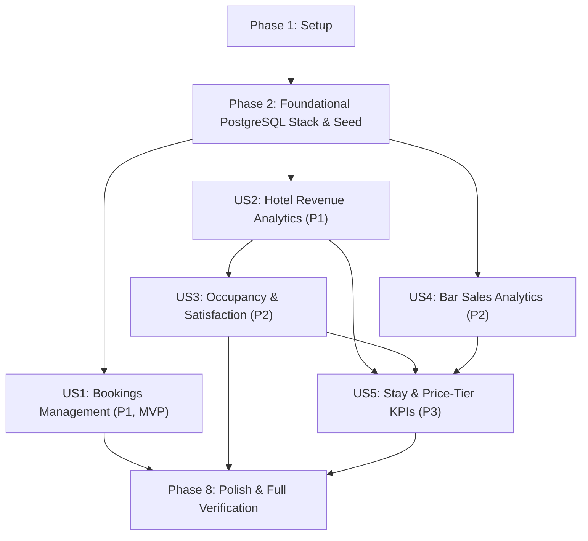

# Tasks: Hotel Kong Arthur Operations & Analytics Platform

**Input**: Design documents from `/specs/001-hotel-analytics-platform/` and Week 2 demands from `/context/teacher/Tillægsopgave_uge_2.md`

**Prerequisites**: plan.md (required), spec.md (required for user stories), research.md, data-model.md, contracts/openapi.yaml, quickstart.md

**Tests**: INCLUDED. Constitution Principle IX requires unit tests for every business rule and KPI formula, and an automated test for every API endpoint (contract tests, validated against `openapi.yaml`).

**Organization**: Tasks are grouped by user story (spec.md US1–US5) to enable independent implementation and testing of each story.

## Format: `- [ ] [ID] [P?] [Story] Description with file path`

- **[P]**: Can run in parallel (different files, no dependency on an unfinished task)
- **[Story]**: US1–US5, only on user-story phase tasks
- All paths are relative to the repository root. Backend source is under `backend/src/hotel_api/`, abbreviated `SRC/` below.
- `SPEC/` = `specs/001-hotel-analytics-platform/`.

## Path Conventions

- Backend: `backend/src/hotel_api/{presentation,business,data}/`, composition root `main.py`, `config.py`
- Tests: `backend/tests/{unit,contract,integration,architecture}/`
- Database bootstrap: `db/init/`
- Frontend: `frontend/public/`
- Contract (authoritative, never copied): `SPEC/contracts/openapi.yaml`
- Layer rule (R3): `presentation → business → data`. `business` imports no HTTP or SQL. `data` implements `business/ports.py`.
- **No Tableau files or connector code anywhere** (FR-017).

---

## Phase 1: Setup (PostgreSQL Stack & Dependencies)

**Purpose**: Update project dependencies and Docker infrastructure to replace MySQL with PostgreSQL 17 per Week 2 requirements.

- [X] T001 Update `backend/pyproject.toml` to replace `PyMySQL[rsa]` with `psycopg[binary] >= 3.2.0`, keeping FastAPI 0.16x, Uvicorn 0.5x, Pydantic 2.14, and dev dependencies (pytest 9, httpx 0.28, openapi-core 0.23, openapi-spec-validator 0.9)
- [X] T002 [P] Update `docker-compose.yml` to replace the `db` service image with `postgres:17-alpine`, configure environment variables (`POSTGRES_DB=hotel`, `POSTGRES_USER=hotel`, `POSTGRES_PASSWORD=hotel_dev`), mount `./db/init` to `/docker-entrypoint-initdb.d`, attach named volume `postgres-data`, and set TCP healthcheck `pg_isready -U hotel -d hotel -h 127.0.0.1`
- [X] T003 [P] Update `SRC/config.py` with PostgreSQL development defaults (DB host `db`, default port `5432`, DB name `hotel`, user `hotel`, password `hotel_dev`, CORS origins, `TZ=Europe/Copenhagen`)

---

## Phase 2: Foundational (PostgreSQL Database Bootstrap, Repositories, Test Harness & Seed)

**Purpose**: PostgreSQL schema bootstrap, database connection handling, repository adaptations, test harness, and identity-sequence-safe sample data seeding. No user story can start before this phase is complete.

**⚠️ CRITICAL**: The seed command (T013) must be operational and sequence-synchronised so integration tests and all subsequent KPI stories can verify their calculations against seeded data.

### Database bootstrap (Data layer, deployment)

- [X] T004 Create PostgreSQL DDL in `db/init/01_schema.sql` per data-model.md §2–§3:
  - `room_types`: `id SMALLINT PRIMARY KEY CHECK (id BETWEEN 1 AND 8)`, `name VARCHAR(40) NOT NULL UNIQUE`, `name_da VARCHAR(60) NOT NULL`, `room_count SMALLINT NOT NULL CHECK (room_count > 0)`, `max_guests SMALLINT NOT NULL CHECK (max_guests BETWEEN 1 AND 4)`
  - `room_type_rates`: composite PK (`room_type_id SMALLINT REFERENCES room_types(id)`, `season VARCHAR(10) CHECK (season IN ('low', 'mid', 'high'))`), `min_nightly_dkk NUMERIC(10,2) NOT NULL CHECK (min_nightly_dkk > 0)`, `max_nightly_dkk NUMERIC(10,2) NOT NULL CHECK (max_nightly_dkk >= min_nightly_dkk)`, `standard_nightly_dkk NUMERIC(10,2) NOT NULL CHECK (standard_nightly_dkk BETWEEN min_nightly_dkk AND max_nightly_dkk)`
  - `bookings`: `id INTEGER GENERATED BY DEFAULT AS IDENTITY PRIMARY KEY`, `first_name VARCHAR(100) NOT NULL`, `family_name VARCHAR(100) NOT NULL`, `country VARCHAR(100) NOT NULL`, `room_type_id SMALLINT NOT NULL REFERENCES room_types(id)`, `check_in_date DATE NOT NULL`, `days_rented SMALLINT NOT NULL CHECK (days_rented BETWEEN 1 AND 365)`, `price_dkk NUMERIC(10,2) NOT NULL CHECK (price_dkk > 0)`, `created_at TIMESTAMPTZ NOT NULL DEFAULT CURRENT_TIMESTAMP`, `updated_at TIMESTAMPTZ NOT NULL DEFAULT CURRENT_TIMESTAMP`; index `ix_bookings_check_in_date` on `check_in_date`
  - `reviews`: `id INTEGER GENERATED BY DEFAULT AS IDENTITY PRIMARY KEY`, `booking_id INTEGER REFERENCES bookings(id) ON DELETE SET NULL`, `room_type_id SMALLINT NOT NULL REFERENCES room_types(id)`, `stay_date DATE NOT NULL`, `rating SMALLINT NOT NULL CHECK (rating BETWEEN 1 AND 5)`, `created_at TIMESTAMPTZ NOT NULL DEFAULT CURRENT_TIMESTAMP`; index `ix_reviews_stay_date` on `stay_date`
  - `bar_drink_sales`: `id INTEGER GENERATED BY DEFAULT AS IDENTITY PRIMARY KEY`, `sales_year SMALLINT NOT NULL CHECK (sales_year BETWEEN 2000 AND 2100)`, `drink_name VARCHAR(100) NOT NULL`, `category VARCHAR(20) NOT NULL CHECK (category IN ('Cocktail', 'Coffee'))`, `unit_price_dkk NUMERIC(10,2) NOT NULL CHECK (unit_price_dkk > 0)`, `units_sold INTEGER NOT NULL CHECK (units_sold >= 0)`, `UNIQUE (sales_year, drink_name)`
- [X] T005 [P] Create PostgreSQL reference data in `db/init/02_reference_data.sql`: 8 room types (IDs 1–8 in canonical order; counts 27,27,27,27,27,27,26,26 = 214; Danish names and `max_guests` from data-model.md §2.1) and the 24 `room_type_rates` rows from data-model.md §2.2
- [X] T006 [P] Create PostgreSQL test database init in `db/init/03_test_database.sql`: `CREATE DATABASE hotel_test WITH ENCODING 'UTF8';` and `GRANT ALL PRIVILEGES ON DATABASE hotel_test TO hotel;`

### Data layer implementation with psycopg

- [X] T007 Implement PostgreSQL connection factory in `SRC/data/connection.py`: use `psycopg.connect` (`autocommit=False`, `row_factory=dict_row`, UTF-8 client encoding) and map driver connection/operational errors to `StorageUnavailable`
- [X] T008 [P] Implement `SRC/data/repositories/health.py`: PostgreSQL `SELECT 1` ping query
- [X] T009 [P] Implement `SRC/data/repositories/room_types.py`: parameterised SQL querying `room_types` and joining `room_type_rates`, returning `RoomType` domain objects with rates ordered low, mid, high
- [X] T010 [P] Implement `SRC/data/repositories/bookings.py`: parameterised SQL for `get`, `list` (ordered by `id` DESC), `add` (using `INSERT ... RETURNING id, created_at, updated_at`), `replace` (using `UPDATE ... RETURNING id, created_at, updated_at`), `delete`, and `bulk_insert` with explicit IDs
- [X] T011 [P] Implement `SRC/data/repositories/reviews.py`: parameterised SQL for `get`, `list` (ordered by `id` DESC), `add` (using `INSERT ... RETURNING id, created_at`), and `bulk_insert` with explicit IDs
- [X] T012 [P] Implement `SRC/data/repositories/bar_sales.py`: parameterised SQL for `list` (ordered by `id` ASC) and `bulk_insert` with explicit IDs

### Seeding with PostgreSQL sequence synchronization

- [X] T013 Update `SRC/business/services/sample_data_service.py` and `SRC/presentation/cli/seed.py`: execute sample data seeding inside one PostgreSQL transaction (delete existing rows; insert 1,000 bookings with explicit IDs 1–1000; insert 500 reviews with deterministic ratings; insert 30 drink sales); synchronize PostgreSQL identity sequences (`SELECT setval(pg_get_serial_sequence('bookings', 'id'), COALESCE(MAX(id), 1), MAX(id) IS NOT NULL) FROM bookings`, and similarly for `reviews` and `bar_drink_sales`) so subsequent `POST` operations generate IDs starting from 1001

### Test harness & foundational verification

- [X] T014 Update `backend/tests/conftest.py`: connect to PostgreSQL `hotel_test`, execute `db/init/*.sql` scripts on test session startup, truncate operational tables (`reviews`, `bookings`, `bar_drink_sales`) and restart identity sequences before each test, provide FastAPI `TestClient`, and configure `openapi-core` contract loader
- [X] T015 [P] Update integration tests in `backend/tests/integration/test_repositories.py`: verify PostgreSQL CRUD round-trips for all repositories, `ON DELETE SET NULL` on `reviews.booking_id`, UTF-8 character preservation (`Müller`), and sequence handling
- [X] T016 [P] Update integration tests in `backend/tests/integration/test_seed.py`: run seed twice against PostgreSQL, assert exact counts (1000 bookings, 500 reviews, 30 drink sales), assert booking 1 (Liam Nguyen, Spa Executive, 2026-03-01, price 2577.00), assert booking 21 (`Müller`), and verify subsequent booking insert receives ID 1001
- [X] T017 [P] Run contract tests in `backend/tests/contract/test_health_and_room_types.py`: validate `GET /api/v1/health` (200) and `GET /api/v1/room-types` (200, 8 room types summing to 214 rooms) against `openapi.yaml`
- [X] T018 [P] Update architecture tests in `backend/tests/architecture/test_layers.py`: parse imports across `SRC/` and assert that `presentation` does not import `data`, `business` does not import `presentation`, `data`, `fastapi`, `psycopg`, or `pymysql`, and `data` does not import `presentation` or `business.services`

**Checkpoint**: `docker compose up` starts PostgreSQL 17 (`postgres:17-alpine`) and initializes the schema, 214 rooms, and 24 rate bands with no operational data. `docker compose run --rm seed` loads 1,000 bookings, 500 reviews, and 30 drink sales with synchronized identity sequences. All foundational repository, seed, health, and layer tests pass.

---

## Phase 3: User Story 1 - Manage Room Bookings on PostgreSQL (Priority: P1) 🎯 MVP

**Goal**: Receptionists and external booking systems can create, read, edit, and delete room bookings on PostgreSQL, with live price calculation, mutual exclusivity of price fields (FR-019), and distinct Edit Mode UI (FR-020).

**Independent Test**: quickstart.md §3. Create a booking without a price (`price_dkk` calculated as standard rate 6000.00 DKK for 3 nights high season), edit nights 3 → 5 (`10000.00` DKK), create with fixed price per night (`price_per_night_dkk = 2100.50` storing `price_dkk = 6301.50`), test invalid input rejection (`422`/`400`), delete booking (`204`, then `404`), and verify in browser frontend at `http://localhost:8080`.

### Tests for User Story 1

- [X] T019 [P] [US1] Unit tests in `backend/tests/unit/test_booking_service.py`: verify standard price derivation, custom price validation against seasonal bands, dual price mutual exclusivity (FR-019), and unknown ID handling
- [X] T020 [P] [US1] Contract tests in `backend/tests/contract/test_bookings.py`: validate `GET /api/v1/bookings`, `POST /api/v1/bookings` (201 + `Location`), `GET /api/v1/bookings/{booking_id}`, `PUT /api/v1/bookings/{booking_id}`, and `DELETE /api/v1/bookings/{booking_id}` responses against `openapi.yaml` using `openapi-core`
- [X] T021 [P] [US1] Integration tests in `backend/tests/integration/test_booking_crud.py`: verify booking creation persists in PostgreSQL, update modifies fields and price, delete removes record while leaving linked reviews with `booking_id = NULL`, and subsequent booking ID sequence increments properly

### Implementation for User Story 1

- [X] T022 [US1] Verify and wire `SRC/business/services/booking_service.py` with PostgreSQL `BookingRepository` and `RoomTypeRepository`, ensuring validation, seasonal pricing, and transaction commits function identically to specification
- [X] T023 [US1] Verify `SRC/presentation/api/routers/bookings.py` and `SRC/presentation/api/schemas/bookings.py` handle parameterless list `GET`, single get, create `POST` (201 + `Location`), replace `PUT`, and delete `DELETE` (204)
- [X] T024 [P] [US1] Verify frontend booking management in `frontend/public/app.js`, `frontend/public/api.js`, `frontend/public/price-preview.js`, `frontend/public/index.html`, and `frontend/public/styles.css`: dynamic price breakdown preview before create (FR-018), dual price input mutual exclusivity (FR-019), and distinct visual Edit Mode banner/theme with cancel action (FR-020)
- [X] T025 [US1] Execute quickstart.md §3 manual validation in browser at `http://localhost:8080` and via `curl`: verify create, edit, price-per-night, and delete operations take < 30 seconds (SC-001) and persist in PostgreSQL

**Checkpoint**: User Story 1 works completely on PostgreSQL. Live booking CRUD operates via browser and REST API with zero errors.

---

## Phase 4: User Story 2 - Room & Country Revenue Overview by Season via API & Frontend (Priority: P1)

**Goal**: Expose backend-calculated room and country revenue metrics (A2–A6, K2) via the new **`Hotel Analytics`** Swagger UI tag (`/api/v1/kpis/hotel/*`) with filter attributes (`year`, `season`, `room_type`, `country`), while preserving raw `GET /api/v1/bookings` for Tableau and displaying revenue analytics in the frontend prototype (`F2`).

**Independent Test**: quickstart.md §4. After `seed`, `GET /api/v1/kpis/hotel/summary?year=2026` returns `total_revenue_dkk = 11234034.00`, `GET /api/v1/kpis/hotel/by-room-type?year=2026` ranks Suite rank 1 (2119671.00 DKK, 18.87%) and Standard Single rank 8 (730444.00 DKK), `GET /api/v1/kpis/hotel/by-country?year=2026` ranks South Korea rank 1 (767699.00 DKK, 63 bookings) and Egypt rank 20 (335786.00 DKK), `GET /api/v1/kpis/hotel/by-room-type-and-season?year=2026` returns 24 rows summing to 11234034.00 DKK, and `GET /api/v1/kpis/hotel/by-season?year=2026` returns 3 rows summing to 11234034.00 DKK; all metrics render in frontend prototype.

### Tests for User Story 2

- [ ] T026 [P] [US2] Unit tests in `backend/tests/unit/test_hotel_revenue_kpis.py`: verify pure KPI calculations for total revenue (A6/K2), revenue by room type with largest-remainder shares and competition rank (A4), revenue by country with booking shares and revenue rank (A1/A3/A5), revenue by room type × season (A2), and revenue by season, testing empty datasets, leap year days, and single-dimension filter slices
- [ ] T027 [P] [US2] Contract tests in `backend/tests/contract/test_kpis_hotel_revenue.py`: validate `GET /api/v1/kpis/hotel/by-room-type`, `GET /api/v1/kpis/hotel/by-season`, `GET /api/v1/kpis/hotel/by-room-type-and-season`, and `GET /api/v1/kpis/hotel/by-country` against `openapi.yaml` under tag `Hotel Analytics`, asserting 200 responses for valid filters (`year=2026`, `year=all`, `season=high`, `room_type=Suite`, `country=Germany`) and 400 Problem Details for invalid query parameters (`year=abc`, `season=autumn`, `room_type=Invalid`, empty `country=`)
- [ ] T028 [P] [US2] Golden-value integration test in `backend/tests/integration/test_golden_revenue.py`: against seeded PostgreSQL data, assert exact revenue numbers (total 11,234,034.00 DKK, Suite 2,119,671.00 DKK, South Korea 767,699.00 DKK, LOFT Suite high season 683,198.00 DKK) within 0.01 DKK tolerance (SC-003)

### Implementation for User Story 2

- [ ] T029 [US2] Implement `SRC/business/rules/ranking.py`: competition ranking ("1224" rank order, equal values share rank, next rank skips, ties ordered alphabetically)
- [ ] T030 [US2] Implement revenue calculation functions in `SRC/business/kpis/hotel.py`: calculate total revenue, room type revenue & shares, seasonal revenue, room type × season revenue, and country revenue, booking counts, and shares over filtered booking collections
- [ ] T031 [US2] Implement revenue methods in `SRC/business/services/kpi_service.py`: fetch bookings from `BookingRepository` matching filter scope (`year`, `season`, `room_type`, `country`) and call pure KPI functions
- [ ] T032 [P] [US2] Implement revenue DTOs in `SRC/presentation/api/schemas/kpis_hotel.py`: `RoomTypeKpi`, `SeasonKpi`, `RoomTypeSeasonKpi`, `CountryKpi`, and list wrappers matching `openapi.yaml`
- [ ] T033 [US2] Implement query filter dependencies in `SRC/presentation/api/dependencies.py`: `report_year` (int 2000–2100 or 'all', default 'all'), `season_filter` (low, mid, high), `room_type_filter` (8 names), `country_filter` (trimmed non-empty string <= 100 chars); raise `ValidationFailed` / 400 on malformed query values
- [ ] T034 [US2] Create router `SRC/presentation/api/routers/kpis_hotel.py`: implement `GET /api/v1/kpis/hotel/by-room-type`, `by-season`, `by-room-type-and-season`, and `by-country` with filter dependencies under tag `Hotel Analytics`, and register in `SRC/main.py`
- [ ] T035 [US2] Add revenue analytics views and filter controls to `frontend/public/api.js`, `frontend/public/index.html`, `frontend/public/app.js`, and `frontend/public/styles.css`: create Hotel Analytics section displaying total revenue card, by-room-type table, by-season breakdown, and country origin/revenue table, with dynamic filter dropdowns (FR-022)

**Checkpoint**: User Story 2 is functional. Hotel revenue calculations are served directly by `Hotel Analytics` endpoints and displayed in the frontend prototype, matching golden values.

---

## Phase 5: User Story 3 - Guest Origin, Occupancy Rate & Customer Satisfaction via API & Frontend (Priority: P2)

**Goal**: Expose backend-calculated occupancy rate (K1) and customer satisfaction (K3) alongside revenue in `GET /api/v1/kpis/hotel/summary` and the breakdown endpoints, while preserving raw `GET /api/v1/reviews` and displaying occupancy & satisfaction in the frontend prototype (`F2`).

**Independent Test**: quickstart.md §5. After `seed`, `GET /api/v1/kpis/hotel/summary?year=2026` returns `available_room_nights = 78110`, `occupancy_rate_pct = 6.89`, `review_count = 500`, and `satisfied_share_pct = 64.20`; seasonal occupancy reports `low = 9.34%`, `mid = 5.61%`, `high = 6.70%`; adding a review via `POST /api/v1/reviews` increments `review_count` to 501; metrics render in frontend prototype.

### Tests for User Story 3

- [ ] T036 [P] [US3] Unit tests in `backend/tests/unit/test_hotel_occupancy_satisfaction.py`: verify occupancy calculation (`nights_sold / available_room_nights * 100`), available room-nights calculation for single year, leap year, all-time, and filtered slices; verify customer satisfaction mean rating (1–5) and satisfied share (% ratings >= 4), handling zero reviews and zero denominators safely
- [ ] T037 [P] [US3] Contract tests in `backend/tests/contract/test_kpis_hotel_summary.py`: validate `GET /api/v1/kpis/hotel/summary` under tag `Hotel Analytics` with optional `year`, `season`, `room_type`, `country` filters, asserting 200 response matching `HotelSummary` schema and 400 Problem Details on invalid filter query parameters
- [ ] T038 [P] [US3] Golden-value integration test in `backend/tests/integration/test_golden_occupancy_satisfaction.py`: against seeded PostgreSQL data, assert exact occupancy rates (overall 6.89%, low 9.34%, mid 5.61%, high 6.70%, Suite 7.44%, Standard Single 6.37%) and review metrics within 0.01 tolerance (SC-003)

### Implementation for User Story 3

- [ ] T039 [US3] Extend `SRC/business/kpis/hotel.py` with occupancy and satisfaction logic: calculate `available_room_nights` using calendar days and inventory, `occupancy_rate_pct`, `review_count`, `average_satisfaction`, and `satisfied_share_pct` for summary and breakdowns
- [ ] T040 [US3] Extend `SRC/business/services/kpi_service.py` to fetch reviews from `ReviewRepository` matching filter scope and compute complete `HotelSummary` and enriched room-type/season breakdowns
- [ ] T041 [P] [US3] Update DTOs in `SRC/presentation/api/schemas/kpis_hotel.py`: implement `HotelSummary` DTO and ensure `RoomTypeKpi` and `SeasonKpi` include `available_room_nights`, `occupancy_rate_pct`, `review_count`, `average_satisfaction`, and `satisfied_share_pct`
- [ ] T042 [US3] Add `GET /api/v1/kpis/hotel/summary` to `SRC/presentation/api/routers/kpis_hotel.py` with filter parameters (`year`, `season`, `room_type`, `country`) under tag `Hotel Analytics`
- [ ] T043 [US3] Add occupancy rate, available room-nights, and satisfaction cards/metrics to the Hotel Analytics dashboard in `frontend/public/index.html`, `frontend/public/app.js`, and `frontend/public/styles.css` (FR-022)

**Checkpoint**: User Story 3 is complete. Occupancy rate (K1), guest satisfaction (K3), and geographic origin (A1) are calculated in backend and displayed in frontend prototype and API.

---

## Phase 6: User Story 4 - Cocktail Bar Sales & Drink Category Split via API & Frontend (Priority: P2)

**Goal**: Expose Helene Christine's bar sales totals (B1), revenue per drink & ranks (B2), and cocktail vs. coffee split (B3) via `Hotel Analytics` endpoints (`/api/v1/kpis/bar/*`) with filter attributes (`year`, `category`, `price_tier`), while preserving raw `GET /api/v1/bar/drink-sales` for Tableau and displaying bar analytics in the frontend prototype (`F2`).

**Independent Test**: quickstart.md §6. After `seed`, `GET /api/v1/kpis/bar/summary?year=2026` returns `drink_count = 30`, `units_sold = 179958`, `total_revenue_dkk = 13448640.34`; `GET /api/v1/kpis/bar/by-drink?year=2026` returns 30 drinks with Espresso rank 1 (1,012,729.60 DKK) and Margarita rank 30 (171,101.67 DKK); `GET /api/v1/kpis/bar/by-category?year=2026` returns Cocktail (34.50% units, 52.83% revenue) and Coffee (65.50% units, 47.17% revenue); metrics render in frontend prototype.

### Tests for User Story 4

- [ ] T044 [P] [US4] Unit tests in `backend/tests/unit/test_bar_kpis.py`: verify pure calculations for bar total revenue (B1), exact Decimal revenue per drink (`unit_price_dkk * units_sold`, B2), competition ranking by revenue and by units, and category split percentages with largest-remainder rounding summing to 100.00 (B3), testing empty years and filter slices
- [ ] T045 [P] [US4] Contract tests in `backend/tests/contract/test_bar_analytics.py`: validate `GET /api/v1/kpis/bar/summary`, `GET /api/v1/kpis/bar/by-drink`, and `GET /api/v1/kpis/bar/by-category` under tag `Hotel Analytics` with optional `year`, `category`, and `price_tier` filters, verifying 200 responses and 400 Problem Details for invalid filter values
- [ ] T046 [P] [US4] Golden-value integration test in `backend/tests/integration/test_golden_bar.py`: against seeded PostgreSQL data, assert exact bar revenue (13,448,640.34 DKK, Espresso 1,012,729.60 DKK, Cocktail revenue 7,104,755.43 DKK / 52.83%, Coffee revenue 6,343,884.91 DKK / 47.17%) within 0.01 tolerance (SC-003)

### Implementation for User Story 4

- [ ] T047 [US4] Implement `SRC/business/kpis/bar.py`: pure functions calculating bar summary totals, per-drink revenue and ranks, and category split shares
- [ ] T048 [US4] Implement bar analytics methods in `SRC/business/services/kpi_service.py`: fetch drink sales from `BarSalesRepository` matching filter scope (`year`, `category`, `price_tier`) and compute bar KPIs
- [ ] T049 [P] [US4] Implement bar KPI DTOs in `SRC/presentation/api/schemas/bar.py`: `BarSummary`, `RankedDrinkSale`, `RankedDrinkSaleList`, `BarCategoryKpi`, `BarCategoryKpiList` matching `openapi.yaml`
- [ ] T050 [US4] Implement filter dependencies in `SRC/presentation/api/dependencies.py`: `category_filter` (Cocktail, Coffee) and `price_tier_filter` (budget, standard, premium); raise 400 on invalid query values
- [ ] T051 [US4] Create router `SRC/presentation/api/routers/kpis_bar.py`: implement `GET /api/v1/kpis/bar/summary`, `GET /api/v1/kpis/bar/by-drink`, and `GET /api/v1/kpis/bar/by-category` with filter parameters under tag `Hotel Analytics`, and register in `SRC/main.py`
- [ ] T052 [US4] Add cocktail bar analytics section to `frontend/public/index.html`, `frontend/public/app.js`, `frontend/public/api.js`, and `frontend/public/styles.css`: display total bar sales, category unit/revenue split, and ranked drink sales table with category filter controls (FR-022)

**Checkpoint**: User Story 4 is complete. Helene Christine's bar sales (B1–B3) are calculated in the backend API and displayed in the frontend prototype.

---

## Phase 7: User Story 5 - Self-Chosen KPI: Stay Length, Revenue per Booking & Bar Price-Tier Demand (Priority: P3)

**Goal**: Expose team-selected KPIs (A7) — Average Length of Stay (ALOS), Average Daily Rate (ADR), and Average Revenue per Booking in hotel analytics, plus bar price-tier demand in `GET /api/v1/kpis/bar/by-price-tier`, and display in the frontend prototype (`F2`).

**Independent Test**: quickstart.md §7. After `seed`, `GET /api/v1/kpis/hotel/summary?year=2026` returns `average_length_of_stay_nights = 5.38`, `average_daily_rate_dkk = 2088.50`, `average_revenue_per_booking_dkk = 11234.03`; `GET /api/v1/kpis/bar/by-price-tier?year=2026` returns 3 tiers (`budget` 65.50% units / 47.17% revenue, `standard` 16.29% units / 20.37% revenue, `premium` 18.21% units / 32.46% revenue); metrics render in frontend prototype.

### Tests for User Story 5

- [ ] T053 [P] [US5] Unit tests in `backend/tests/unit/test_hotel_stay_kpis.py`: verify ALOS (`nights_sold / booking_count`), ADR (`room_revenue / nights_sold`), and revenue per booking (`room_revenue / booking_count`) across summary, room types, and seasons, with zero denominators safely returning 0.00
- [ ] T054 [P] [US5] Unit tests in `backend/tests/unit/test_price_tiers.py` and `backend/tests/unit/test_bar_price_tier_kpis.py`: verify price-tier boundaries (`budget` < 70 DKK, `standard` 70 to < 110 DKK, `premium` >= 110 DKK), units and revenue aggregation per tier, and largest-remainder share rounding summing to 100.00
- [ ] T055 [P] [US5] Contract tests in `backend/tests/contract/test_kpis_bar_price_tier.py`: validate `GET /api/v1/kpis/bar/by-price-tier` under tag `Hotel Analytics` with optional `year`, `category`, and `price_tier` filters against `BarPriceTierKpiList` schema in `openapi.yaml`
- [ ] T056 [P] [US5] Golden-value integration test in `backend/tests/integration/test_golden_a7.py`: against seeded PostgreSQL data, assert exact ALOS (5.38), ADR (2088.50 DKK), revenue per booking (11234.03 DKK), and price tier figures (budget 6,343,884.91 DKK, standard 2,739,242.59 DKK, premium 4,365,512.84 DKK) within 0.01 tolerance (SC-003)

### Implementation for User Story 5

- [ ] T057 [US5] Implement `SRC/business/rules/price_tiers.py`: boundary classification logic for `budget`, `standard`, and `premium` price tiers
- [ ] T058 [US5] Extend `SRC/business/kpis/hotel.py` and `SRC/business/kpis/bar.py`: compute ALOS, ADR, and revenue per booking for hotel endpoints, and compute price-tier aggregates (`drink_count`, `units_sold`, `unit_share_pct`, `revenue_dkk`, `revenue_share_pct`) for bar endpoints
- [ ] T059 [US5] Extend `SRC/business/services/kpi_service.py` to calculate price-tier demand for requested filter scope
- [ ] T060 [P] [US5] Implement `BarPriceTierKpi` and `BarPriceTierKpiList` DTOs in `SRC/presentation/api/schemas/bar.py`
- [ ] T061 [US5] Add `GET /api/v1/kpis/bar/by-price-tier` to `SRC/presentation/api/routers/kpis_bar.py` under tag `Hotel Analytics`
- [ ] T062 [US5] Add stay length / ADR metric cards and bar price-tier distribution cards/tables to `frontend/public/index.html`, `frontend/public/app.js`, and `frontend/public/styles.css` (FR-022)

**Checkpoint**: All 5 user stories are complete. All 20 API operations across the 6 Swagger UI tags exist and are displayed in the frontend prototype and Swagger UI.

---

## Phase 8: Polish, Cross-Cutting Verification & Documentation

**Purpose**: End-to-end verification, contract route parity, cross-cutting all-time tests, and updated system documentation.

- [ ] T063 [P] Add multi-year / all-time integration tests in `backend/tests/integration/test_all_time_kpis.py`: query hotel and bar KPI endpoints with `year=all` and omitted `year`, verifying available room-nights span all booking years and bar totals aggregate across sales years (FR-021)
- [ ] T064 Update route-parity contract test in `backend/tests/contract/test_contract_validity.py`: assert that FastAPI app registers exactly the 20 operations across 15 paths specified in `contracts/openapi.yaml`, and validate OpenAPI 3.0.3 schema validity
- [ ] T065 [P] Run architecture tests in `backend/tests/architecture/test_no_tableau_files.py` (assert zero `.twb`, `.twbx`, `.hyper` files) and `test_frontend_price_mirror.py` (assert price preview season table matches `seasons.py`)
- [ ] T066 [P] Update `README.md`: update architecture diagram with PostgreSQL container (`postgres:17-alpine`) and 6 Swagger UI tags, document Week 2 MySQL → PostgreSQL migration and Git release `v1.0.0`, explain the new `Hotel Analytics` API endpoints with filter attributes, and document the frontend prototype analytics view
- [ ] T067 [P] Update `CONTRIBUTE.md`: document PostgreSQL connection setup, running tests via `docker compose run --rm tests`, database reset via `docker compose down -v`, and seeding via `docker compose run --rm seed`
- [ ] T068 Execute full quickstart.md validation (§1–§9): test fresh `docker compose up` startup under 60 seconds (SC-005), run seed twice, test booking CRUD (SC-001), verify all 9 `Hotel Analytics` endpoints and frontend views, and confirm all test suites pass

---

## Dependencies & Execution Order

### Phase Dependencies

- **Setup (Phase 1)**: No dependencies — can start immediately.
- **Foundational (Phase 2)**: Depends on Phase 1 completion. **Blocks all user stories.**
- **US1 (Phase 3)**, **US2 (Phase 4)**: Depend on Phase 2 completion. Can run in parallel.
- **US3 (Phase 5)**: Depends on Phase 2 and extends US2 hotel KPI logic.
- **US4 (Phase 6)**: Depends on Phase 2. Can run in parallel with US1–US3.
- **US5 (Phase 7)**: Depends on US2/US3 (hotel metrics) and US4 (bar metrics).
- **Polish (Phase 8)**: Depends on completion of all user stories.

### User Story Dependencies

### Within Each User Story

- Tests written first, verified failing before implementation.
- Domain rules and KPI calculators (`business/`) implemented before service methods.
- DTO schemas and filter validators implemented before routers (`presentation/`).
- Routers registered in `main.py`.
- Frontend analytics view updated to render the new endpoint data.

---

## Parallel Execution Opportunities

- **Phase 1**: `docker-compose.yml` (T002) and `SRC/config.py` (T003) can be edited in parallel after `pyproject.toml` (T001).
- **Phase 2**:
  - DDL scripts `01_schema.sql` (T004), `02_reference_data.sql` (T005), and `03_test_database.sql` (T006) can be created in parallel.
  - Repositories `health.py` (T008), `room_types.py` (T009), `bookings.py` (T010), `reviews.py` (T011), and `bar_sales.py` (T012) can be implemented in parallel after `connection.py` (T007).
  - Tests `test_repositories.py` (T015), `test_seed.py` (T016), `test_health_and_room_types.py` (T017), and `test_layers.py` (T018) can run in parallel.
- **User Story 2**: Unit tests (T026), contract tests (T027), golden tests (T028), and DTO schemas (T032) can be drafted in parallel.
- **User Story 4**: Can be developed completely in parallel with US1, US2, and US3.

---

## Implementation Strategy

### MVP First (User Story 1 Only)

1. Complete Phase 1: Setup (PostgreSQL stack).
2. Complete Phase 2: Foundational (DDL, connection, repositories, seed, test harness).
3. Complete Phase 3: User Story 1 (booking CRUD on PostgreSQL with live preview and edit mode).
4. **STOP and VALIDATE**: Verify booking CRUD via `http://localhost:8080` and `curl`. MVP achieved.

### Incremental Delivery (Week 2 Demands)

1. Add User Story 2: Hotel revenue KPIs (`/api/v1/kpis/hotel/*`) + revenue frontend cards.
2. Add User Story 3: Occupancy & customer satisfaction KPIs + summary card.
3. Add User Story 4: Cocktail bar sales & category split (`/api/v1/kpis/bar/*`) + bar frontend section.
4. Add User Story 5: Stay length (ALOS, ADR) & price-tier demand + price-tier frontend section.
5. Complete Phase 8: Route parity check (all 20 operations), multi-year integration tests, and updated `README.md`/`CONTRIBUTE.md`.

---

## Notes

- Checkbox format `- [ ] [ID] [P?] [Story] Description with file path` is strictly maintained.
- All 20 API operations across the 6 Swagger UI tags (`Health`, `Reference data`, `Bookings`, `Reviews`, `Bar`, `Hotel Analytics`) are covered.
- No Tableau connector code or workbooks are produced in this repository (FR-017).
