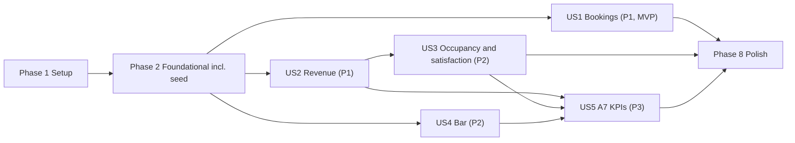

# Tasks: Hotel Kong Arthur Operations & Analytics Platform

**Input**: Design documents from `/specs/001-hotel-analytics-platform/`

**Prerequisites**: plan.md, spec.md, research.md, data-model.md, contracts/openapi.yaml, quickstart.md

**Tests**: INCLUDED. Constitution Principle IX requires unit tests for every business rule and KPI formula, and an automated test for every API endpoint (contract tests, validated against `openapi.yaml`).

**Organization**: Tasks are grouped by user story (spec.md US1–US5) so each story can be built and verified on its own.

## Format: `- [ ] [ID] [P?] [Story] Description with file path`

- **[P]**: Can run in parallel (different files, no dependency on an unfinished task)
- **[Story]**: US1–US5, only on user-story phase tasks
- All paths are relative to the repository root. Backend source is under `backend/src/hotel_api/`, abbreviated `SRC/` below.
- `SPEC/` = `specs/001-hotel-analytics-platform/`.

## Path Conventions

- Backend: `backend/src/hotel_api/{presentation,business,data}/`, composition root `main.py`, `config.py`
- Tests: `backend/tests/{unit,contract,integration,architecture}/`
- Database bootstrap: `db/init/`
- Frontend: `frontend/public/`
- Contract (authoritative, never copied): `SPEC/contracts/openapi.yaml`
- Layer rule (R3): `presentation → business → data`. `business` imports no HTTP or SQL. `data` implements `business/ports.py`.
- **No Tableau files or connector code anywhere** (FR-017).

---

## Phase 1: Setup (Shared Infrastructure)

**Purpose**: Repository skeleton, dependency pins and container images.

- [ ] T001 Create the directory tree from plan.md "Source Code": `backend/src/hotel_api/{presentation/api/{routers,schemas},presentation/cli,business/{domain,rules,kpis,services},data/repositories}`, `backend/tests/{unit,contract,integration,architecture}`, `db/init/`, `frontend/public/`, each Python package with an `__init__.py`
- [ ] T002 Create `backend/pyproject.toml`: Python `>=3.13`; pinned runtime deps FastAPI 0.16x, Uvicorn 0.5x, Pydantic 2.14, `PyMySQL[rsa]` 1.2; dev deps pytest 9, httpx 0.28, openapi-core 0.23, openapi-spec-validator 0.9; `[tool.pytest.ini_options]` with `testpaths = ["tests"]`, `pythonpath = ["src"]` and markers `unit`, `contract`, `integration`, `architecture`
- [ ] T003 [P] Create `backend/Dockerfile` (base `python:3.13-slim`) with stage `runtime` (installs runtime deps, runs `uvicorn hotel_api.main:app --host 0.0.0.0 --port 8000`) and stage `test` (adds dev deps; default command `pytest`)
- [ ] T004 [P] Create `.dockerignore` and a `.gitignore` for Python caches (`__pycache__/`, `.pytest_cache/`, `*.pyc`), `.venv/`, `.env`
- [ ] T005 [P] Create `CONTRIBUTE.md` skeleton: dev setup, `docker compose run --rm tests`, schema reset (`docker compose down -v`), commit conventions (finished in T104)

---

## Phase 2: Foundational (Blocking Prerequisites)

**Purpose**: Database, layer skeleton, shared rules, health + reference-data endpoints, test harness and the seed command. No user story can start before this phase is complete.

**⚠️ CRITICAL**: The seed command (T038–T041) is here because every KPI story (US2–US5) verifies its golden values against the seeded sample data.

### Database bootstrap (Data layer, deployment)

- [ ] T006 Create `db/init/01_schema.sql` with InnoDB, `utf8mb4`, `utf8mb4_0900_ai_ci` tables per data-model.md §2–§3:
  - `room_types`: `id TINYINT UNSIGNED` PK; `name VARCHAR(40) NOT NULL UNIQUE`; `name_da VARCHAR(60) NOT NULL`; `room_count SMALLINT UNSIGNED NOT NULL CHECK (room_count > 0)`; `max_guests TINYINT UNSIGNED NOT NULL CHECK (max_guests BETWEEN 1 AND 4)`
  - `room_type_rates`: PK (`room_type_id` FK → `room_types.id`, `season ENUM('low','mid','high')`); `min_nightly_dkk DECIMAL(10,2) NOT NULL CHECK (> 0)`; `max_nightly_dkk DECIMAL(10,2) NOT NULL CHECK (>= min_nightly_dkk)`; `standard_nightly_dkk DECIMAL(10,2) NOT NULL CHECK (between min and max)`
  - `bookings`: `id INT UNSIGNED AUTO_INCREMENT` PK; `first_name`, `family_name`, `country` each `VARCHAR(100) NOT NULL`; `room_type_id TINYINT UNSIGNED NOT NULL` FK; `check_in_date DATE NOT NULL` with index `ix_bookings_check_in_date`; `days_rented SMALLINT UNSIGNED NOT NULL CHECK (days_rented BETWEEN 1 AND 365)`; `price_dkk DECIMAL(10,2) NOT NULL CHECK (price_dkk > 0)`; `created_at TIMESTAMP NOT NULL DEFAULT CURRENT_TIMESTAMP`; `updated_at TIMESTAMP NOT NULL DEFAULT CURRENT_TIMESTAMP ON UPDATE CURRENT_TIMESTAMP`
  - `reviews`: `id INT UNSIGNED AUTO_INCREMENT` PK; `booking_id INT UNSIGNED NULL` FK → `bookings.id` **ON DELETE SET NULL**; `room_type_id TINYINT UNSIGNED NOT NULL` FK; `stay_date DATE NOT NULL` with index `ix_reviews_stay_date`; `rating TINYINT UNSIGNED NOT NULL CHECK (rating BETWEEN 1 AND 5)`; `created_at TIMESTAMP NOT NULL DEFAULT CURRENT_TIMESTAMP`
  - `bar_drink_sales`: `id INT UNSIGNED AUTO_INCREMENT` PK; `sales_year SMALLINT UNSIGNED NOT NULL`; `drink_name VARCHAR(100) NOT NULL` with `UNIQUE (sales_year, drink_name)`; `category ENUM('Cocktail','Coffee') NOT NULL`; `unit_price_dkk DECIMAL(10,2) NOT NULL CHECK (unit_price_dkk > 0)`; `units_sold INT UNSIGNED NOT NULL`
- [ ] T007 [P] Create `db/init/02_reference_data.sql`: the 8 room types (ids 1–8 in T1 order; counts 27,27,27,27,27,27,26,26 = **214**; Danish names and `max_guests` from data-model.md §2.1) and the 24 `room_type_rates` rows with min / max / standard (midpoint) from the data-model.md §2.2 table
- [ ] T008 [P] Create `db/init/03_test_database.sql`: `CREATE DATABASE IF NOT EXISTS hotel_test CHARACTER SET utf8mb4` plus a `GRANT ALL` on `hotel_test.*` to the application user (R16)

### Business layer foundations

- [ ] T009 [P] Create `SRC/business/errors.py` with `ValidationFailed(field_errors: list[FieldError])`, `NotFound(message)`, `StorageUnavailable`
- [ ] T010 Create `SRC/business/domain/models.py` (depends on T009): enums `Season` (`low|mid|high`), `DrinkCategory` (`Cocktail|Coffee`), `PriceTier` (`budget|standard|premium`); dataclasses `SeasonRate`, `RoomType`, `NewBooking` (price optional), `Booking` (properties `season`, `year`), `GuestReview` (properties `season`, `year`), `BarDrinkSale` (properties `revenue_dkk`, `price_tier`) and the KPI value objects `HotelSummary`, `RoomTypeKpi`, `SeasonKpi`, `RoomTypeSeasonKpi`, `CountryKpi`, `BarSummary`, `BarCategoryKpi`, `BarPriceTierKpi`, `RankedDrinkSale`. Money is `Decimal`. No HTTP or SQL imports
- [ ] T011 Create `SRC/business/ports.py` (depends on T010): `Protocol`s `RoomTypeRepository`, `BookingRepository`, `ReviewRepository`, `BarSalesRepository`, `HealthRepository`, covering the operations the services in this task list need (list/get/add/replace/delete bookings with year/season/room_type/country filters; add/get/list reviews; list drink sales by year and category; bulk reset-and-insert for seeding; room type lookup; health ping)
- [ ] T012 [P] Implement `SRC/business/rules/seasons.py`: month → season mapping (`low` = Jan, Feb, Nov; `mid` = Mar, Apr, May, Sep, Oct; `high` = Jun, Jul, Aug, Dec); `season_days(year)` derived from the calendar (2026 → 89/153/123, total 365; leap year gives `low` 90 and total 366); `available_room_nights(room_count, days)` (R8, K1 denominator)
- [ ] T013 [P] Implement `SRC/business/rules/numbers.py`: half-up rounding to 2 decimals, `safe_ratio` returning 0 when the denominator is 0, and largest-remainder share rounding so a breakdown sums to exactly `100.00` (R10)
- [ ] T014 [P] Implement `SRC/business/rules/ranking.py`: competition ranking ("1224": equal values share a rank, the next rank skips), ties ordered by name (data-model §4.3)
- [ ] T015 [P] Implement `SRC/business/rules/pricing.py`: standard price = `standard_nightly_dkk(room_type, season(check_in_date)) × days_rented`; a manual price is accepted only if `min_nightly_dkk ≤ price_dkk / days_rented ≤ max_nightly_dkk`; error text names the allowed range, e.g. "4,500.00 DKK for 3 nights is 1,500.00 DKK per night, outside 900.00–1,200.00 DKK per night for Standard Single in low season."
- [ ] T016 [P] Implement `SRC/business/rules/booking_validation.py` returning one `{field, message}` per broken rule (data-model §5.1):
  - `first_name`, `family_name`, `country`: required; trimmed; 1 to 100 characters
  - `room_type`: one of the 8 names in `room_types`
  - `check_in_date`: ISO `YYYY-MM-DD`; a real date; year 2000 to 2100
  - `days_rented`: whole number, 1 to 365
  - `price_dkk`: optional; when given: `> 0`, at most 2 decimals, nightly rate inside the band
- [ ] T017 [P] Implement `SRC/business/rules/review_validation.py` (data-model §5.2): `rating` required whole number 1 to 5; when `booking_id` is given the booking must exist (field `booking_id`) and `room_type` / `stay_date` must be omitted; otherwise `room_type` and `stay_date` are required together with the same rules as booking `room_type` / `check_in_date`
- [ ] T018 [P] Unit tests for the rules in `backend/tests/unit/`: `test_seasons.py` (month mapping, 89/153/123/365 for 2026, leap-year 90/366, `available_room_nights` 78110 for 214 rooms), `test_numbers.py` (half-up, zero denominator, shares sum to exactly 100.00), `test_ranking.py` (ties, skipped rank, name order), `test_pricing.py` (standard price, band edges, error message), `test_booking_validation.py` (every rule above, multiple errors at once), `test_review_validation.py`

### Data layer foundations

- [ ] T019 Create `SRC/config.py`: settings from environment variables with development defaults only (DB host `db`, port 3306, name `hotel`, user, password, CORS origins incl. `http://localhost:8081` and `http://localhost:8080`, `TZ=Europe/Copenhagen`); no real secrets
- [ ] T020 Create `SRC/data/connection.py` (depends on T009, T019): PyMySQL connection factory (`utf8mb4`, autocommit off, `DictCursor`); wraps driver errors as `StorageUnavailable`; one connection per request/CLI run
- [ ] T021 [P] Implement `SRC/data/repositories/room_types.py` (parameterised SQL; builds `RoomType` with `rates` ordered low, mid, high)
- [ ] T022 [P] Implement `SRC/data/repositories/bookings.py`: list with filters (`year` as `check_in_date >= ? AND < ?`, `season` via month list, `room_type`, `country`; ordered by `id` DESC), get, add (reads the row back for id and timestamps), replace, delete, and bulk insert with explicit ids for the seed
- [ ] T023 [P] Implement `SRC/data/repositories/reviews.py`: list (year/season/room_type filters, newest first), get, add (copies room type and `stay_date`), bulk insert for the seed
- [ ] T024 [P] Implement `SRC/data/repositories/bar_sales.py`: list by `sales_year` and optional category, bulk insert with explicit ids for the seed
- [ ] T025 [P] Implement `SRC/data/repositories/health.py`: `SELECT 1` ping
- [ ] T026 Integration tests for the repositories in `backend/tests/integration/test_repositories.py` against `hotel_test` (round trip of each table, `ON DELETE SET NULL` on reviews, filters, UTF-8 `Müller`)

### Presentation foundations and composition root

- [ ] T027 [P] Create `SRC/presentation/api/schemas/problem.py`: Pydantic `Problem` and `FieldError` DTOs (RFC 9457, `errors[]`)
- [ ] T028 Create `SRC/presentation/api/errors.py` (depends on T009, T027): handlers mapping malformed JSON / bad query or path parameter → `400`, `NotFound` → `404`, `ValidationFailed` and body type errors → `422`, `StorageUnavailable` → `503`, unexpected → `500`, all as `application/problem+json` with the contract's `type` URNs
- [ ] T029 [P] Create `SRC/business/services/health_service.py` and `SRC/business/services/room_type_service.py` (depend on T011)
- [ ] T030 [P] Create `SRC/presentation/api/schemas/room_types.py` and `SRC/presentation/api/dependencies.py` (service provider stubs typed with business services; `year` default from an injectable clock in `Europe/Copenhagen`)
- [ ] T031 [P] Create routers `SRC/presentation/api/routers/health.py` (`GET /api/v1/health`) and `SRC/presentation/api/routers/room_types.py` (`GET /api/v1/room-types`)
- [ ] T032 Create the composition root `SRC/main.py` (depends on T020–T031): FastAPI app with `docs_url=None, redoc_url=None, openapi_url=None`; CORS from settings; error handlers; middleware adding `Cache-Control: no-store` to every response; binds service providers to request-scoped repositories and services; one transaction per request (commit on success, rollback on error); JSON numbers for `Decimal` (never strings)
- [ ] T033 [P] Create `docker-compose.yml` with services `db` (`mysql:8.4`, volume `mysql-data`, `./db/init` mounted to `/docker-entrypoint-initdb.d`, no published port, healthcheck `SELECT COUNT(*) FROM room_types` over TCP `-h 127.0.0.1`), `api` (build `backend/` target `runtime`, port 8000, `depends_on: db: condition: service_healthy`, healthcheck `GET /api/v1/health`) and `swagger-ui` (`swaggerapi/swagger-ui:v5.33.3`, port 8081, mounts `SPEC/contracts/openapi.yaml` read-only, `SWAGGER_JSON=/spec/openapi.yaml`); development defaults for env vars incl. `TZ=Europe/Copenhagen`. Add the `seed` (profile `tools`) and `tests` (profile `test`, target `test`, mounts the repository at `/repo`) services

### Test harness

- [ ] T034 Create `backend/tests/conftest.py`: rebuild the `hotel_test` schema from `db/init/*.sql` once per session, empty the operational tables (`reviews`, `bookings`, `bar_drink_sales`) before each test, FastAPI `TestClient` bound to `hotel_test`, and an openapi-core loader for `SPEC/contracts/openapi.yaml` with a helper that validates a response (status, content type, headers, body)
- [ ] T035 [P] Architecture tests in `backend/tests/architecture/test_layers.py`: parse every module's imports and fail when `presentation` imports `data`; `business` imports `presentation`, `data`, `fastapi` or `pymysql`; `data` imports `presentation` or `business.services` (R3)
- [ ] T036 [P] Architecture test in `backend/tests/architecture/test_no_tableau_files.py`: scan `/repo` and fail on any `.twb`, `.twbx`, `.tbm`, `.tds`, `.tdsx`, `.hyper` file or Tableau connector code (FR-017)
- [ ] T037 Contract-validity tests in `backend/tests/contract/test_contract_validity.py`: `openapi-spec-validator` accepts `openapi.yaml` as 3.0.3; **route parity**: the (method, path) pairs registered in the FastAPI app (ignoring HEAD/OPTIONS) equal the contract's 19 operations. Mark the parity test `xfail(strict=False)` until all routers exist, and remove the marker in T102. Add `backend/tests/contract/test_health_and_room_types.py` validating `GET /api/v1/health` (`200`) and `GET /api/v1/room-types` (8 items, `room_count` sum 214, 3 rates each), plus the `503` response when the connection fails

### Seed command (sample data, R13, FR-004)

- [ ] T038 [P] Create `SRC/business/services/sample_data_service.py`: `replace_with_sample_data(bookings, reviews, drinks)` in **one transaction**: delete all `reviews`, `bookings`, `bar_drink_sales`; insert 1,000 bookings with explicit ids 1–1000 (CSV row order); insert 500 reviews (one per odd booking id, `booking_id`/`room_type`/`stay_date` copied from the booking, `rating` from `random.Random(2026)` with weights 1: 5%, 2: 10%, 3: 20%, 4: 35%, 5: 30%); insert 30 drink sales for `sales_year = 2026`. Every booking passes `booking_validation` and `pricing`. Check-in date: the *k*-th row (0-based) of a season gets the *k mod N*-th date of that season's 2026 dates (N = 89 / 153 / 123)
- [ ] T039 [P] Unit tests in `backend/tests/unit/test_sample_data_service.py` using fake ports: date assignment is deterministic and the derived season equals the CSV season, rating distribution is reproducible, every sample nightly rate is inside its band, the run is atomic (a failure leaves old data)
- [ ] T040 Create `SRC/presentation/cli/seed.py` (depends on T038): `python -m hotel_api.presentation.cli.seed`; parses `context/teacher/international_names_with_rooms_1000.csv` (columns `First Name, Family Name, Country, Room Type, Days Rented, Season, Price`) and `context/teacher/drinks_menu_with_sales.csv` (UTF-8 **BOM**, delimiter `;`, decimal comma `72,47` → `Decimal('72.47')`); trims fields; repairs `M�ller` → `Müller` through a one-entry documented repair map and stops with an error on any other U+FFFD; prints "1000 bookings, 500 reviews, 30 drink sales"
- [ ] T041 Integration tests in `backend/tests/integration/test_seed.py`: run the seed twice and assert identical counts (1000 / 500 / 30), ids and totals; booking 1 is Liam Nguyen, China, Spa Executive, 2026-03-01, `mid`, 1 night, 2577.00; booking 21 has `family_name == "Müller"` and 2026-01-08; a failing seed leaves existing rows intact

**Checkpoint**: `docker compose up` yields a healthy `db` and `api` with the schema, 214 rooms and 24 rate bands and no operational data. `docker compose run --rm seed` loads the sample data. Health and room-type contract tests pass.

---

## Phase 3: User Story 1 - Manage Room Bookings (Priority: P1) 🎯 MVP

**Goal**: The Receptionist, and the hotel's booking system, can create, read, edit and delete bookings; each change is stored before the response is sent (F1, FR-001–FR-005).

**Independent Test**: quickstart §3. Create a booking without a price (`price_dkk` 6000.00), edit nights 3 → 5 (`10000.00`), submit invalid input (`422`/`400`, nothing changes), delete (`204`, then `404`); repeat in the browser at `http://localhost:8080`.

### Tests for User Story 1

- [ ] T042 [P] [US1] Unit tests for `BookingService` with fake ports in `backend/tests/unit/test_booking_service.py`: price derived when omitted or `null`, recalculated on update when omitted, manual price outside band rejected, unknown id → `NotFound`, a failed validation does not call the repository (US1 scenarios 1–4)
- [ ] T043 [P] [US1] Contract tests for the 5 booking operations in `backend/tests/contract/test_bookings.py`, each response validated with openapi-core: `GET /bookings` (`200`, filters, `400` bad `year`), `POST` (`201` + `Location` header + `season` `high`, `year` 2026, `price_dkk` 6000.00 for the quickstart example; `400` malformed JSON; `422` with `errors` for `room_type` and `days_rented`; `422` price band), `GET /bookings/{id}` (`200`, `400` id 0, `404`), `PUT` (`200` price 10000.00 after nights 3 → 5; `404`; `422`), `DELETE` (`204`, then `404`); `503` on a failed connection
- [ ] T044 [P] [US1] Integration test in `backend/tests/integration/test_booking_crud.py`: a created booking is visible on the next request, an invalid create leaves the table unchanged, deleting a booking sets `reviews.booking_id` to NULL while the review remains

### Implementation for User Story 1

- [ ] T045 [US1] Implement `SRC/business/services/booking_service.py` (depends on T011, T015, T016): `create`, `get`, `list`, `replace`, `delete`; loads room types through the port, validates (`booking_validation`), derives season, prices (`pricing`), raises `ValidationFailed` listing every broken field, `NotFound` for unknown ids
- [ ] T046 [P] [US1] Create `SRC/presentation/api/schemas/bookings.py`: `BookingInput` (required `first_name`, `family_name`, `country`, `room_type`, `check_in_date`, `days_rented`; optional nullable `price_dkk`), `Booking` (adds `id`, `season`, `year`, `created_at`, `updated_at`), `BookingList` (`{"items": [...]}`) exactly as the contract (`additionalProperties: false`)
- [ ] T047 [US1] Create `SRC/presentation/api/routers/bookings.py` (depends on T045, T046): `GET/POST /api/v1/bookings`, `GET/PUT/DELETE /api/v1/bookings/{booking_id}`; `201` with `Location: /api/v1/bookings/{id}`; `204` with no body; path ids ≥ 1 else `400`; each handler only calls the service and maps to DTOs
- [ ] T048 [US1] Register the bookings router and the `BookingService` provider in `SRC/main.py`, and add `BookingService` to `SRC/presentation/api/dependencies.py`
- [ ] T049 [P] [US1] Create `frontend/public/api.js`: `fetch` wrappers for `/api/v1/room-types` and the booking CRUD that return parsed Problem Details (`errors[]`) on `400/422`
- [ ] T050 [P] [US1] Create `frontend/public/index.html` and `frontend/public/styles.css`: booking table, create/edit form (first name, family name, country, room type select, check-in date, days rented, optional price), delete button with confirmation, per-field error placeholders; UTF-8 declared
- [ ] T051 [US1] Create `frontend/public/app.js` (depends on T049, T050): loads room types and bookings, renders the list, submits create / edit, deletes with confirmation, reloads the list after each change, shows `errors[]` next to the matching field, clears the price field when room type, check-in date or nights change (the API recalculates). **No business rule in JavaScript**: no season mapping, no price calculation (R15)
- [ ] T052 [P] [US1] Create `frontend/nginx.conf` (serves `/`, proxies `/api/` to `http://api:8000`) and `frontend/Dockerfile` (`nginx:1.30-alpine`, copies `public/` and config)
- [ ] T053 [US1] Add the `frontend` service to `docker-compose.yml` (port 8080, `depends_on: api: condition: service_healthy`, healthcheck)
- [ ] T054 [US1] Run quickstart §3 by hand in the browser and with `curl`: create/edit/delete each take under 30 seconds (SC-001), invalid entries show a message next to the field, `Müller` displays correctly; record the result in `SPEC/checklists/` or the PR description

**Checkpoint**: US1 works on its own. This is the MVP: live bookings in MySQL through REST and the browser.

---

## Phase 4: User Story 2 - Room & Country Revenue Overview by Season (Priority: P1)

**Goal**: Expose revenue (K2) as annual total (A6), per room type and season (A2), per country (A3), ranked room types (A4) and ranked countries (A5), computed once in the business layer (FR-006–FR-009).

**Independent Test**: quickstart §4. After `seed`, `total_revenue_dkk` is 11234034.00, Suite is rank 1 (2119671.00, 18.87%), South Korea is rank 1 (767699.00, 63 bookings, 6.30%), the 24 room-type × season rows sum to 11234034.00.

> **Shared endpoints (read first)**: `/kpis/hotel/summary`, `/by-room-type` and `/by-season` carry A7, K1 and K3 fields in the contract (`required` + `additionalProperties: false`). US2 builds the revenue part of them; the occupancy fields come with US3 and the satisfaction fields with US3, and ALOS/ADR with US5. Their **response contract tests are therefore written in the story that completes them** (T067, T086). `/by-country` and `/by-room-type-and-season` are complete within US2.

### Tests for User Story 2

- [ ] T055 [P] [US2] Unit tests in `backend/tests/unit/test_hotel_revenue_kpis.py` for revenue functions: Σ `price_dkk`, booking count, nights sold, revenue share (largest remainder, sums to exactly 100.00), competition rank by revenue, empty dataset returns 0 / 0.00 (no error), a booking belongs to the season and year of its `check_in_date`
- [ ] T056 [P] [US2] Contract tests in `backend/tests/contract/test_kpis_hotel_revenue.py`: `GET /kpis/hotel/by-room-type-and-season` (exactly 24 rows in T1 order then low/mid/high) and `GET /kpis/hotel/by-country` (ordered by `revenue_rank`; `400` for `?year=abc`; empty year returns `{"items": []}`), validated with openapi-core
- [ ] T057 [P] [US2] Golden-value integration test in `backend/tests/integration/test_golden_revenue.py` (seeds the sample data first): `total_revenue_dkk` 11234034.00, `booking_count` 1000, `nights_sold` 5379; by room type Suite rank 1 = 2119671.00 (18.87%), Spa Executive 1722396.00, Standard Single rank 8 = 730444.00 (6.50%); by country 20 rows, South Korea 767699.00, China 722928.00, Egypt rank 20 = 335786.00; LOFT Suite / `high` = 683198.00 and Standard Single / `low` = 239940.00; by season revenue 3354077.00 / 3809387.00 / 4070570.00 (29.86% / 33.91% / 36.23%); all within 0.01 (SC-003)

### Implementation for User Story 2

- [ ] T058 [US2] Create `SRC/business/kpis/hotel.py` revenue part: pure functions for revenue per scope (K2/A6), booking count, nights sold, revenue by room type, by season, by room type and season (A2), by country (A3/A5) with `booking_share_pct` (A1 shape) and `revenue_share_pct`, using `ranking.py` and `numbers.py`
- [ ] T059 [US2] Create `SRC/business/services/kpi_service.py` (depends on T058, T022): loads one reporting year of bookings through the port and calls the KPI functions; one method per grain (summary, by room type, by season, by room type and season, by country)
- [ ] T060 [P] [US2] Create `SRC/presentation/api/schemas/kpis_hotel.py`: DTOs `HotelSummary`, `RoomTypeKpi`, `SeasonKpi`, `RoomTypeSeasonKpi`, `CountryKpi` and their `{"items": [...]}` lists, field names and types exactly as `openapi.yaml`; `Decimal` serialised as JSON numbers
- [ ] T061 [US2] Create `SRC/presentation/api/routers/kpis_hotel.py` (depends on T059, T060): `GET /api/v1/kpis/hotel/{summary,by-room-type,by-season,by-room-type-and-season,by-country}` with the `year` parameter (2000–2100, default current year in Europe/Copenhagen, else `400`); `by-room-type` always 8 rows ordered by `revenue_rank`; `by-season` always 3 rows low, mid, high; `by-room-type-and-season` always 24 rows
- [ ] T062 [US2] Register `kpis_hotel` router and the `KpiService` provider in `SRC/main.py` and `SRC/presentation/api/dependencies.py`

**Checkpoint**: A2–A6 and K2 values match the quickstart §4 golden table. The three shared endpoints exist and return their revenue fields.

---

## Phase 5: User Story 3 - Guest Origin, Occupancy Rate & Customer Satisfaction (Priority: P2)

**Goal**: Add guest origin share (A1), occupancy rate (K1) and customer satisfaction (K3) with the reviews resource (FR-010, FR-011).

**Independent Test**: quickstart §5. After `seed`: `available_room_nights` 78110, `occupancy_rate_pct` 6.89 (5379 / 78110), by season 9.34 / 5.61 / 6.70 with `season_days` 89 / 153 / 123, `review_count` 500, and a new review for booking 2 gives `201` and `review_count` 501.

### Tests for User Story 3

- [ ] T063 [P] [US3] Unit tests in `backend/tests/unit/test_hotel_occupancy_satisfaction.py`: occupancy = `nights_sold` ÷ `available_room_nights` × 100 overall (214 × 365), per season (214 × 89 / 153 / 123) and per room type (27 or 26 rooms × days); mean rating; satisfied share (rating ≥ 4); zero reviews and zero denominators return 0; a review belongs to the season and year of its `stay_date`; by room type uses the review's room type
- [ ] T064 [P] [US3] Unit tests for `ReviewService` in `backend/tests/unit/test_review_service.py`: with `booking_id` the room type and `stay_date` are copied; unknown `booking_id` → `ValidationFailed` field `booking_id`; both `booking_id` and `room_type` → `ValidationFailed`; `rating` outside 1–5 rejected
- [ ] T065 [P] [US3] Contract tests in `backend/tests/contract/test_reviews.py`: `GET /reviews` (`200`, filters, `400`), `POST /reviews` (`201` + `Location`, response `season` derived; `400` malformed JSON; `422` rules), `GET /reviews/{id}` (`200`, `400`, `404`)
- [ ] T066 [P] [US3] Golden-value integration test in `backend/tests/integration/test_golden_occupancy_satisfaction.py`: occupancy 6.89 overall; `low` 9.34 (1779 / 19046), `mid` 5.61 (1837 / 32742), `high` 6.70 (1763 / 26322); Suite 7.44 (706 / 9490), Standard Single 6.37 (628 / 9855), LOFT Suite 5.13 (487 / 9490); `average_satisfaction` equals the mean of `GET /reviews?year=2026` and `satisfied_share_pct` the share of ratings ≥ 4, overall, per room type and per season; `by-country` `booking_count` and `booking_share_pct` sum to 1000 and 100.00 (A1); year 2030 returns 0 for every rate and 78110 available room-nights
- [ ] T067 [P] [US3] Contract tests for the partly-shared endpoints in `backend/tests/contract/test_kpis_hotel_summary.py` for `summary`, `by-room-type` (8 rows) and `by-season` (3 rows): validate the shape produced so far. Extend the same file in T086 once ALOS/ADR fields exist, so the full `required` list is enforced

### Implementation for User Story 3

- [ ] T068 [US3] Extend `SRC/business/kpis/hotel.py` (depends on T058): `available_room_nights` via `seasons.py`, `occupancy_rate_pct`, `review_count`, `average_satisfaction`, `satisfied_share_pct` for summary, per room type and per season
- [ ] T069 [US3] Create `SRC/business/services/review_service.py` (depends on T017, T023): `create` (copies room type and `stay_date` from the booking, validates), `get`, `list`
- [ ] T070 [US3] Extend `SRC/business/services/kpi_service.py` to load the year's reviews and call the new occupancy and satisfaction functions for summary, by room type and by season
- [ ] T071 [P] [US3] Create `SRC/presentation/api/schemas/reviews.py` (`ReviewInput`, `Review`, `ReviewList`) as the contract, and add the occupancy / satisfaction fields to the DTOs in `SRC/presentation/api/schemas/kpis_hotel.py`
- [ ] T072 [US3] Create `SRC/presentation/api/routers/reviews.py`: `GET/POST /api/v1/reviews` (`201` + `Location`), `GET /api/v1/reviews/{review_id}` (path id ≥ 1 else `400`); register it and a `ReviewService` provider in `SRC/main.py` and `SRC/presentation/api/dependencies.py`
- [ ] T073 [US3] Run quickstart §5 by hand, including the `POST /reviews {"booking_id": 2, "rating": 5}` example (`stay_date` 2026-01-01, `season` `low`, `review_count` 501)

**Checkpoint**: US1, US2 and US3 all work independently. A1, K1 and K3 verified.

---

## Phase 6: User Story 4 - Cocktail Bar Sales & Drink Category Split (Priority: P2)

**Goal**: Expose Helene Christine's bar totals (B1), revenue per drink (B2) and the cocktail / coffee split (B3) (FR-012–FR-014).

**Independent Test**: quickstart §6. After `seed`: 30 drinks, `units_sold` 179958, `total_revenue_dkk` 13448640.34; Espresso rank 1 with 1012729.60 DKK; `Cocktail` 34.50% of units and 52.83% of revenue, `Coffee` 65.50% and 47.17%.

### Tests for User Story 4

- [ ] T074 [P] [US4] Unit tests in `backend/tests/unit/test_price_tiers.py`: `budget` < 70, `standard` 70 ≤ price < 110, `premium` ≥ 110 (boundaries 69.99, 70, 109.99, 110)
- [ ] T075 [P] [US4] Unit tests in `backend/tests/unit/test_bar_kpis.py`: revenue per drink = `unit_price_dkk × units_sold` exact with `Decimal` (e.g. 72.47), bar totals, category split by revenue and by units (each column sums to exactly 100.00), zero sales returns 0 (no division error), ranks by revenue and by units
- [ ] T076 [P] [US4] Contract tests in `backend/tests/contract/test_bar.py`: `GET /bar/drink-sales` (`200`, `category` filter, `400` bad `year` or `category`, ordered by `revenue_rank`), `GET /kpis/bar/summary` (`200`; an empty year returns zeros), `GET /kpis/bar/by-category` (always 2 rows `Cocktail`, `Coffee`)
- [ ] T077 [P] [US4] Golden-value integration test in `backend/tests/integration/test_golden_bar.py`: `drink_count` 30, `units_sold` 179958, `total_revenue_dkk` 13448640.34; Espresso 1012729.60 (14656 units, `units_rank` 1); Margarita rank 30 = 171101.67; top cocktail Mint Julep 524351.62; `Cocktail` 20 drinks / 62077 units (34.50%) / 7104755.43 DKK (52.83%), `Coffee` 10 drinks / 117881 units (65.50%) / 6343884.91 DKK (47.17%); `?year=2030` returns both categories with 0

### Implementation for User Story 4

- [ ] T078 [P] [US4] Implement `SRC/business/rules/price_tiers.py` (data-model §4.4, FR-016)
- [ ] T079 [US4] Implement `SRC/business/kpis/bar.py` (depends on T078, T013, T014): revenue per drink (B2), ranks by revenue and units, bar summary (B1), category split with largest-remainder shares (B3)
- [ ] T080 [US4] Create `SRC/business/services/bar_service.py` (depends on T024, T079): list ranked drink sales, summary, by category; extend `SRC/business/services/kpi_service.py` or a separate `BarKpiService` consistently with US2 (one service module per concern in plan.md)
- [ ] T081 [P] [US4] Create `SRC/presentation/api/schemas/bar.py` (`DrinkSale`, `DrinkSaleList`, `BarSummary`, `BarCategoryKpi` and lists) as the contract
- [ ] T082 [US4] Create routers `SRC/presentation/api/routers/bar.py` (`GET /api/v1/bar/drink-sales`, `year` and `category` parameters) and `SRC/presentation/api/routers/kpis_bar.py` (`GET /api/v1/kpis/bar/summary`, `GET /api/v1/kpis/bar/by-category`); register both and the service provider in `SRC/main.py` and `SRC/presentation/api/dependencies.py`
- [ ] T083 [US4] Run quickstart §6 by hand and check the values against the golden table

**Checkpoint**: B1–B3 verified. Bar data is read-only through the API (no write endpoint; seed only).

---

## Phase 7: User Story 5 - Self-Chosen KPI: Stay Length, Revenue per Booking & Bar Price-Tier Demand (Priority: P3)

**Goal**: Provide ALOS, ADR and revenue per booking per scope (A7, FR-015) and bar demand per price tier (FR-016).

**Independent Test**: quickstart §7. After `seed`: ALOS 5.38, ADR 2088.50, revenue per booking 11234.03; by season ALOS / ADR / revenue per booking `low` 5.36 / 1885.37 / 10102.64, `mid` 5.48 / 2073.70 / 11371.30, `high` 5.29 / 2308.89 / 12223.93; price tiers `budget` 65.50% of units, `standard` 16.29%, `premium` 18.21%.

### Tests for User Story 5

- [ ] T084 [P] [US5] Unit tests in `backend/tests/unit/test_hotel_stay_kpis.py`: ALOS = Σ `days_rented` ÷ booking count, ADR = Σ `price_dkk` ÷ Σ `days_rented`, revenue per booking = Σ `price_dkk` ÷ booking count, each rounded half-up to 2 decimals, each 0 for an empty scope
- [ ] T085 [P] [US5] Unit tests in `backend/tests/unit/test_bar_price_tier_kpis.py`: units and revenue per tier, tier shares sum to exactly 100.00, an empty year returns 3 rows with 0
- [ ] T086 [US5] Extend `backend/tests/contract/test_kpis_hotel_summary.py` (from T067) so `summary`, `by-room-type` and `by-season` are validated against the **complete** contract schemas incl. `average_length_of_stay_nights`, `average_daily_rate_dkk`, `average_revenue_per_booking_dkk`; add `backend/tests/contract/test_kpis_bar_price_tier.py` for `GET /kpis/bar/by-price-tier` (always 3 rows: `budget` with `price_from_dkk` 0, `standard`, `premium` with `price_to_dkk` null)
- [ ] T087 [P] [US5] Golden-value integration test in `backend/tests/integration/test_golden_a7.py`: the hotel values above (summary and by season); tiers `budget` 10 drinks / 117881 units / 6343884.91 DKK (47.17%), `standard` 10 / 29306 / 2739242.59 (20.37%), `premium` 10 / 32771 / 4365512.84 (32.46%); `?year=2030` hotel summary returns 0 for all counts, amounts, averages and rates, with `available_room_nights` 78110

### Implementation for User Story 5

- [ ] T088 [US5] Extend `SRC/business/kpis/hotel.py`: ALOS, ADR, revenue per booking for summary, per room type and per season (FR-015)
- [ ] T089 [US5] Extend `SRC/business/kpis/bar.py` and the bar service from T080 with price-tier demand (units, revenue, shares per tier; FR-016)
- [ ] T090 [US5] Extend `SRC/business/services/kpi_service.py` to include ALOS / ADR / revenue per booking in summary, by room type and by season
- [ ] T091 [P] [US5] Add the A7 fields to the DTOs in `SRC/presentation/api/schemas/kpis_hotel.py`, and add `BarPriceTierKpi` and `BarPriceTierKpiList` to `SRC/presentation/api/schemas/bar.py` (`price_tier`, `price_from_dkk`, `price_to_dkk` nullable, `drink_count`, `units_sold`, `unit_share_pct`, `revenue_dkk`, `revenue_share_pct`)
- [ ] T092 [US5] Add `GET /api/v1/kpis/bar/by-price-tier` to `SRC/presentation/api/routers/kpis_bar.py`
- [ ] T093 [US5] Run quickstart §7 by hand, including the edge cases (`?year=2030`, `?year=abc` → `400`)

**Checkpoint**: All five stories work. All 19 operations exist.

---

## Phase 8: Polish & Cross-Cutting Concerns

**Purpose**: Documentation required by the constitution, contract and requirement sync, and whole-system checks.

- [ ] T094 [P] Write `README.md`: the mermaid architecture diagram from plan.md "System and containers" (Q1), the three-layer table (Q3), how to run and seed, data persistence (named volume `mysql-data`; `docker compose down -v` wipes it; the seed removes user-created bookings and reviews), the seed command, ports 8080 / 8000 / 8081
- [ ] T095 [P] Complete `CONTRIBUTE.md` (T005): dev setup, running `unit`, `contract`, `integration`, `architecture` suites in Docker (`docker compose run --rm tests`) and locally on Python ≥ 3.13, schema reset, commit flow to `main`
- [ ] T096 [P] Add the Tableau handover section to `README.md` (text only): REST API Connector, JSONPath `$.items[*]` for tables and `$` for summaries, extract refresh, dummy credentials accepted, and the early-check step (quickstart §8). **No Tableau files** (FR-017)
- [ ] T097 [P] Record the architecture decision log outcome in `SPEC/research.md`: mark each "Pending team review" row Kept or Changed after the team review
- [ ] T098 Run `docker compose down -v && docker compose up --build -d` from a fresh clone and confirm `db`, `api`, `frontend` healthy and `swagger-ui` running within 60 seconds (SC-005); then walk quickstart §1 and confirm an empty state (`{"items": []}`, `available_room_nights` 78110, occupancy 0)
- [ ] T099 Run `docker compose run --rm seed` twice and walk quickstart §2 (idempotent, same counts and ids)
- [ ] T100 Run `docker compose run --rm tests` and make sure all four suites pass; confirm the `hotel` database is untouched (tests use `hotel_test`)
- [ ] T101 Performance spot check on a laptop: booking CRUD p95 < 200 ms; each KPI endpoint p95 < 500 ms with 10,000 bookings generated into `hotel_test` (R6); write the numbers into `README.md`
- [ ] T102 Remove the `xfail` marker from the route-parity test (T037) and confirm it passes: the app's routes equal the contract's 19 operations
- [ ] T103 Verify Swagger UI at `http://localhost:8081`: the contract renders, *Try it out* on `GET /api/v1/room-types` returns 200 (CORS allows `http://localhost:8081`); verify persistence (`docker compose down` then `up -d` keeps bookings)
- [ ] T104 [P] Team-owned, manual, outside the repository (FR-017): the first day the API runs, prove the Tableau route against `GET /api/v1/kpis/hotel/by-room-type?year=2026` (quickstart §8). After that, build the dashboard from quickstart §4–§7 and compare every figure within 0.01 DKK / 0.01% (SC-003). Run `git ls-files | grep -Ei '\.(twb|twbx|tbm|tds|tdsx|hyper)$'` and confirm no output
- [ ] T105 [P] Process items from plan.md "Spec follow-ups" that need the team: amend the constitution wording (Gate VI/VIII, WDC hint, OQ-1, OQ-4) with `/speckit-constitution`; amend FR-010 (366-day leap year) and FR-003 (R17 bounds) in `SPEC/spec.md`; then run `/speckit-checklist` and `/speckit-analyze` before `/speckit-implement`
- [ ] T106 Run every quickstart section (§1–§10) one last time and tick off each golden value

---

## Dependencies & Execution Order

### Phase dependencies

- **Setup (Phase 1)**: no dependencies.
- **Foundational (Phase 2)**: depends on Phase 1. **Blocks all user stories.**
- **US1 (Phase 3)**, **US2 (Phase 4)**: depend on Phase 2 only. They can run in parallel (US2 needs seeded data, not US1 code).
- **US3 (Phase 5)**: depends on Phase 2; extends files created in US2 (`business/kpis/hotel.py`, `kpi_service.py`, `schemas/kpis_hotel.py`), so start it after T058–T062.
- **US4 (Phase 6)**: depends on Phase 2 only; can run in parallel with US1–US3.
- **US5 (Phase 7)**: extends US2/US3 hotel KPI files and US4 bar files, so start it after US2, US3 and US4.
- **Polish (Phase 8)**: after the stories you want to ship.

### Within a phase

- Foundational order: T006 → T007/T008; T009 → T010 → T011; T012–T018 in parallel after T010; T019 → T020 → T021–T025 in parallel → T026; T027 → T028; T029–T031 → T032; T033 after T032; T034 → T035–T037; T038–T041 after T016, T022–T024.
- Tests before implementation inside each story (write them, see them fail, then implement).
- Models/rules → services → routers → registration in `main.py`.
- `SRC/main.py`, `dependencies.py`, `kpi_service.py`, `kpis/hotel.py`, `schemas/kpis_hotel.py` are shared files. Tasks that edit them must not run in parallel.

### Story completion order



## Parallel Execution Examples

**Phase 2 (after T010)**: rules and their tests together

```text
T012 seasons.py   T013 numbers.py   T014 ranking.py   T015 pricing.py   T016 booking_validation.py   T017 review_validation.py
```

**Phase 2 (after T020)**: repositories together

```text
T021 room_types.py   T022 bookings.py   T023 reviews.py   T024 bar_sales.py   T025 health.py
```

**User Story 1**: tests and the frontend files together

```text
T042 test_booking_service.py   T043 test_bookings.py (contract)   T044 test_booking_crud.py
T049 api.js   T050 index.html + styles.css   T052 nginx.conf + Dockerfile
```

**User Story 2 / 4**: tests first, in parallel

```text
T055 unit   T056 contract   T057 golden        |        T074–T077 (US4)
```

**Across stories** (if the team has capacity, after Phase 2): one developer takes US1 (T042–T054), one takes US2 → US3 (T055–T073), one takes US4 (T074–T083); US5 starts when all three are done.

## Implementation Strategy

### MVP first (US1)

1. Phase 1 Setup.
2. Phase 2 Foundational, including the seed command.
3. Phase 3 US1.
4. **Stop and validate** with quickstart §3 and `docker compose run --rm tests`.
5. Demo the live booking page.

### Incremental delivery

1. Setup + Foundational → empty system starts with `docker compose up`.
2. US1 → live bookings (MVP).
3. US2 → revenue KPIs (A2–A6, K2); the CFO can start the Tableau route check (T104).
4. US3 → occupancy and satisfaction (A1, K1, K3).
5. US4 → bar KPIs (B1–B3).
6. US5 → self-chosen KPIs (A7). All 19 operations done, route-parity test passes.
7. Polish → README, CONTRIBUTE, performance, final quickstart run.

### Mandatory scope coverage

| Scope ID | Tasks |
|----------|-------|
| F1 | T045–T054 |
| A1 | T058, T066 |
| A2, A3, A4, A5, A6, K2 | T058–T062, T055–T057 |
| K1 | T012, T068, T063, T066 |
| K3 | T017, T068–T072, T063–T066 |
| B1, B2, B3 | T079–T082, T075–T077 |
| A7 | T088–T092, T084–T087 |
| FR-004 (empty `up`, idempotent seed) | T007, T033, T038–T041, T098–T099 |
| FR-017 (no Tableau files) | T036, T104 |
| Principle V (contract sync) | T037, T102 |

## Notes

- [P] tasks touch different files and have no dependency on unfinished tasks.
- Each story's checkpoint can be verified by its quickstart section; the golden values come from the sample data and are asserted by the integration tests.
- Commit after each task or logical group; the constitution's commit flow applies (tests must pass before pushing to `main`).
- Avoid: business rules in JavaScript or SQL (Principle VII), imports that break the layer rules (T035), copies of `openapi.yaml`, any Tableau file (T036).

